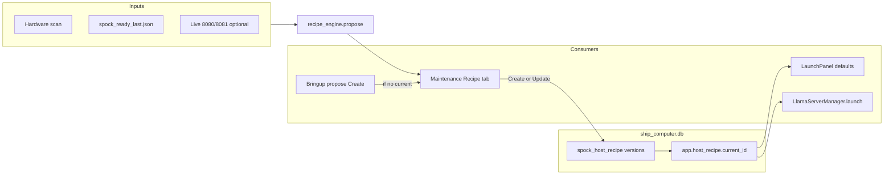

# Host Recipe Profile + Launch Defaults

## Goals

- Encode **machine capability** separately from session [`spock_profile`](WarpCore/profile_store.py) snapshots.
- **Create** / **Update** only from explicit user action; hardware drift shows a warning, never auto-mutates.
- Persist an **append-only audit trail** (version history + reason).
- Make Launch / `llama-server` honor recipe: GPU policy, `--split-mode` / `--tensor-split`, role `-c`, embed `-np`.

## Architecture

**Keep separate:** session profiles (`spock_profile`) continue to store running GGUFs/providers. Recipe may record `recipe_version` inside a session payload later for forensics; v1 does not merge the two stores.

## Storage

New table in `ship_computer.db` (schema helper next to WarpCore stores; wipe policy: **keep on content reset** like settings/profiles, not like `ask_timing_history`):

- `spock_host_recipe`: `id`, `version`, `created_at`, `created_by`, `reason`, `hardware_json`, `recipe_json`, `is_current` (0/1; exactly one current when any exist)
- Pointer also mirrored in Spock_Console: `app.host_recipe.current_id` (convenience for `settings_store`)

`recipe_json` shape (v1):

- `gpu_policy`: `pin_per_role` | `tensor_split_chat` | `single_gpu`
- `embed_gpu_index`, `chat_gpu_index` (for `pin_per_role`)
- `split_mode`: `layer` (default)
- `tensor_split`: e.g. `"0.5,0.5"`
- `embed_n_ctx`, `chat_n_ctx`
- `embed_np`: `1`
- `ngl_default`: `"-1"`
- `embed_size_class`: `small|medium|large` (advisory text only in v1)
- `host_ram_gb`, `gpu_summary` (denormalized for UI banners)

## Recipe engine

New module e.g. [`WarpCore/host_recipe.py`](WarpCore/host_recipe.py) (pure logic, no Qt):

- `probe_hardware()` — reuse existing scanner / `get_ram_gb` / GPU list patterns from [`spock_scanner_core.py`](spock_scanner_core.py)
- `propose_recipe(hardware) -> recipe_json` rules (committed defaults):
  - **2+ GPUs each ≤12GB VRAM, host RAM ≤40GB:** `tensor_split_chat`, chat `-c 8192`, embed `-c 4096`, `embed_np=1`, embed class `medium` (warn if 8B)
  - **1 GPU ≥20GB:** `single_gpu` or `pin_per_role` same index; chat `-c 16384`, embed `-c 4096`
  - **Else:** `pin_per_role` when 2+ GPUs; chat `-c 8192`
- `create_recipe(...)` / `update_recipe(..., reason)` — bump version, clear prior `is_current`, write audit row
- `get_current_recipe()` / `list_recipe_history()` / `hardware_drift(current) -> messages`

No timing-history auto-tuning in v1 (defer).

## Maintenance UI

Add **Recipe** tab on [`WikiMaintenancePanel`](wiki_maintenance.py) (after Timing, before Spock Config Profiles):

- Show **current** recipe summary + hardware snapshot
- Drift banner when probed RAM/GPU count/VRAM disagrees with recipe inputs
- Buttons: **Create recipe profile** (disabled if current exists), **Update recipe profile** (confirm + required reason), **Recompute preview** (does not save)
- History table: version, stardate, by, reason; select to view JSON diff vs previous
- Docs: [`AIHelperDocuments/Spock-Engineering-Maintenance-HELPER.md`](AIHelperDocuments/Spock-Engineering-Maintenance-HELPER.md)

## Launch + llama-server wiring

1. [`llama_server_manager.py`](llama_server_manager.py) `launch()`:
   - Accept `split_mode`, `tensor_split`, `n_parallel` (`-np`)
   - If `tensor_split` set for chat: **do not** pin single `CUDA_VISIBLE_DEVICES`; emit `--split-mode` / `--tensor-split`
   - If `pin_per_role`: set CVD from recipe indices by role
   - Embed: pass `-np` from recipe (default 1)

2. [`model_selector/launch_panel.py`](model_selector/launch_panel.py):
   - On init, load current recipe → set `n_ctx_spin` default (replace hard-coded **32768**), GPU policy combo, tensor-split fields (shown when policy needs them), embed `-np`
   - Pass new args through `_do_launch`
   - Sibling-aware Suggest Context: only subtract sibling GGUF size when recipe says both roles share one physical GPU

3. Profile restore [`_restore_servers`](spock_shell/profiles.py): pass recipe (or per-server saved split fields) into `manager.launch` so Bringup/Navigation restore matches manual PowerShell recipe

4. Persist new server fields in session profile `servers[]`: `split_mode`, `tensor_split`, `n_parallel` (so restore survives without recipe, but Launch still prefers current recipe for *defaults*)

## Bringup / onboarding

In [`spock_bringup_menu/app.py`](spock_bringup_menu/app.py) (and briefly HELPER):

- After window ready: if **no** current recipe → offer **Create recipe profile** (preview + confirm); writes via same engine/`by=bringup`
- If recipe exists and drift detected → status/log line only (“Update in Maintenance → Recipe”); **no** auto Update

## Out of scope (v1)

- Auto-changing recipe on RAM upgrade without Update
- Timing-history “dial in” ML loop
- Changing which GGUF file to download (size class is advisory text only)
- Merging recipe into `spock_profile` as the primary store

## Test plan

- Dual-GPU machine: Create recipe → Launch chat gets `--tensor-split` and no single CVD; embed gets `-np 1` and `-c 4096`
- Update with reason → history shows v1/v2; only v2 `is_current`
- Kill/restart: drift banner if RAM stubbed differently in unit test of `hardware_drift`
- Session profile restore still launches embed/chat with saved split fields
- Content DB reset does **not** delete `spock_host_recipe`

## Research results
What we learned
System RAM pain was mostly launch shape, not Spock UI. Huge chat -c, both roles on one 12 GB GPU, then a heavy embed left resident after wiki scan.

Embed (:8080) dominates sticky RAM on this box (8B Q4 ≈ +15% steady; more after a scan until restart). Chat split across both 3060s at -c 8192 was comparatively fine.

Deep Dive quality tracks usable packed context + evidence, not “max train ctx.” A fat -c you can’t afford hurts; a sane -c that packs more docs helps.

Multi-GPU for chat works (--split-mode layer --tensor-split 0.5,0.5), but Spock Launch today thinks in one GPU per process (CUDA_VISIBLE_DEVICES), so you had to do the good recipe by hand.

Wiki scan inflates embed working set; recycling :8080 recovers a chunk. Idle after settle is the real metric, not the load spike.

Status/provider labels can lie (14B on :8081 vs configured qwen2.5-coder-7b-instruct). Operators need “what’s actually listening” tied to Ask AI.

Two hardware classes need two recipes: dual 12 GB ≠ single 24 GB Quadro.

Launch UI / config defaults worth adding
Not every llama flag—only knobs that repeatedly decided success/failure:

Knob	Why	Sensible default / behavior
GPU policy
Biggest footgun
pin one GPU | split roles (embed→GPU0, chat→GPU1) | tensor-split chat across all
--tensor-split
Dual-3060 chat
e.g. 0.5,0.5 when policy = split-all
--split-mode
Same
layer default
-c / n_ctx
RAM/VRAM cliff
Role-aware Suggest Context; default spin much lower than 32k (e.g. chat 8k on ≤12 GB, 16k on 24 GB)
-ngl
Already there
Keep; “99” vs “-1” is fine
-np / parallel slots
Quiet RAM multiplier
Embed default 1 (Spock is not a multi-slot embed farm)
Sibling-aware suggest
Shared VRAM
Always subtract the other role’s GGUF when both on one card
Post-scan hint
Sticky RAM
Soft note: “restart embed after large wiki” (behavior/docs, not necessarily a flag)
Profile fields
Reproducibility
Save GPU policy + tensor-split + n_ctx + ngl + np + model paths (you already care about embed/chat in profile)
Config table (app.* / ctx) is better for Deep Dive packing (budget, top_k, inventory, stream). Launch flags belong on Launch / profile, not buried only in Ask ctx.

Optional later: --fit on, --main-gpu, embed vs chat batch — useful, not the first cut.

Do you need a standalone “tuning scanner”?
Not as a separate forever app. You already have the inputs: hardware scan, live nvidia-smi-ish reality, spock_ready_last.json, wiki corpus row, Ask/Deep Dive timing history.

What you want is a “Dial in this machine” step (Bringup or Maintenance), not another product:

Read GPUs (count, VRAM), RAM, current :8080/:8081.
Propose a recipe card: GPU policy, embed size class, chat -c, -np, tensor-split yes/no.
Optionally apply → Launch defaults / profile.
Optionally learn from timing history: “Deep Dive often at 90% of tiny budget / used 3 docs → raise chat -c or shrink inventory; RAM high after wiki → suggest smaller embed or recycle.”
Standalone only if you want it runnable headless on a lab box before the GUI—same engine, two entry points.

Ideas (priority order)
Hardware recipe profiles: dual-12gb, single-24gb, low-RAM-32gb presets that set Launch defaults in one click.
Operator checklist after wiki: “Embed RSS high? Restart :8080.”
Status honesty: show loaded GGUF + n_ctx from the live server next to configured provider model id.
Quality loop from timings: used_docs, budget_pct, stage ms → one recommendation sentence (no ML required).
Don’t auto-max n_ctx to GGUF native (40k); cap by VRAM recipe.
Embed size advisor: “8B costs ~X% RAM on 32 GB hosts; 4B/0.6B for daily.”
Bottom line: Encode GPU policy + tensor-split + sane -c + embed -np 1 + sibling-aware suggest into Launch/profile. Use a dial-in wizard fed by hardware + timing history, not a separate tuning product—unless you specifically want headless fleet setup.

We can put the "Create recipe profile" into the Spock Engineering Maintenance Module.  1st onboarding could approximate the profile, then the user can later "Update recipe profile" - for example when my RAM upgrade from 32GB --> 64 GB arrives.  I wouldn't want it to change without the users knowledge, or without an audit trail.

That’s a solid place for it, and the explicit Create / Update + audit trail rule is the right product instinct.

Fit in Maintenance
Engineering Maintenance already owns DB, settings, timings, and “ship computer” state. A Recipe tab (or Database/Settings section) next to Ctx/Timing works well:

Create recipe profile — first time (or after wipe): from hardware scan + optional live :8080/:8081 + ready JSON
Update recipe profile — only on button; never silent
View / diff / history — what changed and why
Bringup/onboarding can propose a recipe and offer “Save to Maintenance,” but shouldn’t overwrite an existing one without the Update path.

What “doesn’t change without knowledge” means
Behavior	Policy
Auto-detect RAM/GPU on launch
OK to show “hardware changed since recipe”
Auto-rewrite Launch defaults
No
Suggest Context using recipe
OK
Apply new defaults after RAM upgrade
Only via Update recipe profile (+ confirm)
Banner example: “Host RAM 64 GB (recipe was 32 GB). Update recipe?” — never silent mutate.

Audit trail (keep it boring and useful)
Each Create/Update writes a row (or profile version), e.g.:

timestamp / stardate
action: create | update
who: maintenance / bringup / user label
inputs: RAM GB, GPU count/VRAM, notes
outputs: GPU policy, tensor-split, embed/chat -c, -np, ngl policy, recommended embed size class
optional: “reason” text (“upgraded 32→64 GB”)
link to prior version id
UI: current recipe + history list + diff of last change. Same spirit as spock_profile, but this is host capability, not “last session’s running models” (keep those concepts separate).

Onboarding vs later
First onboarding: approximate recipe → Create (version 1).
Daily Launch: reads recipe as defaults; user can still override per launch.
Hardware change / timing pain: Maintenance warns → user Update → version N+1.
Optional later: “Recompute suggestion” preview without saving, then Update to commit.
Split from session profiles
Recipe profile = how this machine should run Spock (stable, audited).
Session/spock_profile = which GGUFs/providers were up (start/stop save).
Don’t merge them; let session save reference recipe_version for forensics.

Your RAM 32→64 case is exactly the Update story: new suggestion, user confirms, audit says why—Launch gets new defaults only after that.