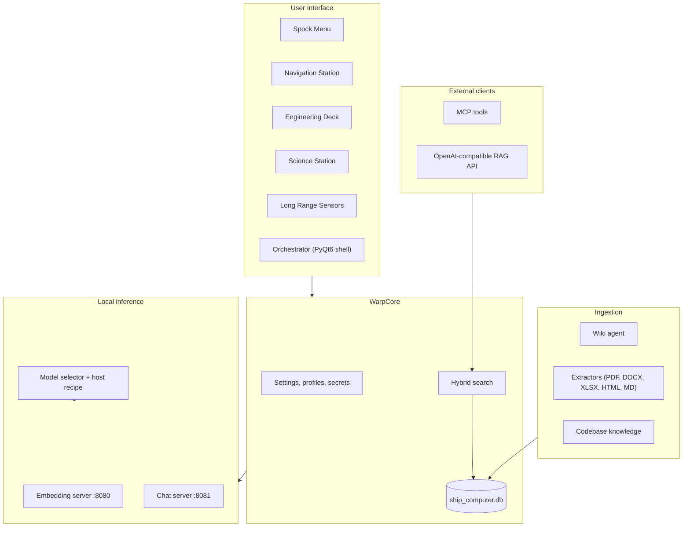

# Spock Universal AI Wiki

**A local-first AI workstation that provisions itself, indexes your documents, and answers questions with citations — all on your own hardware.**

Spock is a Windows desktop suite for standing up a private LLM environment from a clean machine: it detects your hardware, downloads and launches the right GGUF models, ingests your wiki and source code into a single SQLite knowledge base, and serves grounded answers through a PyQt6 interface, an OpenAI-compatible RAG API, and an MCP tool surface for external agents.

No cloud account. No external vector database. No telemetry.

---

## Why Spock

Most local-AI setups are a pile of scripts, a separate vector store, and a chat UI that has no idea where its answers came from. Spock treats the whole stack as one system:

| Principle | What it means in practice |
|---|---|
| **One file of truth** | Documents, chunks, embeddings, FTS5 index, settings, audit logs, and conversation history live in `ship_computer.db`. Back it up by copying one file. |
| **Grounded by construction** | Answers are assembled from retrieved passages with source metadata, and the prompt contract requires the model to cite evidence or say it does not know. |
| **Hardware-aware** | The model selector reads VRAM/RAM, picks a fitting quantization, and launches `llama-server` with a host recipe instead of hoping a default works. |
| **Agent-ready** | The same retrieval layer is exposed over MCP, so coding agents and other tools can query your knowledge base directly. |
| **Inspectable** | Every retrieval, launch, and answer is logged. You can open the database and see exactly what happened. |

---

## Feature Highlights

### Bring-up and station suite
- **Bootstrap wizard** — hardware scan, dependency installation, model acquisition, and first-run configuration.
- **Navigation Station** — guided setup and environment validation.
- **Engineering Deck** — maintenance, diagnostics, database tools, and health checks.
- **Science Station** — wiki crawling, knowledge ingestion, Ask AI, and Deep Dive investigations.
- **Long Range Sensors** — capture and extract content from external sources into the knowledge base.
- **Orchestrator** — the PyQt6 shell that ties the stations together.

### Retrieval-augmented generation
- **Hybrid search** — SQLite FTS5 keyword matching fused with embedding cosine similarity.
- **Budget-governed context packing** — excerpts are sized to the model's context window (8K/32K profiles, hard caps) rather than truncated blindly.
- **Grounding contract** — the answer prompt requires citations and an explicit "insufficient evidence" path, enforced by tests.
- **Ask AI and Deep Dive** — fast conversational lookup, plus multi-step investigation with a persisted evidence trail.

### Models and inference
- **VRAM-aware model selection** with GGUF catalog entries and per-host recipes.
- **`llama-server` lifecycle management** — embedding service on `:8080`, chat service on `:8081`.
- **OpenAI-compatible endpoints**, so existing clients work unchanged.

### Integrations
- **MCP server** (`scripts/mcp_spock_server.py`, FastMCP) exposing search, document retrieval, inventory, and health tools over stdio or SSE.
- **RAG API server** (`rag_api_server.py`) for HTTP clients and external UIs.
- **Codebase knowledge acquisition** — deterministic, resumable indexing of a repository into architecture, structure, and convention documents.

---

## Architecture



### The data flow

1. **Acquire** — a scanner or watcher enqueues work in `agent_queue`.
2. **Extract** — the appropriate parser normalizes the content.
3. **Store** — documents and chunks are written to `documents` and indexed in `docs_fts`.
4. **Embed** — each chunk is sent to the local embedding model and stored alongside its metadata.
5. **Retrieve** — a question runs through FTS5 and vector search, results are fused and ranked.
6. **Pack** — the top passages are trimmed to the active context budget.
7. **Answer** — the chat model responds under the grounding contract.
8. **Persist** — the question, retrieved evidence, answer, and timing are recorded for audit.

---

## Quick Start

### Requirements

| Item | Requirement |
|---|---|
| OS | Windows 10/11 (launchers are PowerShell-based) |
| PowerShell | 5.1+ |
| Python | 3.10+ (installed into the project-local `.venv`) |
| RAM | 8 GB minimum, 16 GB recommended |
| GPU | Optional NVIDIA GPU with CUDA; CPU inference falls back to smaller models |
| Disk | Several GB for models and the knowledge base |

> Python does not need to be installed globally. The bootstrap creates `.venv` inside the repository.

### 1. Bootstrap

```powershell
powershell -NoProfile -ExecutionPolicy Bypass -File .\bootstrap.ps1 -NonInteractive -EmitEvents -NoHandOffGui
```

This installs the Phase A UI tier, prepares the virtual environment, and writes the readiness contract.

### 2. Launch

```bat
Spock-Menu.bat
```

### 3. Verify

```powershell
.venv\Scripts\python.exe -m spock_probe
.venv\Scripts\python.exe -m spock_status
```

Readiness is recorded in `spock_ready_last.json`:

| Flag | Meaning |
|---|---|
| `ui_ready` | Python, `.venv`, and PyQt6 are importable |
| `servers_ready` | Embedding (`:8080`) and chat (`:8081`) services are healthy |

### Launchers

| Launcher | Purpose |
|---|---|
| `Spock-Menu.bat` | Bring-up menu and dashboard |
| `Spock.bat` | Station suite orchestrator (Navigation / UIEG / Maintenance) |
| `Spock-AI-Helper.bat` | Ask AI helper |
| `Spock-Navigation.bat` | Navigation Station |
| `Spock-UIEG-KnowledgeBase.bat` | UIEG knowledge base |
| `Spock-Maintenance.bat` | Engineering maintenance tools |
| `SpockBootstrapWizard.bat` | Bootstrap wizard |
| `Spock-live_monitor.bat` | Live service monitor |

All launchers prefer `.venv\Scripts\python.exe`, then `py -3`, then `python` on `PATH`.

---

## Python CLIs

```bat
.venv\Scripts\python.exe -m spock_bringup acquire
.venv\Scripts\python.exe -m spock_bringup up
.venv\Scripts\python.exe -m spock_bringup status
.venv\Scripts\python.exe -m spock_bringup down
.venv\Scripts\python.exe -m spock_probe
.venv\Scripts\python.exe -m spock_status
.venv\Scripts\python.exe -m spock_live_monitor
```

---

## Configuration

Settings are stored in `ship_computer.db` through `WarpCore.settings_store`, organized into namespaces such as `scan.*`, `app.*`, and `secrets`. Optional local overlays (`scan_config.json`, `.env`) are git-ignored.

| Variable | Purpose |
|---|---|
| `EMBEDDINGS_URL` | Base URL of the OpenAI-compatible embedding endpoint |
| `EMBEDDINGS_DIM` | Expected vector dimensionality; must match the model and schema |
| `HF_TOKEN` | Hugging Face token for gated model access |
| `SPOCK_EMBED_MODEL_PATH` | Local path to a pre-downloaded embedding model |
| `PYTHONUNBUFFERED` | Unbuffered stdout/stderr for live logs |

API keys are kept in the OS keyring rather than in the database.

---

## MCP Integration

The MCP server lets external agents query the same evidence layer:

```bat
.venv\Scripts\python.exe scripts\mcp_spock_server.py
```

Transport (stdio or SSE) and tool registration are configurable. Tools cover hybrid search, document lookup, knowledge-base inventory, and service health, so an agent can ask "what does this repo do?" and receive cited passages instead of guesses.

Example client configuration:

```json
{
  "mcpServers": {
    "spock": {
      "command": "D:\\Spock-Universal-AI-Wiki\\.venv\\Scripts\\python.exe",
      "args": ["D:\\Spock-Universal-AI-Wiki\\scripts\\mcp_spock_server.py"]
    }
  }
}
```

---

## Repository Layout

```text
Spock-Universal-AI-Wiki/
├── WarpCore/                 # Shared kernel: DB, settings, profiles, search
├── Orchestrator/             # Top-level application shell
├── NavigationStation/        # Guided bring-up wizard
├── EngineeringDeck/          # Maintenance and diagnostics
├── ScienceStation/           # Wiki and knowledge queries
├── LongRangeSensors/         # External capture and extraction
├── model_selector/           # Hardware-aware model selection
├── spock_shell/              # PyQt6 shell components
├── spock_rag_adapter/        # Retrieval pipeline
├── spock_wiki_adapter/       # Wiki crawling
├── spock_mcp_adapter/        # MCP protocol adapter
├── spock_codebase_knowledge/ # Repository indexing
├── spock_bringup/            # Headless bring-up CLI
├── spock_probe/              # Health probe
├── spock_status/             # Status CLI
├── spock_live_monitor/       # Live monitor
├── scripts/                  # Standalone tools (MCP server, utilities)
├── docs/                     # Documentation site source
├── tests/                    # pytest suite
├── ship_computer_schema.sql  # Database schema
└── ship_computer.db          # Local knowledge base (generated)
```

---

## Testing

```powershell
.venv\Scripts\python.exe -m pytest
```

The suite covers acquisition determinism, retrieval fusion, context-budget packing, grounding-prompt construction, GPU/device selection, and database migrations. Some modules require a live embedding service or GPU/Qt state and are skipped or error at collection when those are unavailable.

---

## Documentation

The full documentation site is built with MkDocs Material:

```powershell
.venv\Scripts\python.exe -m mkdocs serve
```

Key entry points:

- [Documentation index](index.md)
- [Quick start](getting-started/quick-start.md)
- [Prerequisites](getting-started/prerequisites.md)
- [Architecture overview](architecture/overview.md)
- [Project layout](development/project-layout.md)
- [MCP adapter](features/mcp-adapter.md)
- [RAG API server](features/rag-api-server.md)
- [Model selector](features/model-selector.md)

### Screenshots gallery

ShareX captures live in `assets/` (source of truth). For GitHub-friendly docs, pre-scan them with LM Studio vision into `gallery/` (resized JPEG + captions), then serve that site separately:

```powershell
powershell -NoProfile -ExecutionPolicy Bypass -File .\scripts\prescan-screenshots.ps1
cd gallery
mkdocs serve -a 127.0.0.1:8001
```

See [gallery/README.md](../gallery/README.md).

---

## Design Notes

**Why SQLite for vectors?** A single file keeps the knowledge base portable, transactional, and easy to inspect. For local, single-user workloads the simplicity outweighs the throughput of a dedicated vector service, and FTS5 lives in the same file as the embeddings.

**Why require citations?** A local model with a small context window is confident even when it is wrong. Retrieval quality is only half the problem; the prompt contract that forces the model to ground claims in numbered evidence is the other half.

**Why budget the context?** Stuffing every candidate passage into the prompt degrades answers and blows the window. Spock sizes excerpts to the active profile and reserves space for instructions and history.

---

## Status

Spock is under active development. The bring-up path, database schema, and station interfaces are stabilizing, but internal APIs may change between commits. Benchmark results for retrieval quality and answer accuracy are being collected; the repository documents the evaluation protocol rather than claiming finished numbers.

---

## Contributing

1. Fork the repository and create a feature branch.
2. Keep changes scoped and consistent with the surrounding module style.
3. Add or update tests under `tests/`.
4. Run `pytest` before opening a pull request.
5. Describe the user-visible behavior change and any schema or configuration impact.

Bug reports are most useful with the output of `spock_status`, the relevant log excerpt, and the OS/GPU configuration.

---

## License

No license file is currently included. Add one before distributing or accepting external contributions; until then, all rights are reserved by the author.

---

## Acknowledgements

Built on the shoulders of [llama.cpp](https://github.com/ggerganov/llama.cpp), [llama-server](https://github.com/ggerganov/llama.cpp/tree/master/tools/server), [FastMCP](https://github.com/jlowin/fastmcp), [PyQt6](https://www.riverbankcomputing.com/software/pyqt/), [SQLite](https://sqlite.org/), [MkDocs Material](https://squidfunk.github.io/mkdocs-material/), and the open-weight model community.
