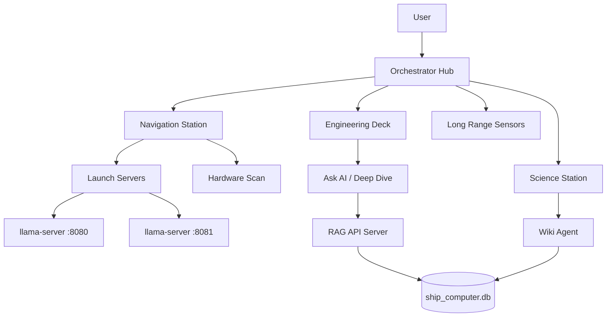

# Spock AI Helper

Welcome to the **Spock AI Helper** documentation site. This guide serves as the primary reference for **Spock-Onboarding**, a local AI workstation management suite that helps users initialize, run, and query local large language model (LLM) environments from a clean starting point.

**UI screenshots (captioned):** [Screenshot gallery](https://kimmlombard.github.io/Spock-AI-Universal-Wiki/gallery/) · [GitHub repo](https://github.com/kimmlombard/Spock-AI-Universal-Wiki)

## What is Spock-Onboarding?

**Spock-Onboarding** is a console-first initialization suite designed to provision and manage local LLM workstations from scratch. In this context, “greenfield” indicates that the system can be deployed on a new machine or fresh user profile without requiring prior AI tooling configuration. The suite automates setup by managing the following key aspects of the AI environment:

- **Hardware Detection** — Scans GPU, VRAM, CPU, and RAM resources to identify system capabilities for local model deployment.
- **Model Management** — Queries the Hugging Face Hub and downloads GGUF model files optimized for local inference with `llama-server`.
- **Server Lifecycle** — Starts, stops, and monitors `llama-server` processes on port 8080 (embedding/semantic services) and port 8081 (chat).
- **RAG Search** — Performs hybrid vector and FTS5 search over ingested documents to retrieve relevant context for prompts.
- **Document Ingestion** — Uses the Wiki Agent to monitor directories and extract content from over 15 file formats into a searchable local knowledge base.
- **MCP Integration** — Enables Model Context Protocol (MCP) integration, allowing the LLM to interact with external tools and data sources through compatible clients such as Cursor and OpenCode.

### Core Concepts

- **Local inference**: The model runs on the user’s workstation rather than in a cloud service.
- **GGUF**: A common file format for quantized large language models used by local inference engines.
- **RAG (Retrieval-Augmented Generation)**: A pattern where relevant documents are retrieved first and then included in the prompt to ground the model’s answer.
- **FTS5**: SQLite’s full-text search extension, used here for fast keyword matching.

## Quick Start

To launch the Spock-Onboarding interface, run the following command in a terminal from the installation directory or an environment where `Spock-Menu.bat` is available:

```bat
Spock-Menu.bat
```

The menu provides entry points to hardware scanning, model management, server control, document ingestion, and AI chat features.

## AI Chat Helper

The **Spock AI Helper** (`Spock-AI-Helper.bat`) launches the underlying Python engine (`helper_main.py`) to provide a chat interface powered by the suite’s local chat LLM. The context used for the chat is pulled from curated files located in the `AIHelperDocuments/` directory at the root of the Spock-Onboarding installation.

These curated files can include reference material, operational notes, or domain-specific guidance that helps the assistant answer questions consistently with the local workstation setup.

To launch the AI Chat Helper, run the following command in a terminal:

```bat
Spock-AI-Helper.bat
```

## Database Architecture: `ship_computer.db`

The Spock application relies on a single, persistent SQLite 3 database named `ship_computer.db` to manage document storage, metadata, search indexes, and conversation history. This database acts as the central knowledge backbone for both the AI Chat Helper and the broader onboarding suite.

### Schema Overview
The database is structured around several key tables and virtual tables:
- **`documents`**: Stores raw file paths, ingestion timestamps, file types, and parsing status.
- **`chunks`**: Contains text segments extracted during ingestion, along with parent document references and positional metadata.
- **`fts5_index`**: A virtual table powered by SQLite’s FTS5 extension. It maintains an inverted index of all text chunks for rapid keyword and phrase matching.
- **`embeddings`**: Stores high-dimensional vector representations of each text chunk. Vectors are typically stored as serialized binary blobs or fixed-length real arrays, depending on the SQLite extension in use.
- **`chat_history`**: Logs user prompts, assistant responses, retrieval metadata, and session identifiers for context continuity and auditability.
- **`query_logs`**: Tracks search parameters, retrieval scores, and execution times to optimize future RAG pipelines.

### Interaction with Spock Inquiries
When a user submits a query, `helper_main.py` translates the request into structured SQL and vector similarity operations against `ship_computer.db`. The database handles transactional integrity, ensuring that document updates, embedding recalculations, and search results remain consistent across concurrent operations. All retrieval operations are cached at the application layer to reduce redundant disk I/O during rapid follow-up questions.


## Embedding LLM & Vector Database Workflow

Spock uses a dedicated embedding LLM to convert unstructured text into numerical vectors that capture semantic meaning. This process enables the system to understand conceptual relationships between queries and documents, rather than relying solely on exact keyword matches.

### Embedding Generation
1. **Text Chunking**: During ingestion, documents are split into overlapping segments (typically 256–512 tokens) to preserve context while maintaining manageable vector dimensions.
2. **Local Inference**: The embedding model runs on `llama-server` (port 8080). Each chunk is sent to the model, which outputs a fixed-length vector (e.g., 768 or 1536 dimensions).
3. **Storage**: The resulting vectors are persisted in the `embeddings` table of `ship_computer.db`, linked to their corresponding `chunks` via foreign keys.

### Vector Search & Hybrid Retrieval
When a query is submitted, Spock performs a two-stage retrieval process:
- **Semantic Search**: The user’s prompt is embedded using the same model. The system then executes a cosine similarity or inner-product search against the `embeddings` table to rank chunks by conceptual relevance.
- **Keyword Search**: Simultaneously, FTS5 scans the `fts5_index` for exact term matches, handling technical identifiers, version numbers, and proper nouns that embeddings may dilute.
- **Re-Ranking & Fusion**: Results from both pathways are merged using a weighted scoring algorithm. High-confidence matches are passed to the chat LLM as context, while low-scoring results are filtered out to prevent prompt bloat.

This hybrid approach ensures that Spock can accurately resolve both conceptual questions and precise technical lookups.

### How the Embedding LLM and Vector Database Work Together
The embedding LLM and the vector database serve different but complementary roles in Spock’s retrieval pipeline.

- **Embedding LLM**: This model converts text into a dense numerical representation. It is used for both document chunks during ingestion and user prompts during search. Because the same model is used for both sides of the comparison, the resulting vectors live in the same semantic space.
- **Vector Database**: In Spock, the vector database is implemented as part of `ship_computer.db`. The `embeddings` table stores the numerical vectors produced by the embedding LLM, while the `chunks` table stores the source text that each vector represents.
- **Search Behavior**: When a user asks a question, Spock embeds the prompt and compares that vector against stored chunk vectors. Chunks with the highest similarity scores are considered semantically relevant.
- **Hybrid Strength**: Embeddings are effective for conceptual matching, while FTS5 is effective for exact lexical matching. By combining both, Spock can answer questions such as “how do I configure retry behavior?” and “what is the exact flag name for timeout?” with comparable reliability.

## Ask AI vs. Deep Dive Inquiry Modes

Spock distinguishes between two primary inquiry modes to balance response speed with retrieval depth. Both modes leverage `ship_computer.db` and the embedding pipeline, but they differ in scope and computational intensity.

### Ask AI
- **Purpose**: Rapid, conversational responses for straightforward questions.
- **Retrieval Strategy**: Executes a lightweight FTS5 query combined with a shallow vector similarity scan (top-5 to top-10 chunks).
- **Database Interaction**: Reads from cached indexes and avoids full table scans. Context window is kept minimal to reduce latency.
- **Use Case**: Syntax help, quick definitions, status checks, and general navigation guidance.

### Deep Dive
- **Purpose**: Comprehensive, multi-source analysis for complex troubleshooting or architectural questions.
- **Retrieval Strategy**: Triggers a full vector similarity sweep (top-20 to top-50 chunks), cross-references related documents via metadata joins, and applies recursive chunk expansion for context continuity.
- **Database Interaction**: Performs deeper joins across `documents`, `chunks`, and `embeddings` tables. May initiate background embedding recalculations if source files have been modified since last ingestion.
- **Use Case**: Multi-step debugging, policy analysis, cross-document synthesis, and detailed configuration guidance.

Users can explicitly select a mode via the chat interface, or Spock can auto-route queries based on prompt length, keyword triggers, and historical interaction patterns.

## SQLite 3 `ship_computer.db` Architecture

`ship_computer.db` is the central SQLite 3 database used by the Spock application. It stores ingested content, derived chunks, embeddings, full-text search indexes, and metadata needed for both Ask AI and Deep Dive workflows.

### Core Tables
The following tables form the primary data model:

| Table | Purpose |
|---|---|
| `documents` | Tracks source files or records that have been ingested into Spock. |
| `chunks` | Stores the text segments created from each document. |
| `embeddings` | Stores the vector representations generated from each chunk. |
| `fts5_index` | Provides full-text search over chunk text using SQLite FTS5. |
| `metadata` | Stores document- or chunk-level attributes used for filtering and cross-referencing. |
| `ingestion_runs` | Records ingestion jobs, status, and timing information. |
| `query_logs` | Optionally records user queries, selected mode, and retrieval statistics. |

A representative schema is:

```sql
CREATE TABLE documents (
    id INTEGER PRIMARY KEY,
    source_path TEXT NOT NULL,
    title TEXT,
    content_type TEXT,
    file_hash TEXT,
    status TEXT NOT NULL,
    ingested_at TEXT NOT NULL
);

CREATE TABLE chunks (
    id INTEGER PRIMARY KEY,
    document_id INTEGER NOT NULL REFERENCES documents(id),
    chunk_index INTEGER NOT NULL,
    text TEXT NOT NULL,
    token_count INTEGER,
    created_at TEXT NOT NULL
);

CREATE TABLE embeddings (
    id INTEGER PRIMARY KEY,
    chunk_id INTEGER NOT NULL UNIQUE REFERENCES chunks(id),
    model_name TEXT NOT NULL,
    model_version TEXT,
    dimensions INTEGER NOT NULL,
    vector BLOB NOT NULL,
    normalized INTEGER NOT NULL DEFAULT 1,
    created_at TEXT NOT NULL
);

CREATE VIRTUAL TABLE fts5_index USING fts5(
    chunk_id,
    text,
    content='chunks',
    content_rowid='id'
);
```

### Relationships and Constraints
- `chunks.document_id` links each chunk to its parent document.
- `embeddings.chunk_id` links each vector to the exact chunk it represents.
- `fts5_index` maps search results back to `chunks` rows.
- `metadata` can be associated with either documents or chunks, depending on the attribute being stored.
- Indexes are typically maintained on `documents.status`, `chunks.document_id`, and `embeddings.model_name` to support fast retrieval and filtering.

### Ask AI Interaction
For Ask AI requests, Spock uses `ship_computer.db` in a read-optimized, low-latency manner.

1. **Prompt Embedding**: The user prompt is sent to the embedding LLM and converted into a query vector.
2. **Lexical Search**: Spock issues an FTS5 query against `fts5_index` to find chunks containing exact or near-exact terms.
3. **Semantic Search**: Spock compares the query vector against stored vectors in `embeddings` and selects the highest-scoring chunks.
4. **Fusion and Truncation**: The two result sets are merged, scored, and truncated to a small number of chunks.
5. **Context Assembly**: The selected chunk text is passed to the chat LLM as context for a concise answer.

This mode is optimized for speed, so it typically avoids broad joins, large result sets, and background recomputation.

### Deep Dive Interaction
For Deep Dive requests, Spock uses `ship_computer.db` more extensively.

1. **Broader Retrieval**: Spock retrieves a larger candidate set from both FTS5 and vector search.
2. **Metadata Joins**: It joins across `documents`, `chunks`, `embeddings`, and `metadata` to identify related sources, tags, versions, or configuration scopes.
3. **Context Expansion**: Spock may pull neighboring chunks from the same document to preserve continuity around a relevant passage.
4. **Cross-Document Synthesis**: It can combine evidence from multiple documents when the question spans several sources.
5. **Staleness Checks**: If a source file has changed since the last ingestion, Spock may flag the document for re-chunking and re-embedding.

This mode is optimized for completeness and accuracy rather than minimal latency.

### Concurrency and Performance Considerations
Because Spock is built on SQLite 3, the database is file-based and well suited to local or single-node deployment.

- **WAL Mode**: Using write-ahead logging allows concurrent reads while writes are occurring, which is useful when ingestion and query traffic overlap.
- **Prepared Statements**: Reusing prepared statements reduces parsing overhead and improves query consistency.
- **Vector Storage**: Vectors are stored as `BLOB` values. Similarity scoring may be performed in Python or through a SQLite vector extension, depending on the deployment.
- **Hybrid Indexing**: FTS5 handles lexical search efficiently, while vector search handles semantic similarity. Together, they reduce the need for a separate vector database service.

This design lets Spock maintain a single, inspectable SQLite database for both content storage and retrieval, while still supporting the two distinct inquiry modes used by the application.
## Architecture

The following diagram illustrates the overall architecture of the Spock-Onboarding system:



### Explanation of Key Components

- **Orchestrator Hub**: Central management component that coordinates user requests, module interactions, and overall workflow state. It determines which subsystem should handle a request and maintains the session context for the user.
- **Navigation Station**: Handles hardware detection, resource scanning, and server launch operations. It is responsible for identifying local inference resources and starting the required `llama-server` endpoints.
- **Engineering Deck**: Provides AI chat interfaces and deep-dive analysis capabilities for the user. **Ask AI** requests are typically single-turn, context-grounded questions. **Deep Dive** requests use the RAG pipeline to gather more detailed local context before generating a response.
- **Long Range Sensors**: Monitors system health, external data streams, and environmental metrics that may affect local inference performance or reliability.
- **Science Station**: Manages document ingestion pipelines, knowledge-base maintenance, and content extraction workflows.
- **Wiki Agent**: Extracts text from supported file formats, prepares it for indexing, and ingests it into the system’s database.
- **RAG API Server**: Handles hybrid search over ingested documents by combining vector similarity with FTS5 keyword matching to return relevant context.
- **ship_computer.db**: Central SQLite database that stores document chunks, embeddings, full-text indexes, metadata, and system state data used across the suite.

### SQLite Database Core (`ship_computer.db`)

The `ship_computer.db` file is the foundational persistence layer for the Spock-Onboarding suite. It is built on **SQLite 3**, a lightweight, serverless, zero-configuration relational database engine that resides entirely on the local workstation. This design keeps knowledge retrieval and system-state operations offline, portable, and independent of external cloud services. SQLite's ACID compliance and Write-Ahead Logging (WAL) mode ensure data integrity and high concurrent read performance during active RAG queries.

#### Data Storage Strategy

The database is structured to support high-performance Retrieval-Augmented Generation (RAG) by separating semantic meaning from exact keyword matching:

- **Vector Embeddings Table**: Stores high-dimensional vector representations of text chunks as binary large objects (BLOBs) or serialized JSON arrays. These vectors enable semantic similarity searches, retrieving context that matches the *meaning* of a user’s query rather than relying solely on literal keywords.
- **FTS5 Virtual Tables**: Implements SQLite's Full-Text Search (FTS5) extension for rapid, tokenized keyword matching. This ensures that specific technical terms, identifiers, file paths, or error strings are retrieved efficiently without scanning the entire vector space.
- **Metadata & Provenance Tables**: Track document sources, ingestion timestamps, original file paths, chunk boundaries, chunk sizes, and content types. This supports precise filtering, audit trails, and reliable context selection during retrieval.
- **System State & Configuration Tables**: Store runtime parameters, embedding model identifiers, chunking strategies, and user preferences to maintain consistent behavior across sessions.

#### Core Table Responsibilities

The following table responsibilities describe the practical role of each major data area inside `ship_computer.db`:

| Area | Purpose |
|---|---|
| **Documents** | Stores one row per ingested source file or logical document. This provides a stable parent record for chunks, metadata, and provenance. |
| **Chunks** | Stores the actual text fragments used for retrieval. Each chunk is a bounded piece of content that can be embedded, searched, and injected into an LLM prompt. |
| **Embeddings** | Stores the vector representation for each chunk. The vector is generated by the local embedding model and used for semantic similarity search. |
| **FTS5 Index** | Provides fast keyword search over chunk text. This is especially useful for exact terms, code identifiers, error messages, file names, and technical phrases. |
| **Metadata** | Stores attributes such as source path, file type, ingestion time, chunk index, chunk size, and content classification. |
| **System State** | Stores configuration and runtime state, including embedding model identity, vector dimension, chunking settings, and last successful ingestion or indexing operations. |

#### Interaction Flow for Ask AI and Deep Dive

The `ship_computer.db` database interacts directly with the Spock application during user inquiries through the following workflow:

1. **User Input**: A user initiates an **Ask AI** or **Deep Dive** inquiry through the Engineering Deck interface.
2. **Request Routing**: The Orchestrator Hub routes the natural-language query to the RAG API Server.
3. **Hybrid Search Execution**: The RAG API Server constructs a search request against `ship_computer.db` using hybrid logic:
   - It generates vector embeddings for the user’s query and compares them with stored document vectors for semantic relevance.
   - It simultaneously runs FTS5 keyword filters to ensure important terms, identifiers, or exact phrases are considered.
4. **Context Retrieval**: The database returns the top-ranked text chunks that satisfy both semantic and keyword criteria. For **Deep Dive** requests, the query expands to include multi-hop retrieval, broader chunk windows, and recursive metadata filtering to assemble a comprehensive context window.
5. **Prompt Assembly**: These retrieved chunks are injected into the LLM prompt, allowing the Spock AI Helper to generate accurate, context-aware responses grounded in the local knowledge base.

#### Ask AI vs Deep Dive Retrieval Behavior

Although both **Ask AI** and **Deep Dive** use the same underlying database and retrieval infrastructure, they differ in retrieval depth and context assembly:

- **Ask AI**:
  - Optimized for fast, direct answers.
  - Usually performs a single hybrid retrieval pass.
  - Returns a small number of highly relevant chunks.
  - Best suited for questions such as “What does this setting do?” or “How do I configure this component?”

- **Deep Dive**:
  - Optimized for thorough, multi-step analysis.
  - May perform multiple retrieval passes, also called multi-hop retrieval.
  - Expands the search using terms, entities, or concepts discovered in the first retrieved chunks.
  - Applies broader metadata filters and larger context windows.
  - Best suited for questions such as “Explain the full ingestion pipeline” or “Compare the behavior of these two subsystems.”

In both cases, the database remains the source of truth for retrieved content. The LLM does not invent local documentation facts; it synthesizes the chunks returned by the RAG API Server.

#### Concurrency, Integrity, and Portability

SQLite 3 is well suited to this architecture because the Spock application is local-first and does not require a separate database server.

- **Single-file storage**: The entire knowledge base and system state can be stored in one portable file.
- **WAL mode**: Allows readers to continue serving RAG queries while the Wiki Agent or Science Station performs ingestion or indexing work.
- **ACID transactions**: Ensure that ingestion, chunking, embedding, and indexing operations either complete fully or roll back cleanly.
- **Local operation**: No external database service is required, which keeps the system offline-capable and self-contained.

### Embedding LLM and Vector Database Integration

The Spock application relies on a local embedding LLM and a vector-backed retrieval system to bridge natural language queries with structured database content. This integration operates through a deterministic pipeline:

#### Embedding LLM Responsibilities

The embedding LLM, or embedding model, is responsible for converting text into numerical vectors. These vectors represent the semantic meaning of the text in a high-dimensional space.

The embedding model is used in two major phases:

1. **Ingestion Phase**:
   - The Wiki Agent extracts text from documents.
   - The text is split into chunks.
   - Each chunk is sent to the local embedding model.
   - The resulting vector is stored in `ship_computer.db`.

2. **Query Phase**:
   - The user’s question is sent to the same embedding model.
   - The model produces a query vector.
   - The RAG API Server compares the query vector against stored chunk vectors.
   - Chunks with the closest semantic meaning are ranked and returned.

Using the same embedding model for both ingestion and querying is important because vector similarity is only meaningful when both sides of the comparison are produced by the same model and have the same vector dimension.

#### Vector Database Responsibilities

In this architecture, `ship_computer.db` acts as the vector database. It stores the embeddings and provides the persistence layer for semantic search.

The vector database is responsible for:

- Storing chunk embeddings as BLOBs or serialized arrays.
- Preserving the relationship between a vector and its source chunk.
- Supporting similarity comparison between the query vector and stored chunk vectors.
- Providing metadata needed to filter, rank, and cite retrieved content.

Depending on the implementation, vector similarity may be computed in one of two ways:

- **Application-layer similarity**: The RAG API Server loads candidate vectors from SQLite and computes cosine similarity in Python.
- **SQLite vector extension**: If an extension such as `sqlite-vec` is available, similarity search can be executed closer to the database layer.

In both cases, the conceptual role is the same: the database stores vectors, and the RAG API Server uses those vectors to find semantically relevant chunks.

#### Deterministic Retrieval Pipeline

The full embedding and vector retrieval pipeline follows a deterministic sequence:

1. **Document Ingestion**:
   - The Science Station or Wiki Agent reads a supported file.
   - Text is extracted and normalized.
   - The document is split into manageable chunks.

2. **Embedding Generation**:
   - Each chunk is sent to the local embedding model.
   - The model returns a fixed-length vector.
   - The vector is stored alongside the chunk text and metadata.

3. **Keyword Indexing**:
   - The same chunk text is indexed in an FTS5 virtual table.
   - This creates a fast keyword search path for exact terms and technical identifiers.

4. **Query Embedding**:
   - When the user submits an **Ask AI** or **Deep Dive** request, the query text is embedded using the same local embedding model.

5. **Hybrid Search**:
   - The RAG API Server performs vector similarity search using the query vector.
   - It also performs FTS5 keyword search using the raw query terms.
   - The two result sets are combined using a ranking strategy such as weighted scoring or reciprocal rank fusion.

6. **Context Assembly**:
   - The top-ranked chunks are selected.
   - Metadata is used to preserve source information and chunk order.
   - The chunks are formatted into a prompt for the local LLM.

7. **Response Generation**:
   - The local LLM generates an answer based on the retrieved context.
   - The response is returned to the user through the Engineering Deck.

#### Hybrid Scoring and Ranking

Hybrid search is used because vector search and keyword search have different strengths.

- **Vector search** is strong when the user’s wording differs from the document wording.
  - Example: “How do I make the server start faster?” may match documentation that says “reduce startup latency.”

- **Keyword search** is strong when the user includes exact technical terms.
  - Example: “`llama-server :8081`” or “`ship_computer.db`” should be matched directly.

The RAG API Server combines both signals so that the final ranking favors chunks that are both semantically relevant and lexically precise.

#### Ask AI and Deep Dive in the Embedding Pipeline

The embedding and vector database pipeline supports both interaction modes:

- **Ask AI**:
  - Uses a single query embedding.
  - Performs one hybrid retrieval pass.
  - Returns a compact set of chunks.
  - Produces a concise, grounded answer.

- **Deep Dive**:
  - Uses the initial query embedding and retrieval results as a starting point.
  - Extracts additional terms, entities, or concepts from the first retrieved chunks.
  - Performs additional embedding and retrieval passes.
  - Assembles a larger, more comprehensive context window.
  - Produces a more detailed, structured explanation.

This allows the Spock application to answer simple questions quickly while still supporting deeper investigation when the user requests a more thorough analysis.

#### Fallback and Consistency Behavior

Because the system is local and deterministic, the application can maintain consistent behavior even when some components are unavailable.

- If the embedding model is unavailable, the RAG API Server may fall back to FTS5-only keyword search, depending on configuration.
- If a document has not been embedded, it may still be searchable through FTS5 if it has been indexed.
- If a chunk is missing metadata, it may still be retrieved, but citation and filtering accuracy may be reduced.
- If the database is locked or corrupted, SQLite’s transactional behavior helps prevent partial writes and supports recovery.

This design keeps the Spock application responsive, auditable, and grounded in the local knowledge base stored in `ship_computer.db`.
# Retrieval-Augmented Generation Architecture

1. **Text Chunking & Preprocessing**: During ingestion, the Wiki Agent splits documents into semantically coherent chunks, typically 250–500 tokens in length. Overlapping windows are applied to preserve context across chunk boundaries, reducing the risk that important relationships are split between adjacent chunks.

2. **Embedding Generation**: The local embedding LLM converts each chunk into a dense, fixed-dimensional vector. These vectors capture semantic relationships, synonyms, and contextual nuances that traditional keyword search cannot reliably detect.

3. **Vector Storage & Indexing**: Embeddings are persisted in `ship_computer.db` alongside chunk identifiers. SQLite stores the vectors efficiently using BLOB serialization, while distance metrics—typically cosine similarity or Euclidean distance—are computed at query time by the RAG API Server.

4. **Query Embedding & Similarity Search**: When a user submits a prompt, the same embedding LLM processes the query into a vector of identical dimensionality. The system then performs a nearest-neighbor search against the stored vectors, ranking chunks by semantic proximity.

5. **Hybrid Fusion & Reranking**: Vector scores are combined with FTS5 keyword relevance scores using a weighted fusion algorithm. This hybrid approach mitigates the limitations of pure semantic search, such as missing exact identifiers, and the limitations of pure keyword search, such as failing to capture conceptual matches.

6. **Context Window Assembly**: The top-ranked chunks are assembled into a structured context payload. For **Ask AI**, a lightweight, single-pass context window is generated. For **Deep Dive**, the system iteratively expands the search radius, applies domain-specific filters, and aggregates multi-source chunks to support complex, multi-step reasoning.

7. **Privacy & Offline Operation**: Because both the embedding LLM and vector database run locally, no query data or embeddings leave the workstation. This ensures full data sovereignty, predictable local latency, and uninterrupted operation in air-gapped or restricted environments.

## SQLite 3 `ship_computer.db` and Spock Application Interaction

`ship_computer.db` is a local SQLite 3 database that serves as the persistent storage layer for the Spock application’s retrieval pipeline. It stores ingested document metadata, text chunks, full-text search indexes, and vector embeddings. The database is local to the workstation and is accessed by the RAG API Server, which provides retrieval and context-assembly services to the Spock application.

### Role of `ship_computer.db`

The database has three primary responsibilities:

- **Document and chunk persistence**: It stores the source documents, their metadata, and the text chunks produced during ingestion.
- **Vector embedding storage**: It stores the dense vector representations generated by the local embedding LLM.
- **Hybrid search support**: It supports both semantic vector search and keyword-based full-text search through SQLite FTS5.

The Spock application does not directly perform vector math or database queries for Ask AI and Deep Dive requests. Instead, it sends user prompts to the RAG API Server, which coordinates embedding generation, database retrieval, scoring, fusion, and context assembly.

### Typical Database Structure

A typical `ship_computer.db` schema includes the following logical components:

```sql
CREATE TABLE documents (
    doc_id TEXT PRIMARY KEY,
    source TEXT,
    title TEXT,
    file_path TEXT,
    content_hash TEXT,
    ingested_at TEXT
);

CREATE TABLE chunks (
    chunk_id TEXT PRIMARY KEY,
    doc_id TEXT,
    sequence INTEGER,
    text TEXT,
    token_count INTEGER,
    metadata_json TEXT,
    FOREIGN KEY (doc_id) REFERENCES documents(doc_id)
);

CREATE TABLE embeddings (
    chunk_id TEXT PRIMARY KEY,
    model_name TEXT,
    dimension INTEGER,
    vector BLOB,
    created_at TEXT,
    FOREIGN KEY (chunk_id) REFERENCES chunks(chunk_id)
);

CREATE VIRTUAL TABLE chunks_fts USING fts5(
    chunk_id UNINDEXED,
    text,
    content='chunks',
    content_rowid='rowid'
);
```

The `embeddings` table stores each vector as a binary BLOB. The vector dimension, model name, and creation timestamp are stored alongside the vector to ensure that queries use compatible embeddings and that stale or incompatible vectors can be identified.

### Ask AI Interaction

For **Ask AI** inquiries, the Spock application provides a lightweight question-and-answer experience. The interaction flow is as follows:

1. The user submits a prompt in the Spock application.
2. The Spock application sends the prompt to the RAG API Server.
3. The RAG API Server sends the prompt to the local embedding LLM.
4. The embedding LLM returns a query vector.
5. The RAG API Server queries `ship_computer.db` for:
   - Semantically similar chunks using vector similarity.
   - Keyword-matching chunks using FTS5.
6. The RAG API Server fuses the vector and keyword scores.
7. The top-ranked chunks are assembled into a compact context window.
8. The context window is used to generate a concise answer.
9. The answer is returned to the Spock application.

Ask AI is optimized for speed and simplicity. It typically performs a single retrieval pass and returns a focused answer based on the most relevant chunks.

### Deep Dive Interaction

For **Deep Dive** inquiries, the Spock application supports more complex, multi-step investigation. The interaction flow is as follows:

1. The user submits a detailed prompt or research question.
2. The Spock application sends the prompt to the RAG API Server.
3. The RAG API Server performs an initial retrieval pass using the embedding LLM and `ship_computer.db`.
4. The system evaluates the retrieved chunks and may generate follow-up subqueries.
5. Additional retrieval passes are performed with:
   - Expanded similarity thresholds.
   - Domain-specific filters.
   - Source or document constraints.
   - Keyword refinements.
6. Results from multiple passes are merged, deduplicated, and reranked.
7. A larger, structured context payload is assembled for multi-step reasoning.
8. The Spock application receives a more detailed response, often with supporting evidence or citations.

Deep Dive is designed for questions that require synthesis across multiple documents, comparison of concepts, or iterative exploration of related material.

## How Spock Uses the Embedding LLM and Vector Database

The Spock application relies on two local components for retrieval: the embedding LLM and the vector database stored in `ship_computer.db`.

### Embedding LLM

The embedding LLM is a local language model used to convert text into numerical vectors. It is used in two places:

- **Ingestion**: The Wiki Agent embeds document chunks before storing them in `ship_computer.db`.
- **Query time**: The RAG API Server embeds user prompts before searching the vector store.

Using the same embedding model for both documents and queries ensures that the vectors are comparable. If the model changes, the dimensionality or semantic space may change, so the system should track the model name and vector dimension in the database.

### Vector Database

The vector database is implemented using SQLite 3 rather than a separate vector database service. This keeps the architecture local, simple, and portable.

The vector database stores:

- Chunk identifiers.
- Embedding vectors.
- Model metadata.
- Vector dimension.
- Creation timestamps.

At query time, the RAG API Server:

1. Loads the query vector.
2. Reads candidate embedding vectors from `ship_computer.db`.
3. Deserializes the BLOB vectors.
4. Computes similarity scores.
5. Ranks chunks by relevance.

For normalized vectors, cosine similarity can be computed efficiently as a dot product. For unnormalized vectors, the system may compute cosine similarity or Euclidean distance depending on the configured metric.

### Hybrid Search

The Spock application does not rely on vector search alone. It combines vector similarity with FTS5 keyword search. This hybrid approach improves recall and precision by handling both semantic and exact-match requirements.

For example:

- Vector search is useful for conceptual questions such as “What are the risks associated with this system?”
- FTS5 keyword search is useful for exact identifiers such as part numbers, error codes, or specific technical terms.

The RAG API Server merges these signals into a final ranked context window before passing it to the answer-generation stage.
## Documentation Sections

Use these entry points to move from setup to design, features, and reference material.

<div class="grid cards" markdown>

- :material-book-open-variant:{ .lg .middle } **Getting Started**

    ---

    System requirements, initial bring-up menu, and navigation-station guides. Use this section for first-time setup and basic orientation.

    [:octicons-arrow-right-24: Getting Started](getting-started/quick-start.md)

- :material-cog:{ .lg .middle } **Architecture**

    ---

    High-level architecture, detailed specifications, and full system design. Use this section to understand component boundaries, data flow, and implementation constraints.

    [:octicons-arrow-right-24: Architecture](architecture/overview.md)

- :material-puzzle:{ .lg .middle } **Features**

    ---

    Orchestrator workflows, engineering maintenance procedures, and the UIEG knowledge base. Use this section for operational features and domain-specific guidance.

    [:octicons-arrow-right-24: Features](features/engineering-deck.md)

- :material-database:{ .lg .middle } **Reference**

    ---

    SQLite schema, project overview, plan summary, and implementation details. Use this section for authoritative data definitions and detailed planning context.

    [:octicons-arrow-right-24: Reference](reference/plan-summary.md)

</div>

## SQLite 3 `ship_computer.db`

`ship_computer.db` is the local SQLite 3 database used by the Spock application to store durable, transactional application state. It acts as the system of record for user interactions, conversation history, document metadata, Deep Dive task state, and audit information.

The database is not the primary vector store. Instead, it provides the relational context that allows the Spock application to make Ask AI and Deep Dive responses reproducible, inspectable, resumable, and auditable.

### Responsibilities

`ship_computer.db` is responsible for storing:

- Application configuration and runtime state.
- User, session, and permission metadata.
- Ask AI conversation history.
- Deep Dive request definitions and execution state.
- Document and chunk metadata.
- Source references and citation provenance.
- Model, prompt, and response metadata.
- Audit logs and operational diagnostics.

This separation allows the application to use SQLite for reliable structured storage while using a vector database for semantic similarity search.

### Core Data Model

The following tables represent the primary relational structures used by the Spock application.

| Table | Purpose |
|---|---|
| `app_state` | Stores application-level settings, version information, and runtime flags. |
| `users` | Stores user identities, roles, and access permissions. |
| `sessions` | Tracks active user sessions and interaction context. |
| `conversations` | Stores Ask AI conversation containers. |
| `messages` | Stores individual user and assistant messages within a conversation. |
| `deep_dive_requests` | Stores Deep Dive task definitions, objectives, and status. |
| `deep_dive_steps` | Stores individual execution steps within a Deep Dive workflow. |
| `documents` | Stores source documents, files, or knowledge-base entries. |
| `chunks` | Stores document chunks used for retrieval and citation. |
| `chunk_metadata` | Stores structured metadata associated with each chunk. |
| `vector_references` | Maps SQLite chunk records to vector database identifiers. |
| `audit_log` | Records significant application events for troubleshooting and compliance. |

### Relationship to Ask AI

Ask AI is the conversational interface where users ask natural-language questions and receive generated answers. The Spock application uses `ship_computer.db` to manage the full lifecycle of an Ask AI interaction.

When a user submits a question, the application performs the following steps:

1. **Resolve the conversation context**  
   The application identifies the active conversation, user, and session from `ship_computer.db`.

2. **Persist the user message**  
   The user’s question is stored in the `messages` table with metadata such as timestamp, user ID, and conversation ID.

3. **Retrieve relevant context**  
   The application converts the question into an embedding and queries the vector database for semantically relevant chunks.

4. **Resolve citations**  
   The vector database returns chunk identifiers. The application uses those identifiers to look up source documents, chunk text, and metadata in `ship_computer.db`.

5. **Generate the response**  
   The application sends the retrieved context to the language model and receives a generated answer.

6. **Persist the assistant response**  
   The generated answer, model metadata, prompt version, retrieval results, and citation references are stored in `ship_computer.db`.

7. **Enable follow-up questions**  
   Because the conversation history is stored in SQLite, the application can reconstruct prior context for subsequent Ask AI questions.

This design ensures that Ask AI responses are not only generated in memory but are also recorded, traceable, and available for later review.

### Relationship to Deep Dive

Deep Dive is a more structured inquiry workflow where the Spock application performs multi-step analysis, retrieval, and synthesis. `ship_computer.db` stores the state required to track and resume these workflows.

A Deep Dive request typically includes:

- A user-defined objective.
- One or more source documents or knowledge-base scopes.
- A sequence of analysis steps.
- Intermediate retrieval results.
- Generated summaries or findings.
- Final report metadata.

The application uses `ship_computer.db` in the following way:

1. **Create the Deep Dive request**  
   The user’s objective, scope, and parameters are stored in `deep_dive_requests`.

2. **Break the request into steps**  
   The application creates records in `deep_dive_steps` for each planned operation, such as retrieval, summarization, comparison, or synthesis.

3. **Track step status**  
   Each step is marked as pending, running, completed, failed, or cancelled.

4. **Store intermediate results**  
   Retrieved chunks, generated summaries, confidence scores, and source references are stored or referenced in SQLite.

5. **Maintain provenance**  
   The application records which documents, chunks, models, and prompts contributed to each finding.

6. **Produce the final report**  
   The final Deep Dive output is stored with links to the underlying steps, sources, and metadata.

This allows Deep Dive workflows to be paused, resumed, audited, and reproduced.

### Data Integrity and Operational Notes

Because `ship_computer.db` is a local SQLite 3 database, the Spock application should use SQLite features that support reliable local operation:

- **Transactions** ensure that multi-step writes either complete fully or roll back cleanly.
- **Foreign keys** preserve relationships between users, conversations, messages, documents, and Deep Dive steps.
- **Indexes** improve lookup performance for conversation history, document metadata, and audit queries.
- **WAL mode** can improve concurrent read performance while the application is writing new interaction data.
- **Backup and restore** should treat `ship_computer.db` as a critical local artifact because it contains user history and workflow state.

## Embedding LLM and Vector Database

The Spock application uses an embedding LLM, also referred to as an embedding model, to convert natural-language text into numerical vectors. These vectors represent the semantic meaning of the text in a way that can be compared mathematically.

The vector database stores these embeddings and provides fast similarity search. Together, the embedding model and vector database allow the Spock application to retrieve relevant information from large text collections without requiring exact keyword matches.

### Why Embeddings Are Used

Traditional keyword search works well when the user’s question uses the same words as the source material. However, Ask AI and Deep Dive often require semantic understanding.

For example, a user may ask:

> “What should we do if the navigation system loses alignment?”

The relevant document may not contain the exact phrase “navigation system loses alignment.” It may instead discuss:

- sensor drift
- attitude correction
- star tracker recalibration
- guidance recovery procedures

An embedding model can recognize that these concepts are semantically related, even if the wording differs.

### Ingestion Pipeline

Before the Spock application can answer questions, source material must be prepared for retrieval.

The ingestion pipeline typically performs the following steps:

1. **Collect source documents**  
   Documents may include engineering guides, maintenance procedures, knowledge-base entries, or other approved content.

2. **Normalize and split documents**  
   Large documents are divided into smaller chunks that are meaningful enough to retrieve but small enough to use as context.

3. **Generate embeddings**  
   Each chunk is passed through the embedding LLM to produce a vector representation.

4. **Store vectors in the vector database**  
   The vector database stores the embedding along with metadata such as document ID, chunk ID, source title, section, and access scope.

5. **Record metadata in SQLite**  
   `ship_computer.db` stores the relational metadata for the document and chunk, including the vector database identifier.

This creates a linked system where the vector database handles semantic search and SQLite handles structured metadata and provenance.

### Ask AI Retrieval Flow

When a user submits an Ask AI question, the Spock application uses the embedding LLM and vector database as follows:

1. **Embed the user question**  
   The user’s question is converted into a vector using the same embedding model used during ingestion.

2. **Query the vector database**  
   The vector database searches for the most similar stored vectors.

3. **Return candidate chunks**  
   The database returns a ranked set of chunks, usually the top N most relevant results.

4. **Filter by metadata**  
   The Spock application may filter results based on user permissions, document scope, session context, or Deep Dive constraints.

5. **Resolve source details**  
   The application uses the chunk identifiers to retrieve full chunk text and source metadata from `ship_computer.db`.

6. **Build the prompt**  
   The retrieved context is combined with the user’s question and any conversation history.

7. **Generate the answer**  
   The language model produces a response based on the retrieved context.

8. **Store the interaction**  
   The question, answer, retrieved chunks, model metadata, and citation references are persisted in `ship_computer.db`.

### Deep Dive Retrieval Flow

Deep Dive uses the same embedding and vector database infrastructure, but in a more iterative and structured way.

A Deep Dive workflow may perform multiple retrieval passes:

1. **Initial retrieval**  
   The application embeds the user’s objective and retrieves broadly relevant chunks.

2. **Step-specific retrieval**  
   Each Deep Dive step may generate its own query, such as “find failure modes,” “find recovery procedures,” or “find related maintenance constraints.”

3. **Refined retrieval**  
   Results from earlier steps can be used to generate more specific follow-up queries.

4. **Cross-reference analysis**  
   The application compares retrieved chunks to identify relationships, contradictions, or supporting evidence.

5. **Citation tracking**  
   Every finding is linked back to the chunks and documents that support it.

6. **Report generation**  
   The final Deep Dive report is generated from the accumulated context and stored with full provenance.

This allows Deep Dive to move beyond a single answer and produce a structured, evidence-backed analysis.

### Relationship Between SQLite and the Vector Database

The SQLite database and vector database serve different but complementary roles.

| System | Primary Role |
|---|---|
| `ship_computer.db` | Stores structured application state, user history, document metadata, and audit information. |
| Vector database | Stores embeddings and performs semantic similarity search. |

The two systems are linked through identifiers. For example, a chunk stored in the vector database may have a `chunk_id` that matches a record in the `chunks` table in `ship_computer.db`.

This design provides the following benefits:

- **Semantic search** is handled by the vector database.
- **Reliable persistence** is handled by SQLite.
- **Citations and provenance** can be resolved through SQLite metadata.
- **Conversation history** remains available even if the vector database is rebuilt.
- **Deep Dive workflows** can be resumed using stored step state.

### Failure and Fallback Behavior

If the vector database is unavailable, the Spock application can still access relational data stored in `ship_computer.db`. Depending on the implementation, it may provide limited functionality such as:

- Viewing previous Ask AI conversations.
- Reviewing stored Deep Dive reports.
- Searching by document title or explicit keywords.
- Displaying cached retrieval results.

However, new semantic Ask AI or Deep Dive queries require the embedding model and vector database to retrieve relevant context.