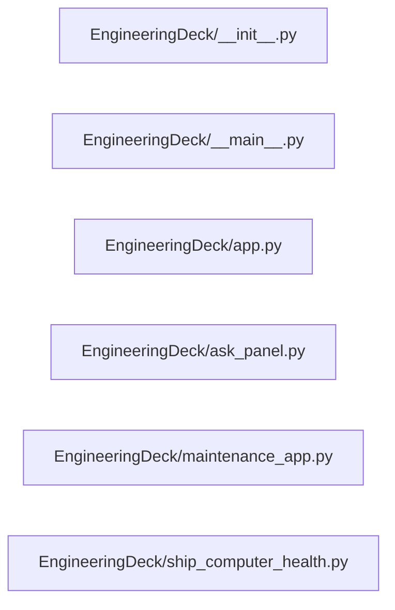

# Structure: EngineeringDeck

**Files:** 6 · **Lines:** 1,763 · **Classes:** 7 · **Functions:** 5 · **Methods:** 70

Solid edges = module-level import/call relationships (determined statically from source; only relationships *within this package* are drawn).

title: "EngineeringDeck module relationships"

## Modules

### `EngineeringDeck/__init__.py`

*EngineeringDeck — Ask AI mini-app + maintenance (+ legacy facade).*

**Imports:** `from __future__ import annotations`, `import importlib`

**Functions**

### `EngineeringDeck/__main__.py`

*Entry: Spock Engineering Deck (Ask AI / Deep Dive).*

> Contains a `__main__` guard (run directly).

**Imports:** `from __future__ import annotations`, `import os`, `import sys`, `import _warpcore_path`, `from EngineeringDeck.app import EngineeringDeckWindow`, `from spock_shell.qt_app import create_app`

**Functions**

- **`main()`** — lines 21-25

### `EngineeringDeck/app.py`

*Spock-Engineering-Deck — PyQt Ask AI + Deep Dive.*

**Imports:** `from __future__ import annotations`, `from typing import Any`, `from typing import Dict`, `from typing import Sequence`, `from PyQt6.QtCore import QTimer`, `from model_selector_core import merge_embedding_profile`, `from EngineeringDeck.ask_panel import AskAiPanel`, `from spock_shell.bridge_host import make_llm_client`, `from spock_shell.config import save_config`, `from spock_shell.markdown_home import build_markdown_home`, `from spock_shell.markdown_home import reload_markdown_home`, `from spock_shell.mcp_host import McpAdapterHost`, `from spock_shell.paths import SHIP_COMPUTER_DB`, `from spock_shell.paths import ensure_root_on_path`, `from spock_shell.profiles import apply_profile_payload`, `from spock_shell.profiles import build_profile_payload`, `from spock_shell.profiles import harvest_live_config`, `from spock_shell.profiles import maybe_load_profile`, `from spock_shell.profiles import prompt_save_profile`, `from spock_shell.profiles import save_profile_interactive`, `from spock_shell.theme import THEMES`, `from spock_shell.window import NavItem`, `from spock_shell.window import SuiteShellWindow`, `from WarpCore.search import hybrid_search`, `from spock_shell.configure_ai import ConfigureAiPanel`, `from spock_shell.busy_ui import busy_scope`, `from spock_shell.busy_ui import clear_override_cursors`, `from PyQt6.QtWidgets import QMessageBox`, `from spock_shell.profiles import prompts_enabled`, `from spock_shell.proc_guard import tcp_open`

**Classes**

- **`EngineeringDeckWindow(SuiteShellWindow)`** — lines 30-232
  - `on_ready(self)`
  - `build_home_widget(self)`
  - `show_home(self)`
  - `closeEvent(self, event)`
  - `nav_steps(self)`

### `EngineeringDeck/ask_panel.py`

*In-app Ask AI + Deep Dive center panel for Engineering Deck.*

**Imports:** `from __future__ import annotations`, `import os`, `import re`, `from datetime import datetime`, `from typing import Any`, `from typing import Callable`, `from typing import Dict`, `from typing import List`, `from typing import Optional`, `from PyQt6.QtCore import QMutex`, `from PyQt6.QtCore import QThread`, `from PyQt6.QtCore import Qt`, `from PyQt6.QtCore import QWaitCondition`, `from PyQt6.QtCore import pyqtSignal`, `from PyQt6.QtGui import QColor`, `from PyQt6.QtGui import QFont`, `from PyQt6.QtGui import QTextCharFormat`, `from PyQt6.QtGui import QTextCursor`, `from PyQt6.QtWidgets import QApplication`, `from PyQt6.QtWidgets import QCheckBox`, `from PyQt6.QtWidgets import QComboBox`, `from PyQt6.QtWidgets import QDialog`, `from PyQt6.QtWidgets import QDialogButtonBox`, `from PyQt6.QtWidgets import QFileDialog`, `from PyQt6.QtWidgets import QHBoxLayout`, `from PyQt6.QtWidgets import QLabel`, `from PyQt6.QtWidgets import QLineEdit`, `from PyQt6.QtWidgets import QMessageBox`, `from PyQt6.QtWidgets import QPushButton`, `from PyQt6.QtWidgets import QSpinBox`, `from PyQt6.QtWidgets import QTextBrowser`, `from PyQt6.QtWidgets import QTextEdit`, `from PyQt6.QtWidgets import QVBoxLayout`, `from PyQt6.QtWidgets import QWidget`, `from spock_shell.paths import SHIP_COMPUTER_DB`, `from spock_shell.paths import ensure_root_on_path`, `import time`, `from spock_shell.busy_ui import clear_override_cursors`, `from spock_shell.busy_ui import clear_override_cursors`, `from spock_shell.good_results_coach import tip_timeout`, `from spock_shell.busy_ui import clear_override_cursors`, `from deep_dive import build_documents_filter_clause`, `from deep_dive import run_http_deep_dive`, `from WarpCore.config_defaults import merge_ctx_settings`, `from spock_shell.busy_ui import clear_override_cursors`, `from spock_shell.good_results_coach import collect_ask_tips`, `from spock_shell.good_results_coach import collect_ask_tips`, `from deep_dive import context_token_budget`, `from llm_client import ASK_SYSTEM_PROMPT`, `from PyQt6.QtWebEngineWidgets import QWebEngineView`, `from spock_shell.embedding_corpus import live_vs_corpus`, `from deep_dive import packing_opts_for_llm`, `from deep_dive import packing_opts_from_config`, `from WarpCore.config_defaults import merge_ctx_settings`, `from WarpCore.settings_store import ensure_ctx_defaults_in_store`, `from db_browser import PreviewDialog`, `from WarpCore.ask_timing_store import insert_timing`

**Classes**

- **`_TimeoutContinueDialog(QDialog)`** — lines 38-98
  - *Choose a new wait window, wait forever, or cancel with retry hints.*
  - `choice(self)`
  - `timeout_seconds(self)`
- **`_AskWorker(QThread)`** — lines 101-330
  - `set_continue_answer(self, decision)` *Wake the worker. False cancels; True keeps timeout; int sets seconds (0=unlimited).*
  - `run(self)`
- **`_AnswerPreviewDialog(QDialog)`** — lines 333-368
  - *Render Markdown / HTML using Spock's text / WebEngine viewers.*
- **`AskAiPanel(QWidget)`** — lines 371-827
  - `path_filter(self)`
  - `set_path_filter(self, path)`

### `EngineeringDeck/maintenance_app.py`

*Spock-Engineering-Maintenance — Wiki / App maintenance + theme.*

**Imports:** `from __future__ import annotations`, `from typing import Any`, `from typing import Dict`, `from typing import Sequence`, `from PyQt6.QtWidgets import QVBoxLayout`, `from PyQt6.QtWidgets import QWidget`, `from spock_shell.brave_search import build_brave_search_panel`, `from spock_shell.markdown_home import build_markdown_home`, `from spock_shell.markdown_home import reload_markdown_home`, `from spock_shell.paths import ensure_root_on_path`, `from spock_shell.widgets import SidePanel`, `from spock_shell.window import NavItem`, `from spock_shell.window import SuiteShellWindow`, `from EngineeringDeck.ship_computer_health import ShipComputerHealthPanel`, `from wiki_maintenance import WikiMaintenancePanel`

**Classes**

- **`EngineeringMaintenanceWindow(SuiteShellWindow)`** — lines 18-85
  - `on_ready(self)`
  - `build_home_widget(self)`
  - `show_home(self)`
  - `nav_steps(self)`
  - `build_right_dock(self, layout)`

### `EngineeringDeck/ship_computer_health.py`

*Ship Computer DB Health — Overview + MCP tool probes for Engineering Maintenance.*

**Imports:** `from __future__ import annotations`, `import importlib.util`, `import json`, `import os`, `import sys`, `from pathlib import Path`, `from typing import Any`, `from typing import Callable`, `from typing import Dict`, `from typing import Optional`, `from PyQt6.QtCore import Qt`, `from PyQt6.QtGui import QFont`, `from PyQt6.QtWidgets import QApplication`, `from PyQt6.QtWidgets import QFormLayout`, `from PyQt6.QtWidgets import QHBoxLayout`, `from PyQt6.QtWidgets import QLabel`, `from PyQt6.QtWidgets import QLineEdit`, `from PyQt6.QtWidgets import QMessageBox`, `from PyQt6.QtWidgets import QPushButton`, `from PyQt6.QtWidgets import QSizePolicy`, `from PyQt6.QtWidgets import QSpinBox`, `from PyQt6.QtWidgets import QTabWidget`, `from PyQt6.QtWidgets import QTextEdit`, `from PyQt6.QtWidgets import QVBoxLayout`, `from PyQt6.QtWidgets import QWidget`, `from spock_shell.paths import ROOT`, `from spock_shell.paths import SHIP_COMPUTER_DB`, `import sqlite3`, `from spock_health_report import format_spock_health_report`, `import subprocess`

**Classes**

- **`ShipComputerHealthPanel(QWidget)`** — lines 74-563
  - *Overview + one tab per MCP ship-computer health tool.*
  - `apply_theme(self)`
  - `refresh_overview(self)`

**Functions**
