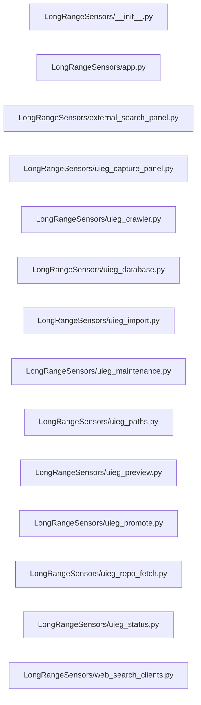

# Structure: LongRangeSensors

**Files:** 14 · **Lines:** 3,990 · **Classes:** 9 · **Functions:** 71 · **Methods:** 81

Solid edges = module-level import/call relationships (determined statically from source; only relationships *within this package* are drawn).

title: "LongRangeSensors module relationships"

## Modules

### `LongRangeSensors/__init__.py`

*LongRangeSensors — Search + Save (UIEG) and Run Search.

Modules live in this package. Imports are lazy so `import LongRangeSensors`
stays cheap until a module is actually touched.*

**Imports:** `from __future__ import annotations`, `import importlib`

**Functions**

### `LongRangeSensors/app.py`

*Spock-UIEG-KnowledgeBase — Repo fetch / Website crawl / Promote.*

**Imports:** `from __future__ import annotations`, `from typing import Any`, `from typing import Dict`, `from typing import Sequence`, `from PyQt6.QtWidgets import QVBoxLayout`, `from PyQt6.QtWidgets import QWidget`, `from LongRangeSensors.uieg_capture_panel import UiegCapturePanel`, `from LongRangeSensors.uieg_status import build_uieg_status_panel`, `from spock_shell.brave_search import build_brave_search_panel`, `from spock_shell.markdown_home import build_markdown_home`, `from spock_shell.markdown_home import reload_markdown_home`, `from spock_shell.paths import ensure_root_on_path`, `from spock_shell.widgets import SidePanel`, `from spock_shell.window import NavItem`, `from spock_shell.window import SuiteShellWindow`

**Classes**

- **`UiegKnowledgeBaseWindow(SuiteShellWindow)`** — lines 20-92
  - `on_ready(self)`
  - `build_home_widget(self)`
  - `show_home(self)`
  - `nav_steps(self)`
  - `build_right_dock(self, layout)`

### `LongRangeSensors/external_search_panel.py`

*External Search results panel — GitHub / Brave API → Capture / Clone via UIEG.

Opened from right-dock Run Search. Does not write ship_computer.db.*

**Imports:** `from __future__ import annotations`, `import os`, `from typing import Any`, `from typing import Callable`, `from typing import Dict`, `from typing import List`, `from typing import Optional`, `from PyQt6.QtCore import Qt`, `from PyQt6.QtCore import QThread`, `from PyQt6.QtCore import QUrl`, `from PyQt6.QtCore import pyqtSignal`, `from PyQt6.QtGui import QDesktopServices`, `from PyQt6.QtGui import QFont`, `from PyQt6.QtWidgets import QHBoxLayout`, `from PyQt6.QtWidgets import QHeaderView`, `from PyQt6.QtWidgets import QLabel`, `from PyQt6.QtWidgets import QMessageBox`, `from PyQt6.QtWidgets import QPushButton`, `from PyQt6.QtWidgets import QTableWidget`, `from PyQt6.QtWidgets import QTableWidgetItem`, `from PyQt6.QtWidgets import QTextEdit`, `from PyQt6.QtWidgets import QVBoxLayout`, `from PyQt6.QtWidgets import QWidget`, `from LongRangeSensors.uieg_crawler import crawl_url_to_disk`, `from LongRangeSensors.uieg_paths import default_crawl_folder`, `from LongRangeSensors.uieg_paths import default_repo_folder`, `from LongRangeSensors.uieg_paths import ensure_capture_folder`, `from LongRangeSensors.uieg_paths import merge_uieg_config`, `from LongRangeSensors.uieg_repo_fetch import fetch_repo_to_capture`, `from LongRangeSensors.uieg_repo_fetch import parse_github_repo`, `from LongRangeSensors.web_search_clients import run_external_search`

**Classes**

- **`_SearchWorker(QThread)`** — lines 70-114
  - `run(self)`
- **`_ActionWorker(QThread)`** — lines 117-131
  - `run(self)`
- **`ExternalSearchPanel(QWidget)`** — lines 134-366
  - *Central panel: API search results + Capture URL / Clone repo.*
  - `apply_theme(self)`

**Functions**

### `LongRangeSensors/uieg_capture_panel.py`

*Spock-themed UIEG capture workspace (repo fetch vs website crawl).

Provenance: D:\Spock-To-Bridge-UIEG-Scanner*

**Imports:** `from __future__ import annotations`, `import os`, `from typing import Any`, `from typing import Callable`, `from typing import Dict`, `from typing import Literal`, `from typing import Optional`, `from PyQt6.QtCore import Qt`, `from PyQt6.QtCore import QThread`, `from PyQt6.QtCore import QUrl`, `from PyQt6.QtCore import pyqtSignal`, `from PyQt6.QtGui import QDesktopServices`, `from PyQt6.QtGui import QFont`, `from PyQt6.QtGui import QIntValidator`, `from PyQt6.QtGui import QPixmap`, `from PyQt6.QtWidgets import QComboBox`, `from PyQt6.QtWidgets import QFileDialog`, `from PyQt6.QtWidgets import QHBoxLayout`, `from PyQt6.QtWidgets import QHeaderView`, `from PyQt6.QtWidgets import QLabel`, `from PyQt6.QtWidgets import QLineEdit`, `from PyQt6.QtWidgets import QMessageBox`, `from PyQt6.QtWidgets import QPushButton`, `from PyQt6.QtWidgets import QSpinBox`, `from PyQt6.QtWidgets import QStackedWidget`, `from PyQt6.QtWidgets import QTableWidget`, `from PyQt6.QtWidgets import QTableWidgetItem`, `from PyQt6.QtWidgets import QTabWidget`, `from PyQt6.QtWidgets import QTextEdit`, `from PyQt6.QtWidgets import QVBoxLayout`, `from PyQt6.QtWidgets import QWidget`, `from LongRangeSensors.uieg_crawler import crawl_url_to_disk`, `from LongRangeSensors.uieg_database import clear_database`, `from LongRangeSensors.uieg_database import count_captures`, `from LongRangeSensors.uieg_database import format_file_size`, `from LongRangeSensors.uieg_database import get_capture_content`, `from LongRangeSensors.uieg_database import get_capture_row`, `from LongRangeSensors.uieg_database import init_db`, `from LongRangeSensors.uieg_database import list_captures`, `from LongRangeSensors.uieg_import import copy_local_file_to_capture`, `from LongRangeSensors.uieg_import import import_captured_files`, `from LongRangeSensors.uieg_paths import CHANNEL_CRAWL`, `from LongRangeSensors.uieg_paths import CHANNEL_REPO`, `from LongRangeSensors.uieg_paths import default_crawl_folder`, `from LongRangeSensors.uieg_paths import default_repo_folder`, `from LongRangeSensors.uieg_paths import ensure_capture_folder`, `from LongRangeSensors.uieg_paths import merge_uieg_config`, `from LongRangeSensors.uieg_paths import migrate_legacy_db`, `from LongRangeSensors.uieg_paths import resolve_repo_capture_folder`, `from LongRangeSensors.uieg_preview import start_preview_server`, `from LongRangeSensors.uieg_preview import write_temp_preview`, `from LongRangeSensors.uieg_promote import promote_captures`, `from LongRangeSensors.uieg_repo_fetch import fetch_repo_to_capture`, `from LongRangeSensors.uieg_repo_fetch import parse_github_repo`, `from PyQt6.QtWebEngineWidgets import QWebEngineView`, `from PyQt6.QtWebEngineCore import QWebEnginePage`

**Classes**

- **`_SizeTableItem(QTableWidgetItem)`** — lines 119-133
  - *Display human size; sort by raw byte count.*
- **`_Worker(QThread)`** — lines 143-157
  - `run(self)`
- **`UiegCapturePanel(QWidget)`** — lines 160-1125
  - *Channel-scoped capture workspace (repo fetch or website crawl).*
  - `refresh_db_view(self)`
  - `apply_theme(self)`
  - `prepare_shutdown(self)`

**Functions**

### `LongRangeSensors/uieg_crawler.py`

*Minimal HTTP crawler → captured_files only (disk-first).

Adapted from D:\Spock-To-Bridge-UIEG-Scanner\crawler.py.
Does not write the DB — Import step loads files into uieg_capture.db.*

**Imports:** `from __future__ import annotations`, `import os`, `import re`, `from collections import deque`, `from typing import Callable`, `from typing import Deque`, `from typing import List`, `from typing import Optional`, `from typing import Set`, `from typing import Tuple`, `from urllib.parse import urljoin`, `from urllib.parse import urlparse`, `import requests`, `from WarpCore.deps import missing_crawler_deps`, `from WarpCore.deps import missing_deps_message`, `from bs4 import BeautifulSoup`, `from urllib.parse import unquote`, `from urllib.parse import urlparse`

**Functions**

- **`to_raw_github_url(url)`** — lines 26-30
- **`snapshot_url_to_html(url, dest_path, timeout_sec, log)`** — lines 79-151
  - *Fetch one URL and write an offline .html snapshot (SingleFile-spirit, no browser).*
- **`crawl_url_to_disk(url, capture_folder, link_limit, crawl_levels, timeout_sec, fetch_code_links, code_exts, log)`** — lines 154-288
  - *BFS crawl: start URL + same-host pages up to crawl_levels deep.*

### `LongRangeSensors/uieg_database.py`

*SQLite store for Search + Save captures (uieg_capture.db).

Adapted from D:\Spock-To-Bridge-UIEG-Scanner\database.py with source_url / source_kind.*

**Imports:** `from __future__ import annotations`, `import os`, `import sqlite3`, `from datetime import datetime`, `from typing import Any`, `from typing import Dict`, `from typing import List`, `from typing import Optional`, `from typing import Tuple`, `from LongRangeSensors.uieg_paths import CHANNEL_CRAWL`, `from LongRangeSensors.uieg_paths import CHANNEL_REPO`, `from collections import Counter`, `from collections import defaultdict`

**Functions**

- **`init_db(db_path)`** — lines 39-100
- **`create_batch(db_path, channel, label, source_url, disk_root, notes)`** — lines 103-133
- **`update_batch_file_count(db_path, batch_id, file_count)`** — lines 136-145
- **`list_batches(db_path, channel, limit)`** — lines 148-177
- **`format_file_size(n)`** — lines 180-194
  - *Human-readable size for Browse grid.*
- **`insert_capture(db_path, filename, filepath, filetype, content, source_url, source_kind, file_size, batch_id, channel)`** — lines 197-237
- **`list_captures(db_path, channel)`** — lines 251-257
- **`get_capture_content(db_path, capture_id)`** — lines 260-268
- **`get_capture_row(db_path, capture_id)`** — lines 271-288
  - *Row: id, filename, filepath, filetype, captured_at, source_url, source_kind,*
- **`mark_capture_promoted(db_path, capture_id, promoted_path, promoted_at)`** — lines 291-311
- **`clear_database(db_path)`** — lines 314-327
- **`file_exists_in_db(db_path, filename)`** — lines 330-337
- **`count_captures(db_path, channel)`** — lines 340-351
- **`summarize_uieg_db(db_path)`** — lines 421-550
  - *Return overview + repo list for UIEG Status panel.*
- **`format_uieg_status_report(db_path)`** — lines 553-624
  - *Plain-text recap of uieg_capture.db for the UIEG Status center pane.*

### `LongRangeSensors/uieg_import.py`

*Import files from captured_files/ into uieg_capture.db.*

**Imports:** `from __future__ import annotations`, `import os`, `import shutil`, `from typing import Callable`, `from typing import List`, `from typing import Optional`, `from typing import Set`, `from LongRangeSensors.uieg_database import create_batch`, `from LongRangeSensors.uieg_database import file_exists_in_db`, `from LongRangeSensors.uieg_database import insert_capture`, `from LongRangeSensors.uieg_database import update_batch_file_count`, `from LongRangeSensors.uieg_paths import CHANNEL_CRAWL`, `from LongRangeSensors.uieg_paths import CHANNEL_REPO`

**Functions**

- **`import_captured_files(capture_folder, db_path, channel, batch_id, batch_label, extensions, source_kind, source_url, skip_existing, log)`** — lines 59-130
  - *Scan capture_folder recursively; insert new files into DB. Returns count inserted.*
- **`copy_local_file_to_capture(src_path, capture_folder, log)`** — lines 133-149
  - *Copy a user-picked file into captured_files. Returns dest path.*

### `LongRangeSensors/uieg_maintenance.py`

*Backup / restore / reindex / channel reset for uieg_capture.db.*

**Imports:** `from __future__ import annotations`, `import os`, `import shutil`, `import sqlite3`, `from datetime import datetime`, `from typing import Optional`, `from typing import Tuple`, `from LongRangeSensors.uieg_database import clear_database`, `from LongRangeSensors.uieg_database import init_db`, `from LongRangeSensors.uieg_paths import CHANNEL_CRAWL`, `from LongRangeSensors.uieg_paths import CHANNEL_REPO`

**Functions**

- **`backup_dir_for(db_path)`** — lines 17-20
- **`backup_db(db_path)`** — lines 23-38
  - *Copy uieg_capture.db into backups/ with timestamp. Returns backup path.*
- **`list_backups(db_path)`** — lines 41-49
- **`restore_db(db_path, backup_name)`** — lines 52-62
  - *Overwrite uieg_capture.db from a named backup file.*
- **`reindex_db(db_path)`** — lines 65-79
  - *Run ANALYZE then VACUUM on uieg_capture.db.*
- **`reset_channel(db_path, channel)`** — lines 82-99
  - *Delete captures and batches for one channel. Returns (captures, batches).*
- **`reset_all(db_path)`** — lines 102-104
  - *Wipe all captures and batches.*
- **`auto_backup_before_reset(db_path, tag)`** — lines 107-125
  - *Create a pre-reset backup; returns path.*

### `LongRangeSensors/uieg_paths.py`

*Paths and config for UIEG capture (Search + Save).

Provenance: adapted from D:\Spock-To-Bridge-UIEG-Scanner (ueig_capture.db → uieg_capture.db).*

**Imports:** `from __future__ import annotations`, `import os`, `import shutil`, `from typing import Any`, `from typing import Dict`, `from typing import Tuple`

**Functions**

- **`channel_disk_folder(capture_folder, channel)`** — lines 23-28
  - *On-disk home for a workflow channel under captured_files/.*
- **`default_crawl_folder(capture_folder)`** — lines 31-32
- **`default_repo_folder(capture_folder)`** — lines 35-36
- **`merge_uieg_config(raw)`** — lines 39-58
- **`ensure_capture_folder(capture_folder)`** — lines 61-63
- **`is_drive_root(path)`** — lines 66-75
  - *True for Windows drive roots like D:\ or D:/ (and Unix /).*
- **`resolve_repo_capture_folder(path, folder_name)`** — lines 78-99
  - *Normalize a user-picked dest for repo fetch.*
- **`ensure_promoted_folder(promoted_folder)`** — lines 102-104
- **`migrate_legacy_db(database_path)`** — lines 107-140
  - *Rename/copy ueig_capture.db → uieg_capture.db if needed.*

### `LongRangeSensors/uieg_preview.py`

*Preview helpers for UIEG capture BLOBs / files (localhost HTTP for HTML).*

**Imports:** `from __future__ import annotations`, `import os`, `import socket`, `import threading`, `from http.server import HTTPServer`, `from http.server import SimpleHTTPRequestHandler`, `from typing import Optional`, `from typing import Tuple`, `from functools import partial`

**Classes**

- **`QuietHandler(SimpleHTTPRequestHandler)`** — lines 18-34
  - `log_message(self, fmt, *args)`
  - `send_head(self)`

**Functions**

- **`find_free_port()`** — lines 12-15
- **`start_preview_server(directory)`** — lines 37-44
- **`write_temp_preview(content, capture_id, ext, temp_dir)`** — lines 47-59

### `LongRangeSensors/uieg_promote.py`

*Promote selected uieg_capture.db rows into ship_computer.db via extractor.

Writes BLOBs under promoted_research/, then runs starfleet_universal_extractor.py
on those paths. Does not auto-watch capture folders.*

**Imports:** `from __future__ import annotations`, `import os`, `import re`, `import subprocess`, `import sys`, `from typing import Callable`, `from typing import List`, `from typing import Optional`, `from typing import Sequence`, `from typing import Tuple`, `from LongRangeSensors.uieg_database import get_capture_content`, `from LongRangeSensors.uieg_database import get_capture_row`, `from LongRangeSensors.uieg_database import init_db`, `from LongRangeSensors.uieg_database import mark_capture_promoted`, `from LongRangeSensors.uieg_paths import ensure_promoted_folder`

**Functions**

- **`promote_capture(db_path, capture_id, promoted_folder, python_exe, log)`** — lines 38-99
  - *Promote one capture. Returns (ok, message).*
- **`promote_captures(db_path, capture_ids, promoted_folder, python_exe, log)`** — lines 102-129
  - *Promote many. Returns (ok_count, fail_count, messages).*

### `LongRangeSensors/uieg_repo_fetch.py`

*Fetch a GitHub (or git) repo into captured_files via clone or zip.

Secondary path for Option 3 step 1 — source truth for .md/.py when HTML crawl is a shell.*

**Imports:** `from __future__ import annotations`, `import os`, `import re`, `import shutil`, `import subprocess`, `import tempfile`, `import zipfile`, `from typing import Callable`, `from typing import List`, `from typing import Optional`, `from typing import Sequence`, `from typing import Set`, `from typing import Tuple`, `from urllib.parse import urlparse`, `import requests`

**Functions**

- **`parse_github_repo(url_or_slug)`** — lines 25-50
  - *Return (owner, repo, ref) or None. Default ref=main.*
- **`fetch_repo_to_capture(url_or_slug, capture_folder, method, extensions, timeout_sec, log)`** — lines 77-113
  - *Clone or zip-download repo; extract allowlisted files under captured_files/<owner>_<repo>/.*

### `LongRangeSensors/uieg_status.py`

*UIEG Status center pane — overview + database maintenance.*

**Imports:** `from __future__ import annotations`, `import os`, `from typing import Any`, `from typing import Callable`, `from typing import Dict`, `from typing import Optional`, `from PyQt6.QtCore import Qt`, `from PyQt6.QtGui import QFont`, `from PyQt6.QtWidgets import QHBoxLayout`, `from PyQt6.QtWidgets import QInputDialog`, `from PyQt6.QtWidgets import QLabel`, `from PyQt6.QtWidgets import QMessageBox`, `from PyQt6.QtWidgets import QPushButton`, `from PyQt6.QtWidgets import QTabWidget`, `from PyQt6.QtWidgets import QTextEdit`, `from PyQt6.QtWidgets import QVBoxLayout`, `from PyQt6.QtWidgets import QWidget`, `from LongRangeSensors.uieg_database import format_uieg_status_report`, `from LongRangeSensors.uieg_maintenance import auto_backup_before_reset`, `from LongRangeSensors.uieg_maintenance import backup_db`, `from LongRangeSensors.uieg_maintenance import list_backups`, `from LongRangeSensors.uieg_maintenance import reindex_db`, `from LongRangeSensors.uieg_maintenance import reset_all`, `from LongRangeSensors.uieg_maintenance import reset_channel`, `from LongRangeSensors.uieg_maintenance import restore_db`, `from LongRangeSensors.uieg_paths import CHANNEL_CRAWL`, `from LongRangeSensors.uieg_paths import CHANNEL_REPO`, `from LongRangeSensors.uieg_paths import merge_uieg_config`

**Classes**

- **`UiegStatusPanel(QWidget)`** — lines 35-336
  - *Tabbed UIEG DB status + maintenance (mirrors Maintenance → Database tab).*
  - `refresh(self)`

**Functions**

- **`build_uieg_status_panel(theme, uieg_cfg, on_db_changed)`** — lines 339-347

### `LongRangeSensors/web_search_clients.py`

*Thin GitHub + Brave Search API clients for Spock right-dock Run Search.

No UI / no DB writes. Env overrides config:
  GITHUB_TOKEN / BRAVE_API_KEY first, then app_config.json → search.**

**Imports:** `from __future__ import annotations`, `import os`, `import re`, `from typing import Any`, `from typing import Dict`, `from typing import List`, `from typing import Optional`, `from typing import Tuple`, `import requests`

**Functions**

- **`merge_search_config(raw)`** — lines 37-50
- **`resolve_credentials(search_cfg)`** — lines 53-54
- **`github_search_query(user_query)`** — lines 57-89
  - *Turn a natural-language question into GitHub Search keywords.*
- **`search_github_repos(query, limit, token, timeout)`** — lines 111-190
  - *Search GitHub repositories. Returns (items, status_note).*
- **`search_brave_web(query, limit, api_key, timeout)`** — lines 193-252
  - *Brave Web Search API. Returns (items, status_note).*
- **`run_external_search(source, query, limit, search_cfg)`** — lines 255-278
  - *Dispatch by Source combo text. Returns (items, status_or_error).*
