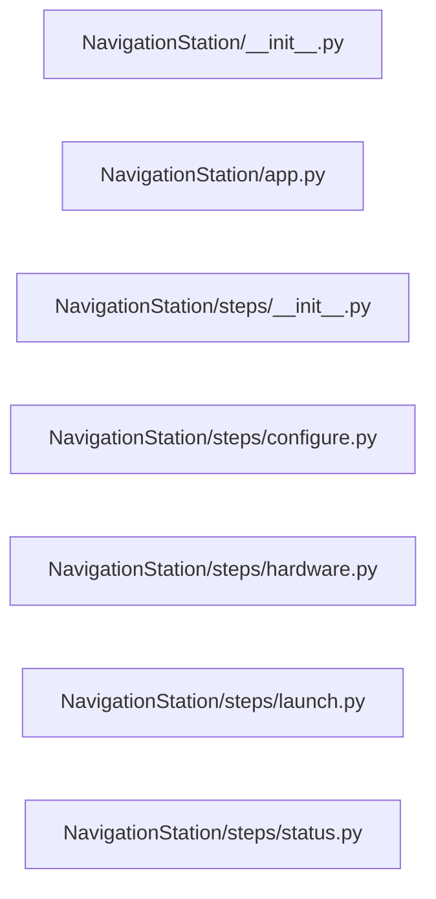

# Structure: NavigationStation

**Files:** 7 · **Lines:** 787 · **Classes:** 1 · **Functions:** 5 · **Methods:** 36

Solid edges = module-level import/call relationships (determined statically from source; only relationships *within this package* are drawn).

title: "NavigationStation module relationships"

## Modules

### `NavigationStation/__init__.py`

*Navigation Station — browser Spock Ask AI (RAG :8090 / templates/webui).*

**Imports:** `from __future__ import annotations`, `import importlib`

**Functions**

### `NavigationStation/app.py`

*Spock-Navigation-Station main window.*

**Imports:** `from __future__ import annotations`, `from typing import Any`, `from typing import Dict`, `from typing import Optional`, `from typing import Sequence`, `from PyQt6.QtCore import QTimer`, `from PyQt6.QtWidgets import QVBoxLayout`, `from PyQt6.QtWidgets import QWidget`, `from llama_server_manager import LlamaServerManager`, `from model_selector_core import merge_embedding_profile`, `from model_selector_core import write_embedding_env`, `from model_selector_panels import ModelInfoPanel`, `from model_selector_panels import ModelSelectorState`, `from model_selector_panels import ModelsPanel`, `from NavigationStation.steps.configure import build_configure_step`, `from NavigationStation.steps.hardware import build_hardware_step`, `from NavigationStation.steps.launch import build_launch_step`, `from NavigationStation.steps.status import build_status_step`, `from rag_api_server import RagApiServer`, `from ScienceStation.ships_logs import build_ships_logs_panel`, `from spock_wiki_adapter.wiki_run import build_wiki_agent_run_panel`, `from spock_shell.brave_search import build_brave_search_panel`, `from spock_shell.bridge_host import make_llm_client`, `from spock_shell.config import save_config`, `from spock_shell.markdown_home import build_markdown_home`, `from spock_shell.markdown_home import reload_markdown_home`, `from spock_shell.mcp_host import McpAdapterHost`, `from spock_shell.paths import SHIP_COMPUTER_DB`, `from spock_shell.paths import ensure_root_on_path`, `from spock_shell.profiles import apply_profile_payload`, `from spock_shell.profiles import build_profile_payload`, `from spock_shell.profiles import harvest_live_config`, `from spock_shell.profiles import maybe_load_profile`, `from spock_shell.profiles import prompt_save_profile`, `from spock_shell.profiles import save_profile_interactive`, `from spock_shell.theme import THEMES`, `from spock_shell.widgets import SidePanel`, `from spock_shell.window import NavItem`, `from spock_shell.window import SuiteShellWindow`, `from WarpCore.search import set_embeddings_url`, `from spock_shell.ask_path_handoff import offer_copy_ships_path_to_ask`, `from spock_shell.busy_ui import busy_scope`, `from spock_shell.busy_ui import clear_override_cursors`, `from PyQt6.QtWidgets import QMessageBox`, `from spock_shell.proc_guard import tcp_open`, `from PyQt6.QtWidgets import QMessageBox`, `from spock_shell.profiles import prompts_enabled`, `import time as _time`, `from spock_shell.paths import ROOT`, `from spock_shell.proc_guard import exclusive_start`, `from spock_shell.proc_guard import pids_running_script`, `from spock_shell.proc_guard import tcp_open`, `from spock_shell.rag_host import is_rag_up`, `from spock_shell.rag_host import rag_url`, `from EngineeringDeck.ask_panel import AskAiPanel`, `from WarpCore.search import hybrid_search`, `from WarpCore as hr`, `from deep_dive import build_documents_filter_clause`, `from deep_dive import packing_opts_from_config`, `from deep_dive import run_http_deep_dive`, `from model_selector_core as _mep`, `from WarpCore.search import hybrid_search`, `from spock_shell.embedding_corpus import guarded_hybrid_search`, `from mcp_panel import stop_ui_mcp_proxy`, `from deep_dive import packing_opts_for_llm`

**Classes**

- **`NavigationStationWindow(SuiteShellWindow)`** — lines 48-653
  - `on_ready(self)`
  - `build_home_widget(self)`
  - `show_home(self)`
  - `nav_steps(self)`
  - `build_right_dock(self, layout)`
  - `start_rag_api(self)`
  - `stop_rag_api(self, persist)`
  - `closeEvent(self, event)`

### `NavigationStation/steps/__init__.py`

*Navigation Station step packages.*

### `NavigationStation/steps/configure.py`

*Configure step — the full tabbed Configure Spock AI form.

This used to be the Embedding Profile panel alone, with MCP and the llama.cpp
WebUI living behind a separate "Connect" step. Both are tabs of
``ConfigureAiPanel`` now, so Navigation shows one form instead of three doors to
the same settings.*

**Imports:** `from __future__ import annotations`, `from typing import Any`, `from typing import Callable`, `from typing import Dict`, `from typing import Optional`, `from spock_shell.configure_ai import ConfigureAiPanel`, `from spock_shell.paths import SHIP_COMPUTER_DB`

**Functions**

- **`build_configure_step(theme, config, mcp_host, on_profile_applied, on_rag_start, on_rag_stop, save_config)`** — lines 17-35

### `NavigationStation/steps/hardware.py`

*Hardware scan step.*

**Imports:** `from __future__ import annotations`, `from typing import Any`, `from typing import Dict`, `from PyQt6.QtWidgets import QVBoxLayout`, `from PyQt6.QtWidgets import QWidget`, `from model_selector_panels import HardwareScanPanel`, `from model_selector_panels import ModelSelectorState`

**Functions**

- **`build_hardware_step(theme, state)`** — lines 12-19

### `NavigationStation/steps/launch.py`

*Launch embed :8080 + chat :8081 step.*

**Imports:** `from __future__ import annotations`, `from typing import Dict`, `from PyQt6.QtWidgets import QLabel`, `from PyQt6.QtWidgets import QVBoxLayout`, `from PyQt6.QtWidgets import QWidget`, `from llama_server_manager import LlamaServerManager`, `from model_selector_panels import LaunchPanel`, `from model_selector_panels import ModelSelectorState`

**Functions**

- **`build_launch_step(theme, state, manager)`** — lines 13-29

### `NavigationStation/steps/status.py`

*Status step — health report in center.*

**Imports:** `from __future__ import annotations`, `from typing import Any`, `from typing import Dict`, `from PyQt6.QtWidgets import QVBoxLayout`, `from PyQt6.QtWidgets import QWidget`, `from spock_shell.status_panel import StatusConsole`

**Functions**

- **`build_status_step(theme, config)`** — lines 12-19
