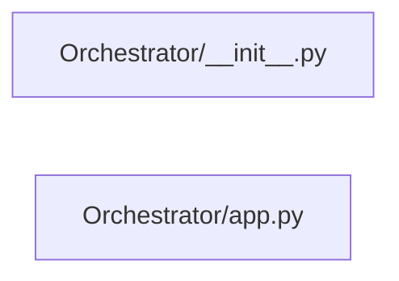

# Structure: Orchestrator

**Files:** 2 · **Lines:** 230 · **Classes:** 1 · **Functions:** 2 · **Methods:** 14

Solid edges = module-level import/call relationships (determined statically from source; only relationships *within this package* are drawn).

title: "Orchestrator module relationships"

## Modules

### `Orchestrator/__init__.py`

*Spock-UIE-Wiki-KB orchestrator package.*

### `Orchestrator/app.py`

*Spock-UIE-Wiki-KB main orchestrator — lite launch hub for suite mini-apps.*

**Imports:** `from __future__ import annotations`, `import os`, `import subprocess`, `import sys`, `from datetime import datetime`, `from pathlib import Path`, `from typing import List`, `from typing import Optional`, `from typing import Sequence`, `from typing import Tuple`, `from PyQt6.QtGui import QFont`, `from PyQt6.QtWidgets import QLabel`, `from PyQt6.QtWidgets import QMessageBox`, `from PyQt6.QtWidgets import QTextEdit`, `from PyQt6.QtWidgets import QVBoxLayout`, `from PyQt6.QtWidgets import QWidget`, `from spock_shell.brave_search import build_brave_search_panel`, `from spock_shell.markdown_home import build_markdown_home`, `from spock_shell.markdown_home import reload_markdown_home`, `from spock_shell.paths import ROOT`, `from spock_shell.paths import ensure_root_on_path`, `from spock_shell.widgets import SidePanel`, `from spock_shell.window import NavItem`, `from spock_shell.window import SuiteShellWindow`, `import psutil`, `from spock_shell.rag_host import stop_spawned_rag`

**Classes**

- **`UieWikiKbOrchestratorWindow(SuiteShellWindow)`** — lines 83-229
  - *Lite hub that opens each stand-alone Spock suite entry in its own process.*
  - `on_ready(self)`
  - `closeEvent(self, event)`
  - `build_home_widget(self)`
  - `show_home(self)`
  - `nav_steps(self)`
  - `build_right_dock(self, layout)`

**Functions**
