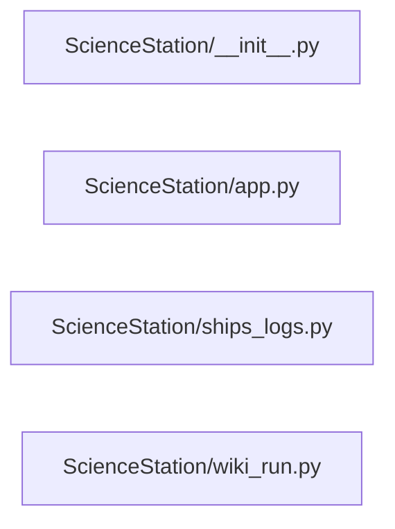

# Structure: ScienceStation

**Files:** 4 · **Lines:** 789 · **Classes:** 3 · **Functions:** 8 · **Methods:** 29

Solid edges = module-level import/call relationships (determined statically from source; only relationships *within this package* are drawn).

title: "ScienceStation module relationships"

## Modules

### `ScienceStation/__init__.py`

*ScienceStation — Wiki Agent mini-app (+ legacy facade).*

**Imports:** `from __future__ import annotations`, `import importlib`

**Functions**

### `ScienceStation/app.py`

*Spock-Science-Station — Wiki Agent / ingest.*

**Imports:** `from __future__ import annotations`, `from typing import Any`, `from typing import Dict`, `from typing import Sequence`, `from PyQt6.QtCore import QTimer`, `from PyQt6.QtWidgets import QVBoxLayout`, `from PyQt6.QtWidgets import QWidget`, `from llama_server_manager import LlamaServerManager`, `from model_selector_panels import LaunchPanel`, `from model_selector_panels import ModelInfoPanel`, `from model_selector_panels import ModelSelectorState`, `from model_selector_panels import ModelsPanel`, `from model_selector_core import merge_embedding_profile`, `from NavigationStation.steps.hardware import build_hardware_step`, `from ScienceStation.ships_logs import build_ships_logs_panel`, `from ScienceStation.wiki_run import build_wiki_agent_run_panel`, `from spock_shell.brave_search import build_brave_search_panel`, `from spock_shell.bridge_host import make_llm_client`, `from spock_shell.markdown_home import build_markdown_home`, `from spock_shell.markdown_home import reload_markdown_home`, `from spock_shell.paths import SHIP_COMPUTER_DB`, `from spock_shell.paths import ensure_root_on_path`, `from spock_shell.widgets import SidePanel`, `from spock_shell.window import NavItem`, `from spock_shell.window import SuiteShellWindow`, `from spock_shell.ask_path_handoff import offer_copy_ships_path_to_ask`, `from EngineeringDeck.ask_panel import AskAiPanel`, `from WarpCore.search import hybrid_search`

**Classes**

- **`ScienceStationWindow(SuiteShellWindow)`** — lines 31-208
  - `on_ready(self)`
  - `build_home_widget(self)`
  - `show_home(self)`
  - `nav_steps(self)`
  - `build_right_dock(self, layout)`
  - `closeEvent(self, event)`

### `ScienceStation/ships_logs.py`

*Ship's Logs — the four ship_computer.db tables in one tabbed panel.

These were four separate left-nav buttons in the retired Enterprise Bridge
window. They are all the same generic ``TableBrowser`` pointed at a different
table, so one tab strip replaces a whole mini-app.

Browsers are built when their tab is first selected: ``documents`` can be large,
and opening the panel should not pay for all *

**Imports:** `from __future__ import annotations`, `from typing import Dict`, `from typing import List`, `from typing import Optional`, `from typing import Tuple`, `from PyQt6.QtWidgets import QLabel`, `from PyQt6.QtWidgets import QTabWidget`, `from PyQt6.QtWidgets import QVBoxLayout`, `from PyQt6.QtWidgets import QWidget`, `from db_browser import DatabaseManager`, `from db_browser import TableBrowser`

**Classes**

- **`ShipsLogsPanel(QWidget)`** — lines 36-124
  - *Tabbed browser over captains_log, agent_queue, documents, quarantine.*
  - `browser(self, table)` *Loaded browser for a table name, or None if that tab is untouched.*
  - `documents_path_filter(self)` *Path: field on the Documents table browser (empty if not loaded).*
  - `select_table(self, table)` *Switch to a log table tab (lazy-builds the browser).*

**Functions**

- **`build_ships_logs_panel(theme, db_path, parent)`** — lines 127-130

### `ScienceStation/wiki_run.py`

*Wiki Agent run panel — stream wiki_agent.py (daemon) without freezing Qt.*

**Imports:** `from __future__ import annotations`, `import io`, `import os`, `import re`, `import subprocess`, `import sys`, `from typing import Any`, `from typing import Dict`, `from typing import Optional`, `from PyQt6.QtCore import QThread`, `from PyQt6.QtCore import Qt`, `from PyQt6.QtCore import pyqtSignal`, `from PyQt6.QtGui import QFont`, `from PyQt6.QtWidgets import QApplication`, `from PyQt6.QtWidgets import QCheckBox`, `from PyQt6.QtWidgets import QDialog`, `from PyQt6.QtWidgets import QHBoxLayout`, `from PyQt6.QtWidgets import QLabel`, `from PyQt6.QtWidgets import QMessageBox`, `from PyQt6.QtWidgets import QPushButton`, `from PyQt6.QtWidgets import QTextEdit`, `from PyQt6.QtWidgets import QVBoxLayout`, `from PyQt6.QtWidgets import QWidget`, `from spock_shell.paths import ROOT`, `from spock_shell.paths import SHIP_COMPUTER_DB`, `from model_selector_core import merge_embedding_profile`, `from model_selector_core import write_embedding_env`, `from spock_shell.process_tree import stop_wiki_scan`, `from spock_shell.busy_ui import clear_override_cursors`, `from wiki_maintenance import ScanRootsDialog`, `from spock_shell.embedding_corpus import record_from_live_server`, `from db_maintenance import format_configured_scan_roots`, `from model_selector_core import merge_embedding_profile`

**Classes**

- **`ProcessOutputReader(QThread)`** — lines 47-81
  - *Reads subprocess stdout line-by-line on a worker thread.*
  - `run(self)`
  - `stop(self)`

**Functions**

- **`strip_ansi(text)`** — lines 33-34
- **`build_wiki_agent_run_panel(theme, config, title, source_label)`** — lines 141-431
  - *Center pane: Run Wiki Scan / Stop Scan + Embedding Status + live log.*
