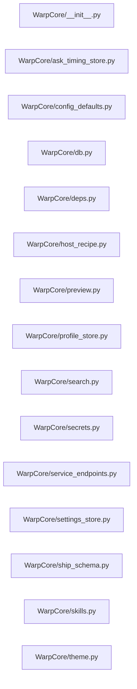

# Structure: WarpCore

**Files:** 15 · **Lines:** 3,947 · **Classes:** 7 · **Functions:** 149 · **Methods:** 2

Solid edges = module-level import/call relationships (determined statically from source; only relationships *within this package* are drawn).

title: "Warp Care Module Relationships"

## Modules

### `WarpCore/__init__.py`

*WarpCore — shared core subroutines for Spock V2 (no PyQt).

Pure logic + sqlite. Importable from the GUI, CLI, wizard, and subprocesses.*

### `WarpCore/ask_timing_store.py`

*Ask AI / Deep Dive timing history — append-only rows in ship_computer.db.

Config knobs stay in Spock_Console (app.ctx.*). This table is wiped by
content reset (see reset.CONTENT_TABLES), not preserved like Spock_Console.*

**Imports:** `from __future__ import annotations`, `import json`, `import sqlite3`, `from typing import Any`, `from typing import Dict`, `from typing import List`, `from typing import Optional`, `from db import DEFAULT_SHIPS_DB`, `from db import connect`, `from db import ensure_schema`, `from db import resolve_db_path`

**Functions**

- **`ensure_timing_schema(db_path)`** — lines 62-79
- **`insert_timing(mode, question, response_length, total_ms, retrieve_ms, pack_ms, llm_ms, n_ctx, budget, budget_used, budget_used_pct, docs_used, match_count, inventory_shown, forced_count, unresolved_count, max_out, pack_summary, provider, stage_timings, filter_info, meta, updated_by, db_path)`** — lines 98-185
  - *Insert one timing row. Best-effort — returns row id or None on failure.*
- **`list_timings(db_path, mode, limit)`** — lines 188-245
  - *Newest-first timing rows for the Maintenance grid.*
- **`count_timings(db_path)`** — lines 248-255
- **`purge_older_than_days(days, db_path)`** — lines 258-279
  - *Delete rows older than ``days``. Returns deleted count.*
- **`mode_label(mode)`** — lines 282-283

### `WarpCore/config_defaults.py`

*WarpCore: single source of truth for Spock default config + merge functions.

Absorbs DEFAULT_APP_CONFIG / DEFAULT_SCAN_CONFIG plus the merge helpers that
previously lived in model_selector_core, mcp_panel, uieg_paths, and
web_search_clients so every consumer (GUI, wizard, subprocess, CLI) shares one
definition of what a valid config looks like.

No PyQt imports.*

**Imports:** `from __future__ import annotations`, `import os`, `from pathlib import Path`, `from typing import Any`, `from typing import Dict`, `from typing import List`, `from typing import Optional`, `from WarpCore.service_endpoints import DEFAULT_CHAT_PORT`, `from WarpCore.service_endpoints import DEFAULT_CTX`, `from WarpCore.service_endpoints import DEFAULT_DOCS_PORT`, `from WarpCore.service_endpoints import DEFAULT_EMBED_PORT`, `from WarpCore.service_endpoints import DEFAULT_MCP_PORT`, `from WarpCore.service_endpoints import DEFAULT_MCP_WEBUI_PORT`, `from WarpCore.service_endpoints import DEFAULT_PORTS`, `from WarpCore.service_endpoints import DEFAULT_RAG_PORT`, `from WarpCore.service_endpoints import resolve_llama_server_path`, `from WarpCore.service_endpoints import resolve_spock_root`

**Functions**

- **`merge_embedding_profile(raw)`** — lines 52-56
- **`merge_launch_settings(raw)`** — lines 72-90
  - *Pinned Launch flags (DB: app.launch.*), clamped to what llama-server takes.*
- **`merge_mcp_settings(raw)`** — lines 106-133
- **`merge_uieg_config(raw)`** — lines 142-159
- **`merge_search_config(raw)`** — lines 163-175
- **`merge_ctx_settings(raw)`** — lines 201-229
  - *Ask / Deep Dive packing knobs (DB: app.ctx.*).*
- **`infer_type(name, value)`** — lines 360-375
  - *Best-effort Variable_Type for a namespaced key / value.*
- **`flatten_config(nested, prefix)`** — lines 378-392
  - *Flatten a nested config dict into namespaced dotted keys.*

### `WarpCore/db.py`

*WarpCore: shared pure-sqlite helpers for Spock V2.

No PyQt imports — safe for the GUI, wiki_agent daemon, extractor,
RAG API server, MCP server, and CLI maintenance scripts.*

**Imports:** `from __future__ import annotations`, `import os`, `import sqlite3`, `from pathlib import Path`, `from typing import Optional`

**Functions**

- **`resolve_db_path(path, name)`** — lines 18-22
  - *Return an absolute DB path, defaulting to <workspace>/<name>.*
- **`connect(db_path, timeout)`** — lines 25-31
  - *Open a connection with WAL + busy_timeout for multi-process safety.*
- **`ensure_schema(db_path, schema_sql)`** — lines 34-41
  - *Execute a batch of DDL (safe to call repeatedly).*
- **`table_exists(db_path, table)`** — lines 44-53
- **`row_count(db_path, table)`** — lines 56-62
- **`table_names(db_path)`** — lines 65-75

### `WarpCore/deps.py`

*Dependency tier checks: pure logic (no PyQt) — shared by the GUI and tools.

Phase A installs only `requirements-ui.txt`, so ingest and crawl features can be
reached from the menu before their packages exist. These helpers turn that into
a readable "run Phase B" message instead of an import traceback.*

**Imports:** `from __future__ import annotations`, `import importlib.util`, `from typing import Dict`, `from typing import Iterable`, `from typing import List`

**Functions**

- **`missing_modules(modules)`** — lines 36-46
  - *Distribution names for any of `modules` that cannot be imported.*
- **`missing_ingest_deps()`** — lines 49-51
  - *Packages Wiki Scan needs that Phase A does not install.*
- **`missing_crawler_deps()`** — lines 54-56
  - *Packages the UIEG crawler needs that Phase A does not install.*
- **`missing_deps_message(missing, feature)`** — lines 59-62
  - *Human-readable 'install the full tier' message for a missing-deps list.*

### `WarpCore/host_recipe.py`

*WarpCore: host recipe profiles — machine capability for Launch defaults.

Separate from session ``spock_profile`` snapshots. Create / Update only via
explicit caller actions; never silent-mutate. Content DB reset preserves this
table (see reset.PRESERVE_TABLES).*

**Imports:** `from __future__ import annotations`, `import json`, `import sqlite3`, `from datetime import datetime`, `from datetime import timezone`, `from functools import lru_cache`, `from typing import Any`, `from typing import Dict`, `from typing import List`, `from typing import Optional`, `from typing import Tuple`, `from db import DEFAULT_SHIPS_DB`, `from db import connect`, `from db as _es`, `from db import resolve_db_path`, `from spock_scanner_core import get_gpu_info`, `from spock_scanner_core import get_ram_gb`, `from config_defaults import merge_launch_settings`, `from WarpCore import settings_store`

**Functions**

- **`ensure_schema(db_path)`** — lines 46-49
- **`probe_hardware()`** — lines 52-84
  - *Snapshot host RAM + GPUs for recipe inputs.*
- **`propose_recipe(hardware)`** — lines 87-167
  - *Heuristic Launch defaults from a hardware snapshot.*
- **`create_recipe(db_path, hardware, recipe, reason, created_by)`** — lines 249-267
  - *Create version 1 (or next) only when no current recipe exists.*
- **`update_recipe(db_path, reason, hardware, recipe, created_by)`** — lines 270-289
  - *Append a new current version. ``reason`` is required.*
- **`ensure_recipe(db_path, hardware, reason, created_by)`** — lines 292-317
  - *Guarantee a current recipe exists, without ever rewriting one.*
- **`probe_hardware_cached(refresh)`** — lines 325-333
  - *Session-cached probe — cards do not appear mid-run, nvidia-smi is slow.*
- **`effective_recipe(db_path, live, reason, created_by)`** — lines 336-390
  - *The recipe to *plan* with, always measured against live hardware.*
- **`apply_drift_update(db_path, live, drift, created_by)`** — lines 393-409
  - *Persist a new recipe version for hardware that moved, with an audit line.*
- **`get_recipe_by_id(db_path, recipe_id)`** — lines 412-429
- **`get_current_recipe(db_path)`** — lines 432-447
- **`list_recipe_history(db_path, limit)`** — lines 450-469
- **`hardware_drift(current, live, ram_tol_gb, vram_tol_gb)`** — lines 472-517
  - *Human messages when probed hardware disagrees with the saved recipe inputs.*
- **`roles_share_physical_gpu(recipe)`** — lines 520-531
  - *True when Suggest Context should subtract sibling GGUF from the same card.*
- **`launch_overrides_for_role(recipe, role)`** — lines 534-574
  - *Args to merge into LlamaServerManager.launch / LaunchPanel.*
- **`pinned_launch_settings(db_path)`** — lines 577-589
  - *The user's ``app.launch.*`` pins, or defaults when the store is unreachable.*
- **`launch_plan_for_role(db_path, recipe, role)`** — lines 592-614
  - *Recipe overrides with the pinned Launch flags applied on top.*

### `WarpCore/preview.py`

*File preview: pure logic (no PyQt) — shared by the GUI and tools.*

**Imports:** `from __future__ import annotations`, `import os`, `from bs4 import BeautifulSoup`, `import pymupdf`, `from PIL import Image`

**Functions**

- **`is_image_file(path)`** — lines 11-12
- **`is_rich_file(path)`** — lines 15-16
- **`preview_file(path)`** — lines 73-85

### `WarpCore/profile_store.py`

*WarpCore: spock_profile store — the sole owner of the profile table.

Consolidated into ships_computer.db (previously shared between
spock_profile_store.py and uieg_database.py in uieg_capture.db).

Pure sqlite — safe for the GUI and any subprocess.*

**Imports:** `from __future__ import annotations`, `import json`, `import os`, `import sqlite3`, `from datetime import datetime`, `from typing import Any`, `from typing import Dict`, `from typing import List`, `from typing import Optional`, `from typing import Tuple`, `from db import connect`, `from db import table_exists`, `from db import DEFAULT_SHIPS_DB`, `from db import resolve_db_path`, `from db as _es`, `from db as _te`

**Functions**

- **`stardate()`** — lines 30-31
- **`ensure_schema(db_path)`** — lines 34-48
- **`list_profiles(db_path)`** — lines 51-61
  - *Return (id, name, stardate, created_at) newest first.*
- **`count_profiles(db_path)`** — lines 64-71
- **`get_profile(db_path, profile_id)`** — lines 74-99
  - *Return {id, name, stardate, created_at, payload} or None.*
- **`find_profile_by_name(db_path, name)`** — lines 102-120
  - *Newest row whose name matches case-insensitively, or None.*
- **`upsert_profile(db_path, name, payload, profile_stardate)`** — lines 123-160
  - *Insert or replace by name. Returns (id, replaced).*
- **`list_profile_summaries(db_path)`** — lines 163-213
  - *Newest first, with embedding GGUF + Ask AI provider from payload.*
- **`insert_profile(db_path, name, payload, profile_stardate)`** — lines 216-224
  - *Insert a row. Prefer upsert_profile so duplicate names replace.*
- **`delete_profiles(db_path, profile_ids)`** — lines 227-244
  - *Delete by id; return number of rows removed.*
- **`migrate_from_legacy(legacy_db, target_db, archive_legacy_rows)`** — lines 247-291
  - *Copy all rows from a legacy uieg_capture.db spock_profile table.*

### `WarpCore/search.py`

*Search + embeddings: pure logic, no PyQt — usable from any process.

Moved out of the monolith (Spock-to-bridge.py) so wiki_agent, RAG API, and the
GUI all share one implementation. All functions are standalone; callers pass a
db_path and get plain data back.*

**Imports:** `from __future__ import annotations`, `import json`, `import math`, `import os`, `import re`, `import sqlite3`, `import struct`, `import urllib.error`, `import urllib.request`, `from dataclasses import dataclass`, `from typing import Any`, `from typing import Dict`, `from typing import List`, `from typing import Optional`, `from typing import Tuple`, `from db as _db_connect`

**Classes**

- **`SearchResult`** — lines 31-38
  - *Search result from vector/FTS search*

**Functions**

- **`set_embeddings_url(url)`** — lines 41-44
  - *Update the module-level embeddings endpoint used by RAG search.*
- **`cosine_similarity(a, b)`** — lines 47-51
- **`deserialize_embedding(blob)`** — lines 54-58
- **`get_query_embedding(text, url)`** — lines 61-99
  - *Get embedding vector from llama-server*
- **`make_snippet(content, terms, max_chars, context_chars)`** — lines 102-165
  - *Build a snippet centered on the first matched term, clipped at line/*
- **`vector_search(db_path, query, top_k, threshold, embeddings_url, filter_clause)`** — lines 168-200
  - *Search documents by embedding similarity*
- **`extract_search_terms(query)`** — lines 218-231
  - *Pull meaningful tokens from a natural-language Ask AI question.*
- **`sanitize_fts_query(query)`** — lines 234-246
  - *Build an FTS5-safe MATCH string (hyphenated names must be quoted).*
- **`embeddings_endpoint_ok(url, timeout, light)`** — lines 249-301
  - *Return (ok, detail) for the RAG embeddings HTTP endpoint.*
- **`fts_search(db_path, query, top_k, filter_clause)`** — lines 304-333
  - *FTS5 keyword search (sanitized for natural-language questions).*
- **`like_search(db_path, query, top_k, filter_clause)`** — lines 336-375
  - *Fallback LIKE search when FTS/vector return nothing.*
- **`hybrid_search(db_path, query, top_k, embeddings_url, filter_clause)`** — lines 378-412
  - *Combine vector and FTS5 search results (LIKE fallback if both empty).*
- **`has_embeddings(db_path)`** — lines 415-425
  - *Check if the database has embedding data*

### `WarpCore/secrets.py`

*OS credential store for Spock API tokens (Windows Credential Manager, etc.).

Plaintext leftovers in Spock_Console are migrated on read, then replaced with
PLACEHOLDER. JSON export never writes secret values.*

**Imports:** `from __future__ import annotations`, `from typing import Dict`, `from typing import Optional`, `from typing import Tuple`, `import keyring`, `import keyring`

**Functions**

- **`use_memory_backend(store)`** — lines 18-21
  - *Pin secrets to a dict (tests). Pass None to restore the OS keyring.*
- **`clear_memory_backend()`** — lines 24-26
- **`put(name, value)`** — lines 66-71
  - *Store a secret. Empty value deletes. Returns False if the OS store failed.*
- **`get(name)`** — lines 74-76
- **`is_placeholder(value)`** — lines 79-80

### `WarpCore/service_endpoints.py`

*Canonical Spock service ports, URLs, and context/token budgets.

All suite consumers should resolve endpoints through this module instead of
scattering 8080/8081/8082/8090/8765/8000 literals. Precedence:

1. SPOCK_* environment overrides (and EMBEDDINGS_URL for embed URL)
2. Loaded app config (ship_computer.db / DEFAULT_APP_CONFIG keys)
3. DEFAULT_PORTS / DEFAULT_CTX below

llama.cpp's futur*

**Imports:** `from __future__ import annotations`, `import os`, `import shutil`, `from pathlib import Path`, `from typing import Any`, `from typing import Dict`, `from typing import Mapping`, `from typing import Optional`, `from typing import Tuple`, `from urllib.parse import urlparse`

**Functions**

- **`resolve_spock_root()`** — lines 23-30
  - *Suite root: SPOCK_ROOT env (must contain WarpCore/) else package parent.*
- **`clamp_port(value, default)`** — lines 60-67
- **`clamp_ctx(value, default, lo, hi)`** — lines 70-75
- **`clamp_max_tokens(value, default)`** — lines 78-79
- **`resolve_ports(cfg)`** — lines 103-141
  - *Resolved port map for embed/chat/mcp_webui/rag/mcp_http/docs.*
- **`resolve_ctx(cfg)`** — lines 144-159
  - *embed_n_ctx / chat_n_ctx / chat_max_tokens from config + defaults.*
- **`embeddings_url(cfg, host)`** — lines 162-180
- **`chat_base_url(cfg)`** — lines 183-186
- **`rag_base_url(cfg)`** — lines 189-194
- **`docs_base_url(cfg)`** — lines 197-199
- **`sync_embedding_url_port(cfg, embed_port)`** — lines 202-229
  - *Keep embedding_profile.embeddings_url host/path; update port if needed.*
- **`resolve_llama_server_path(explicit)`** — lines 232-264
  - *Return (path, note). Prefer LLAMA_SERVER_PATH, then common locations.*

### `WarpCore/settings_store.py`

*WarpCore: Spock_Console settings store in ships_computer.db.

Replaces the root-level app_config.json / scan_config.json / config.json /
wiki_agent_session.json files with a normalized key/value table. Pure sqlite —
safe for the GUI, wizard, CLI, and subprocesses (wiki_agent, extractor, RAG
API, MCP server).

Schema:
    Spock_Console(
        key_id         INTEGER PRIMARY KEY AUTOINCREMENT,
    *

**Imports:** `from __future__ import annotations`, `import json`, `import os`, `import shutil`, `from datetime import datetime`, `from datetime import timezone`, `from pathlib import Path`, `from typing import Any`, `from typing import Dict`, `from typing import Iterable`, `from typing import List`, `from typing import Optional`, `from typing import Tuple`, `from db import connect`, `from db import table_exists`, `from config_defaults import DEFAULT_APP_CONFIG`, `from config_defaults import DEFAULT_CTX_SETTINGS`, `from config_defaults import DEFAULT_SCAN_CONFIG`, `from config_defaults import flatten_config`, `from config_defaults import infer_type`, `from config_defaults import merge_ctx_settings`, `from config_defaults import merge_embedding_profile`, `from config_defaults import merge_launch_settings`, `from config_defaults import merge_mcp_settings`, `from config_defaults import merge_search_config`, `from config_defaults import merge_uieg_config`, `from db import ensure_schema`, `from ship_schema import ensure_ship_computer_schema`

**Functions**

- **`set(db_path, name, value, by)`** — lines 135-157
  - *Store one setting. Converts via infer_type unless a known type wins.*
- **`set_many(db_path, mapping, by)`** — lines 160-183
- **`get(db_path, name, default)`** — lines 186-201
- **`has(db_path, name)`** — lines 204-213
- **`delete(db_path, name)`** — lines 216-236
- **`get_all(db_path, prefix)`** — lines 239-261
  - *Return {Variable_Name: value} rows; optional namespace filter.*
- **`get_meta(db_path)`** — lines 264-277
  - *Return all rows as (Variable_Name, Variable_Type, value_repr, updated_at, updated_by).*
- **`migrate_from_json(db_path, root, archive)`** — lines 321-376
  - *One-time, idempotent import of root JSON config files into Spock_Console.*
- **`export_to_json(db_path, out_dir)`** — lines 379-432
  - *Write current store contents back to app_config.json / scan_config.json /*
- **`load_app_config(db_path)`** — lines 435-495
  - *Return the full app config dict (defaults merged), mirroring old load_config().*
- **`save_app_config(db_path, config, by)`** — lines 498-501
  - *Persist a full app config dict back into the store.*
- **`load_scan_config(db_path)`** — lines 504-513
- **`ensure_ctx_defaults_in_store(db_path, by)`** — lines 516-528
  - *Fill missing app.ctx.* keys so Maintenance Ctx filter has rows to edit.*
- **`ensure_scan_in_store(db_path, root, by)`** — lines 531-570
  - *Import scan.* into Spock_Console when missing (JSON left behind after app-only migrate).*
- **`ensure_live_overlays_in_store(db_path, root, by)`** — lines 617-743
  - *Bring leftover onboarding files into Spock_Console (fill-if-empty / missing only).*
- **`save_scan_config(db_path, cfg, by)`** — lines 746-748
- **`get_hf_token(db_path)`** — lines 751-756

### `WarpCore/ship_schema.py`

*Ensure ship_computer.db has wiki/corpus tables (documents, FTS, etc.).

First launch only creates Spock_Console via settings_store; wiki scan and
embedding_corpus need the full schema from ship_computer_schema.sql.
Safe to call repeatedly — applies only DDL for objects that are still missing.*

**Imports:** `from __future__ import annotations`, `import re`, `import sqlite3`, `from pathlib import Path`, `from db import DEFAULT_SHIPS_DB`, `from db import connect`, `from db import resolve_db_path`, `from db import table_exists`

**Functions**

- **`ensure_ship_computer_schema(db_path)`** — lines 110-125
  - *Create or repair wiki tables; return absolute db path.*

### `WarpCore/skills.py`

*Typed skill contracts for the wiki agent (methods-as-skills).

Each Skills method returns a SkillResult with structured evidence
(counts, affected paths, error summaries) instead of raw tracebacks.
Payloads arriving from agent_queue are validated against per-skill
shapes before dispatch.*

**Imports:** `from __future__ import annotations`, `import json`, `from dataclasses import dataclass`, `from dataclasses import field`, `from typing import Any`, `from typing import Dict`, `from typing import List`, `from typing import Literal`, `from typing import TypedDict`

**Classes**

- **`OnboardingPayload(TypedDict)`** — lines 21-23
- **`MaintenancePayload(TypedDict)`** — lines 26-27
- **`BackupPayload(TypedDict)`** — lines 30-31
- **`UpdateIndexPayload(TypedDict)`** — lines 34-35
- **`ReferenceReviewPayload(TypedDict)`** — lines 38-40
- **`SkillResult`** — lines 63-85
  - *Structured outcome of a skill run, persisted to logs / agent_queue.*
  - `to_dict(self)`
  - `from_json(cls, raw)`

**Functions**

- **`validate_payload(skill, payload)`** — lines 88-114
  - *Validate and normalize a payload for a named skill.*
- **`parse_payload_json(payload_json)`** — lines 117-123
  - *Safely decode agent_queue.payload_json; JSON errors become empty dict.*

### `WarpCore/theme.py`

*Color themes: single source of truth + shared stylesheet builders.

Previously the THEMES dict and apply_theme methods were duplicated across
~15 widget classes (model_selector_panels, chat_ai_helper, mcp_panel,
external_search_panel, uieg_capture_panel). This module owns the palette data
and the common QSS fragments so every panel stays in sync.

Palettes carry a three-step background ramp (``bg`*

**Imports:** `from __future__ import annotations`, `from typing import Any`, `from typing import Dict`

**Functions**

- **`relative_luminance(hex_color)`** — lines 106-112
  - *WCAG relative luminance in 0..1.*
- **`contrast_ratio(a, b)`** — lines 115-119
  - *WCAG contrast ratio between two colors (1.0 = identical, 21 = max).*
- **`readable_on(background)`** — lines 122-126
  - *Pick near-black or white for text drawn on `background`.*
- **`theme_by_name(name)`** — lines 148-150
  - *Palette lookup that never raises; unknown names fall back to dark.*
- **`main_stylesheet(theme)`** — lines 153-235
  - *QSS for the main window frame (docks, toolbar, inputs).*
- **`widget_stylesheet(theme)`** — lines 238-245
  - *QSS for a plain widget container (background + text color).*
- **`base_controls_stylesheet(theme)`** — lines 248-279
  - *QSS for editors, buttons, and labels (dialogs/panels).*
- **`dialog_stylesheet(theme)`** — lines 282-310
  - *QSS for dialogs with lists/grids + buttons.*
- **`tabs_stylesheet(theme)`** — lines 313-335
  - *QSS for tabbed panels; selected tabs stay legible on the accent fill.*
- **`apply_theme_to(widget, theme, scope)`** — lines 338-358
  - *Set a widget's stylesheet from the shared builders.*
