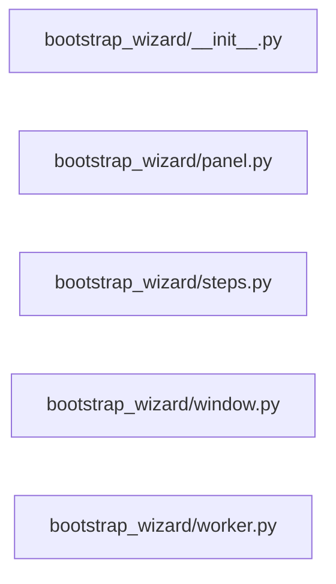

# Structure: bootstrap_wizard

**Files:** 5 · **Lines:** 886 · **Classes:** 3 · **Functions:** 1 · **Methods:** 39

Solid edges = module-level import/call relationships (determined statically from source; only relationships *within this package* are drawn).
Title: "bootstrap_wizard module relationships"

## Modules

### `bootstrap_wizard/__init__.py`

*Bootstrap Control Wizard — Phase B progress / live log / status.*

### `bootstrap_wizard/panel.py`

*Center panel: step checklist, progress bar, live log, action buttons.*

**Imports:** `from __future__ import annotations`, `import os`, `import subprocess`, `import sys`, `from pathlib import Path`, `from typing import Callable`, `from typing import Dict`, `from typing import Optional`, `from PyQt6.QtCore import Qt`, `from PyQt6.QtGui import QFont`, `from PyQt6.QtGui import QColor`, `from PyQt6.QtGui import QTextCharFormat`, `from PyQt6.QtGui import QTextCursor`, `from PyQt6.QtWidgets import QApplication`, `from PyQt6.QtWidgets import QCheckBox`, `from PyQt6.QtWidgets import QHBoxLayout`, `from PyQt6.QtWidgets import QLabel`, `from PyQt6.QtWidgets import QListWidget`, `from PyQt6.QtWidgets import QListWidgetItem`, `from PyQt6.QtWidgets import QMessageBox`, `from PyQt6.QtWidgets import QProgressBar`, `from PyQt6.QtWidgets import QPushButton`, `from PyQt6.QtWidgets import QTextEdit`, `from PyQt6.QtWidgets import QVBoxLayout`, `from PyQt6.QtWidgets import QWidget`, `from bootstrap_wizard.steps import ALL_STEPS`, `from bootstrap_wizard.steps import FULL_DEPS_MARKER`, `from bootstrap_wizard.steps import PHASE_A_STEPS`, `from bootstrap_wizard.worker import BootstrapRunner`

**Classes**

- **`BootstrapControlPanel(QWidget)`** — lines 42-626
  - *Progress + live log control surface for bootstrap.ps1.*
  - `mark_full_deps_ok(self, source)` *Record successful full requirements install (UI + marker file).*

**Functions**

### `bootstrap_wizard/steps.py`

*Named bootstrap steps shared by the control wizard UI.*

**Imports:** `from __future__ import annotations`, `from typing import List`, `from typing import Tuple`

### `bootstrap_wizard/window.py`

*Spock Bootstrap Control Wizard — Phase B suite shell.*

**Imports:** `from __future__ import annotations`, `from pathlib import Path`, `from typing import Optional`, `from typing import Sequence`, `from PyQt6.QtWidgets import QMessageBox`, `from PyQt6.QtWidgets import QVBoxLayout`, `from bootstrap_wizard.panel import BootstrapControlPanel`, `from spock_shell.brave_search import build_brave_search_panel`, `from spock_shell.markdown_home import build_markdown_home`, `from spock_shell.markdown_home import reload_markdown_home`, `from spock_shell.paths import ROOT`, `from spock_shell.paths import ensure_root_on_path`, `from spock_shell.widgets import ModernButton`, `from spock_shell.widgets import SidePanel`, `from spock_shell.window import NavItem`, `from spock_shell.window import SuiteShellWindow`

**Classes**

- **`BootstrapWizardWindow(SuiteShellWindow)`** — lines 20-98
  - `on_ready(self)`
  - `build_home_widget(self)`
  - `show_home(self)`
  - `nav_steps(self)`
  - `build_right_dock(self, layout)`
  - `open_status(self)`

### `bootstrap_wizard/worker.py`

*Run bootstrap.ps1 with -EmitEvents and stream JSONL / log lines.*

**Imports:** `from __future__ import annotations`, `import io`, `import json`, `import os`, `import subprocess`, `import sys`, `from pathlib import Path`, `from typing import List`, `from typing import Optional`, `from PyQt6.QtCore import QThread`, `from PyQt6.QtCore import pyqtSignal`

**Classes**

- **`BootstrapRunner(QThread)`** — lines 16-133
  - *Spawn powershell bootstrap.ps1; emit parsed events + raw lines.*
  - `stop(self)`
  - `run(self)`
