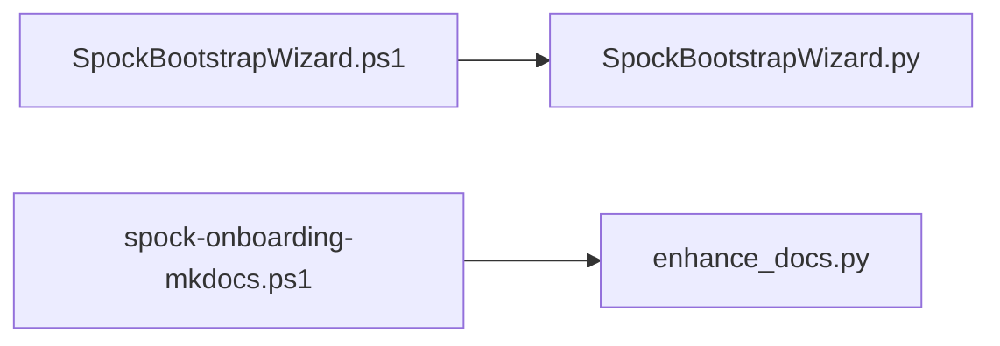

# Entry Points

Every module with a `__main__` guard, and every launcher script that invokes one of the indexed Python files.

title: "Launcher -> module"

| Module                                      | Kind           | `__main__` guard | Launchers                     |
| ------------------------------------------- | -------------- | ---------------- | ----------------------------- |
| `EngineeringDeck/__init__.py`               | package module | no               | _none found_                  |
| `EngineeringDeck/__main__.py`               | package module | yes              | _none found_                  |
| `EngineeringDeck/app.py`                    | package module | no               | _none found_                  |
| `EngineeringDeck/ask_panel.py`              | package module | no               | _none found_                  |
| `EngineeringDeck/maintenance_app.py`        | package module | no               | _none found_                  |
| `EngineeringDeck/ship_computer_health.py`   | package module | no               | _none found_                  |
| `LongRangeSensors/__init__.py`              | package module | no               | _none found_                  |
| `LongRangeSensors/app.py`                   | package module | no               | _none found_                  |
| `LongRangeSensors/external_search_panel.py` | package module | no               | _none found_                  |
| `LongRangeSensors/uieg_capture_panel.py`    | package module | no               | _none found_                  |
| `LongRangeSensors/uieg_crawler.py`          | package module | no               | _none found_                  |
| `LongRangeSensors/uieg_database.py`         | package module | no               | _none found_                  |
| `LongRangeSensors/uieg_import.py`           | package module | no               | _none found_                  |
| `LongRangeSensors/uieg_maintenance.py`      | package module | no               | _none found_                  |
| `LongRangeSensors/uieg_paths.py`            | package module | no               | _none found_                  |
| `LongRangeSensors/uieg_preview.py`          | package module | no               | _none found_                  |
| `LongRangeSensors/uieg_promote.py`          | package module | no               | _none found_                  |
| `LongRangeSensors/uieg_repo_fetch.py`       | package module | no               | _none found_                  |
| `LongRangeSensors/uieg_status.py`           | package module | no               | _none found_                  |
| `LongRangeSensors/web_search_clients.py`    | package module | no               | _none found_                  |
| `NavigationStation/__init__.py`             | package module | no               | _none found_                  |
| `NavigationStation/app.py`                  | package module | no               | _none found_                  |
| `NavigationStation/steps/__init__.py`       | package module | no               | _none found_                  |
| `NavigationStation/steps/configure.py`      | package module | no               | _none found_                  |
| `NavigationStation/steps/hardware.py`       | package module | no               | _none found_                  |
| `NavigationStation/steps/launch.py`         | package module | no               | _none found_                  |
| `NavigationStation/steps/status.py`         | package module | no               | _none found_                  |
| `Orchestrator/__init__.py`                  | package module | no               | _none found_                  |
| `Orchestrator/app.py`                       | package module | no               | _none found_                  |
| `ScienceStation/__init__.py`                | package module | no               | _none found_                  |
| `ScienceStation/app.py`                     | package module | no               | _none found_                  |
| `ScienceStation/ships_logs.py`              | package module | no               | _none found_                  |
| `ScienceStation/wiki_run.py`                | package module | no               | _none found_                  |
| `Spock-UIE-Wiki-KB.py`                      | root script    | yes              | _none found_                  |
| `SpockBootstrapWizard.py`                   | root script    | yes              | `SpockBootstrapWizard.ps1`    |
| `WarpCore/__init__.py`                      | package module | no               | _none found_                  |
| `WarpCore/ask_timing_store.py`              | package module | no               | _none found_                  |
| `WarpCore/config_defaults.py`               | package module | no               | _none found_                  |
| `WarpCore/db.py`                            | package module | no               | _none found_                  |
| `WarpCore/deps.py`                          | package module | no               | _none found_                  |
| `WarpCore/host_recipe.py`                   | package module | no               | _none found_                  |
| `WarpCore/preview.py`                       | package module | no               | _none found_                  |
| `WarpCore/profile_store.py`                 | package module | no               | _none found_                  |
| `WarpCore/search.py`                        | package module | no               | _none found_                  |
| `WarpCore/secrets.py`                       | package module | no               | _none found_                  |
| `WarpCore/service_endpoints.py`             | package module | no               | _none found_                  |
| `WarpCore/settings_store.py`                | package module | no               | _none found_                  |
| `WarpCore/ship_schema.py`                   | package module | no               | _none found_                  |
| `WarpCore/skills.py`                        | package module | no               | _none found_                  |
| `WarpCore/theme.py`                         | package module | no               | _none found_                  |
| `_start_rag_api.py`                         | root script    | yes              | _none found_                  |
| `bootstrap_wizard/__init__.py`              | package module | no               | _none found_                  |
| `bootstrap_wizard/panel.py`                 | package module | no               | _none found_                  |
| `bootstrap_wizard/steps.py`                 | package module | no               | _none found_                  |
| `bootstrap_wizard/window.py`                | package module | no               | _none found_                  |
| `bootstrap_wizard/worker.py`                | package module | no               | _none found_                  |
| `chat_ai_helper.py`                         | root script    | no               | _none found_                  |
| `db_browser.py`                             | root script    | no               | _none found_                  |
| `db_maintenance.py`                         | root script    | yes              | _none found_                  |
| `deep_dive.py`                              | root script    | no               | _none found_                  |
| `docs_server.py`                            | root script    | yes              | _none found_                  |
| `enhance_docs.py`                           | root script    | yes              | `spock-onboarding-mkdocs.ps1` |
| `gemini_openai_models.py`                   | root script    | no               | _none found_                  |
| `helper_main.py`                            | root script    | yes              | _none found_                  |
| `llama_server_manager.py`                   | root script    | no               | _none found_                  |
| `llm_client.py`                             | root script    | no               | _none found_                  |
| `lm_studio_api.py`                          | root script    | no               | _none found_                  |
| `main.py`                                   | root script    | yes              | _none found_                  |
| `mcp_panel.py`                              | root script    | no               | _none found_                  |
| `model_pick_policy.py`                      | root script    | no               | _none found_                  |
| `model_selector/__init__.py`                | package module | no               | _none found_                  |
| `model_selector/embedding_panel.py`         | package module | no               | _none found_                  |
| `model_selector/hardware_panel.py`          | package module | no               | _none found_                  |
| `model_selector/launch_panel.py`            | package module | no               | _none found_                  |
| `model_selector/model_card.py`              | package module | no               | _none found_                  |
| `model_selector/models_panel.py`            | package module | no               | _none found_                  |
| `model_selector/state.py`                   | package module | no               | _none found_                  |
| `model_selector/status_window.py`           | package module | no               | _none found_                  |
| `model_selector/widgets.py`                 | package module | no               | _none found_                  |
| `model_selector/workers.py`                 | package module | no               | _none found_                  |
| `model_selector_core.py`                    | root script    | no               | _none found_                  |
| `model_selector_panels.py`                  | root script    | no               | _none found_                  |
| `rag_api_server.py`                         | root script    | no               | _none found_                  |
| `reset.py`                                  | root script    | yes              | _none found_                  |
| `reset_ship_computer.py`                    | root script    | no               | _none found_                  |
| `reset_uieg.py`                             | root script    | no               | _none found_                  |
| `spock_UIEG_KnowledgeBase.py`               | root script    | yes              | _none found_                  |
| `spock_bringup/__init__.py`                 | package module | no               | _none found_                  |
| `spock_bringup/__main__.py`                 | package module | yes              | _none found_                  |
| `spock_bringup_menu/__init__.py`            | package module | no               | _none found_                  |
| `spock_bringup_menu/__main__.py`            | package module | yes              | _none found_                  |
| `spock_bringup_menu/acquire_dialog.py`      | package module | no               | _none found_                  |
| `spock_bringup_menu/app.py`                 | package module | no               | _none found_                  |
| `spock_bringup_menu/center_log.py`          | package module | no               | _none found_                  |
| `spock_bringup_menu/steps.py`               | package module | no               | _none found_                  |
| `spock_health_report.py`                    | root script    | no               | _none found_                  |
| `spock_live_monitor.py`                     | root script    | yes              | _none found_                  |
| `spock_live_monitor/__init__.py`            | package module | no               | _none found_                  |
| `spock_live_monitor/__main__.py`            | package module | yes              | _none found_                  |
| `spock_maintenance.py`                      | root script    | yes              | _none found_                  |
| `spock_mcp_adapter/__init__.py`             | package module | no               | _none found_                  |
| `spock_mcp_adapter/__main__.py`             | package module | yes              | _none found_                  |
| `spock_mcp_adapter/mcp_host.py`             | package module | no               | _none found_                  |
| `spock_mcp_adapter/mcp_panel.py`            | package module | no               | _none found_                  |
| `spock_mcp_adapter/paths.py`                | package module | no               | _none found_                  |
| `spock_mcp_adapter/proc_guard.py`           | package module | no               | _none found_                  |
| `spock_navigation.py`                       | root script    | yes              | _none found_                  |
| `spock_onboarding/__init__.py`              | package module | no               | _none found_                  |
| `spock_onboarding/fit_select.py`            | package module | no               | _none found_                  |
| `spock_onboarding/health.py`                | package module | no               | _none found_                  |
| `spock_onboarding/live_snapshot.py`         | package module | no               | _none found_                  |
| `spock_onboarding/llama_process.py`         | package module | no               | _none found_                  |
| `spock_onboarding/llmfit_bridge.py`         | package module | no               | _none found_                  |
| `spock_onboarding/pick.py`                  | package module | no               | _none found_                  |
| `spock_onboarding/readiness.py`             | package module | no               | _none found_                  |
| `spock_onboarding/runtime.py`               | package module | no               | _none found_                  |
| `spock_onboarding/spock_status.py`          | package module | no               | _none found_                  |
| `spock_onboarding/state.py`                 | package module | no               | _none found_                  |
| `spock_probe/__init__.py`                   | package module | no               | _none found_                  |
| `spock_probe/__main__.py`                   | package module | yes              | _none found_                  |
| `spock_profile_store.py`                    | root script    | no               | _none found_                  |
| `spock_progress_log/__init__.py`            | package module | no               | _none found_                  |
| `spock_progress_log/__main__.py`            | package module | yes              | _none found_                  |
| `spock_progress_log/panel.py`               | package module | no               | _none found_                  |
| `spock_rag_adapter/__init__.py`             | package module | no               | _none found_                  |
| `spock_rag_adapter/__main__.py`             | package module | yes              | _none found_                  |
| `spock_rag_adapter/bridge_host.py`          | package module | no               | _none found_                  |
| `spock_rag_adapter/embedding_corpus.py`     | package module | no               | _none found_                  |
| `spock_rag_adapter/embedding_panel.py`      | package module | no               | _none found_                  |
| `spock_rag_adapter/embedding_utils.py`      | package module | no               | _none found_                  |
| `spock_rag_adapter/paths.py`                | package module | no               | _none found_                  |
| `spock_rag_adapter/rag_host.py`             | package module | no               | _none found_                  |
| `spock_rag_adapter/reembed.py`              | package module | yes              | _none found_                  |
| `spock_scanner_core.py`                     | root script    | no               | _none found_                  |
| `spock_shell/__init__.py`                   | package module | no               | _none found_                  |
| `spock_shell/__main__.py`                   | package module | yes              | _none found_                  |
| `spock_shell/about.py`                      | package module | no               | _none found_                  |
| `spock_shell/ai_helper.py`                  | package module | no               | _none found_                  |
| `spock_shell/ask_path_handoff.py`           | package module | no               | _none found_                  |
| `spock_shell/brave_search.py`               | package module | no               | _none found_                  |
| `spock_shell/bridge_host.py`                | package module | no               | _none found_                  |
| `spock_shell/busy_ui.py`                    | package module | no               | _none found_                  |
| `spock_shell/config.py`                     | package module | no               | _none found_                  |
| `spock_shell/configure_ai.py`               | package module | no               | _none found_                  |
| `spock_shell/embedding_corpus.py`           | package module | no               | _none found_                  |
| `spock_shell/good_results_coach.py`         | package module | no               | _none found_                  |
| `spock_shell/llmfit_bridge.py`              | package module | no               | _none found_                  |
| `spock_shell/markdown_home.py`              | package module | no               | _none found_                  |
| `spock_shell/mcp_host.py`                   | package module | no               | _none found_                  |
| `spock_shell/mcp_tunnel.py`                 | package module | no               | _none found_                  |
| `spock_shell/paths.py`                      | package module | no               | _none found_                  |
| `spock_shell/proc_guard.py`                 | package module | no               | _none found_                  |
| `spock_shell/process_tree.py`               | package module | no               | _none found_                  |
| `spock_shell/profiles.py`                   | package module | no               | _none found_                  |
| `spock_shell/qt_app.py`                     | package module | no               | _none found_                  |
| `spock_shell/rag_host.py`                   | package module | no               | _none found_                  |
| `spock_shell/status_panel.py`               | package module | no               | _none found_                  |
| `spock_shell/theme.py`                      | package module | no               | _none found_                  |
| `spock_shell/widgets.py`                    | package module | no               | _none found_                  |
| `spock_shell/win_job.py`                    | package module | no               | _none found_                  |
| `spock_shell/window.py`                     | package module | no               | _none found_                  |
| `spock_status/__init__.py`                  | package module | no               | _none found_                  |
| `spock_status/__main__.py`                  | package module | yes              | _none found_                  |
| `spock_uieg.py`                             | root script    | yes              | _none found_                  |
| `spock_wiki_adapter/__init__.py`            | package module | no               | _none found_                  |
| `spock_wiki_adapter/__main__.py`            | package module | yes              | _none found_                  |
| `spock_wiki_adapter/paths.py`               | package module | no               | _none found_                  |
| `spock_wiki_adapter/scan_roots.py`          | package module | no               | _none found_                  |
| `spock_wiki_adapter/wiki_run.py`            | package module | no               | _none found_                  |
| `starfleet_universal_extractor.py`          | root script    | yes              | _none found_                  |
| `wiki_agent.py`                             | root script    | yes              | _none found_                  |
| `wiki_agent_status.py`                      | root script    | yes              | _none found_                  |
| `wiki_maintenance.py`                       | root script    | no               | _none found_                  |
