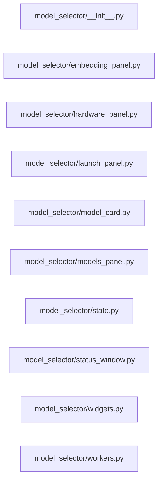

# Structure: model_selector

**Files:** 10 · **Lines:** 4,231 · **Classes:** 13 · **Functions:** 8 · **Methods:** 158

Solid edges = module-level import/call relationships (determined statically from source; only relationships *within this package* are drawn).

title: model_selector module relationships

## Modules

### `model_selector/__init__.py`

*Model selector UI package (split from model_selector_panels.py).*

**Imports:** `from __future__ import annotations`, `from embedding_panel import EmbeddingProfilePanel`, `from hardware_panel import HardwareScanPanel`, `from launch_panel import LaunchPanel`, `from model_card import ModelInfoPanel`, `from model_card import model_card_to_html`, `from models_panel import ModelsPanel`, `from state import ModelSelectorState`, `from status_window import LlmStatusWindow`, `from widgets import _SortableTableItem`, `from widgets import _action_btn`, `from widgets import _panel_stylesheet`, `from workers import DownloadWorker`, `from workers import HardwareScanWorker`, `from workers import HfQueryWorker`, `from workers import LlamaConfigWorker`, `from workers import ModelCardWorker`

### `model_selector/embedding_panel.py`

*Embedding profile + RAG API panel.*

**Imports:** `from __future__ import annotations`, `import os`, `import time`, `from typing import Any`, `from typing import Dict`, `from typing import Optional`, `from PyQt6.QtCore import QUrl`, `from PyQt6.QtCore import pyqtSignal`, `from PyQt6.QtGui import QDesktopServices`, `from PyQt6.QtGui import QFont`, `from PyQt6.QtWidgets import QApplication`, `from PyQt6.QtWidgets import QCheckBox`, `from PyQt6.QtWidgets import QGridLayout`, `from PyQt6.QtWidgets import QGroupBox`, `from PyQt6.QtWidgets import QHBoxLayout`, `from PyQt6.QtWidgets import QLabel`, `from PyQt6.QtWidgets import QLineEdit`, `from PyQt6.QtWidgets import QMessageBox`, `from PyQt6.QtWidgets import QPushButton`, `from PyQt6.QtWidgets import QSpinBox`, `from PyQt6.QtWidgets import QTextEdit`, `from PyQt6.QtWidgets import QVBoxLayout`, `from PyQt6.QtWidgets import QWidget`, `from model_selector_core import acquire_embedding_result`, `from model_selector_core import merge_embedding_profile`, `from model_selector_core import probe_embeddings_dim`, `from model_selector_core import sample_db_embedding_dim`, `from model_selector_core import sync_acquire_n_ctx_to_recipe`, `from model_selector_core import write_embedding_env`, `from widgets import _action_btn`, `from widgets import _panel_stylesheet`, `import urllib.request`

**Classes**

- **`EmbeddingProfilePanel(QWidget)`** — lines 39-480
  - *Tune ingest/RAG embeddings + llama-server -b/-ub; start external RAG API.*
  - `refresh_from_acquire(self, adopt, fill)` *Show (and by default pre-fill) the embedding GGUF from step 3 Acquire.*
  - `collect_rag_api(self)`
  - `set_rag_running(self, running, url)`
  - `apply_theme(self)`

### `model_selector/hardware_panel.py`

*Hardware scan panel (Spock-Scanner tabs).*

**Imports:** `from __future__ import annotations`, `from datetime import datetime`, `from typing import Any`, `from typing import Dict`, `from typing import Optional`, `from PyQt6.QtCore import pyqtSignal`, `from PyQt6.QtGui import QFont`, `from PyQt6.QtWidgets import QHBoxLayout`, `from PyQt6.QtWidgets import QLabel`, `from PyQt6.QtWidgets import QMessageBox`, `from PyQt6.QtWidgets import QPushButton`, `from PyQt6.QtWidgets import QTabWidget`, `from PyQt6.QtWidgets import QTextEdit`, `from PyQt6.QtWidgets import QVBoxLayout`, `from PyQt6.QtWidgets import QWidget`, `from model_selector_core import format_hardware_report`, `from spock_scanner_core import ABOUT_TEXT`, `from spock_scanner_core import load_model_guide`, `from state import ModelSelectorState`, `from widgets import _action_btn`, `from widgets import _panel_stylesheet`, `from workers import HardwareScanWorker`, `from workers import LlamaConfigWorker`

**Classes**

- **`HardwareScanPanel(QWidget)`** — lines 29-220
  - *Spock-Scanner assessment UI in the middle pane.*
  - `apply_theme(self)`

### `model_selector/launch_panel.py`

*Local GGUF Launch panel.*

**Imports:** `from __future__ import annotations`, `import os`, `from typing import Any`, `from typing import Dict`, `from typing import List`, `from typing import Optional`, `from PyQt6.QtCore import Qt`, `from PyQt6.QtCore import pyqtSignal`, `from PyQt6.QtGui import QFont`, `from PyQt6.QtWidgets import QCheckBox`, `from PyQt6.QtWidgets import QComboBox`, `from PyQt6.QtWidgets import QHBoxLayout`, `from PyQt6.QtWidgets import QHeaderView`, `from PyQt6.QtWidgets import QLabel`, `from PyQt6.QtWidgets import QLineEdit`, `from PyQt6.QtWidgets import QMessageBox`, `from PyQt6.QtWidgets import QPushButton`, `from PyQt6.QtWidgets import QSpinBox`, `from PyQt6.QtWidgets import QSplitter`, `from PyQt6.QtWidgets import QTableWidget`, `from PyQt6.QtWidgets import QTableWidgetItem`, `from PyQt6.QtWidgets import QTextEdit`, `from PyQt6.QtWidgets import QVBoxLayout`, `from PyQt6.QtWidgets import QWidget`, `from llama_server_manager import LlamaServerManager`, `from model_selector_core import format_hardware_report`, `from model_selector_core import get_llamaccp_dir`, `from model_selector_core import get_model_directory_options`, `from model_selector_core import gpu_combo_labels`, `from model_selector_core import is_embedding_gguf_path`, `from model_selector_core import merge_embedding_profile`, `from model_selector_core import scan_gguf_models_from_directory`, `from spock_scanner_core import recommend_n_ctx`, `from state import ModelSelectorState`, `from widgets import _SortableTableItem`, `from widgets import _action_btn`, `from widgets import _panel_stylesheet`, `from workers import HardwareScanWorker`, `import re`, `from WarpCore.service_endpoints import DEFAULT_EMBED_PORT`, `from spock_shell.paths import SHIP_COMPUTER_DB`, `from WarpCore.host_recipe import effective_recipe`, `from WarpCore.host_recipe import get_current_recipe`, `from spock_shell.paths import SHIP_COMPUTER_DB`, `from WarpCore.host_recipe import pinned_launch_settings`, `from spock_shell.paths import SHIP_COMPUTER_DB`, `from WarpCore import settings_store`, `from spock_shell.paths import SHIP_COMPUTER_DB`, `from WarpCore as hr`, `from spock_shell.paths import SHIP_COMPUTER_DB`, `from WarpCore.host_recipe import launch_plan_for_role`, `from WarpCore.host_recipe import roles_share_physical_gpu`, `from WarpCore.host_recipe import launch_overrides_for_role`, `from spock_shell.good_results_coach import tip_launch_fit`

**Classes**

- **`LaunchPanel(QWidget)`** — lines 45-1097
  - `use_as_embedding_server(self)`
  - `clear_embedding_server_flag(self)` *Uncheck after Launch has applied Embedding Profile once.*
  - `set_embedding_profile(self, profile)`
  - `reload_host_recipe(self)` *Re-read the host recipe into the Launch controls (e.g. after Acquire).*
  - `prepare_shutdown(self)` *Disconnect from manager signals so late log lines don't hit deleted widgets.*
  - `apply_theme(self)`

### `model_selector/model_card.py`

*Model card HTML helpers and ModelInfoPanel.*

**Imports:** `from __future__ import annotations`, `import re`, `from typing import Optional`, `from PyQt6.QtCore import Qt`, `from PyQt6.QtCore import QUrl`, `from PyQt6.QtGui import QDesktopServices`, `from PyQt6.QtGui import QFont`, `from PyQt6.QtWidgets import QHBoxLayout`, `from PyQt6.QtWidgets import QLabel`, `from PyQt6.QtWidgets import QPushButton`, `from PyQt6.QtWidgets import QStackedWidget`, `from PyQt6.QtWidgets import QTextEdit`, `from PyQt6.QtWidgets import QVBoxLayout`, `from PyQt6.QtWidgets import QWidget`, `from state import ModelSelectorState`, `from widgets import _action_btn`, `from widgets import _panel_stylesheet`, `from workers import ModelCardWorker`, `from PyQt6.QtWebEngineWidgets import QWebEngineView`, `import markdown as md`

**Classes**

- **`ModelInfoPanel(QWidget)`** — lines 183-284
  - `load_model(self, model_id)`
  - `apply_theme(self)`

**Functions**

- **`model_card_to_html(text, theme)`** — lines 105-177
  - *Wrap HF README (HTML fragments and/or markdown) for QWebEngineView.*

### `model_selector/models_panel.py`

*HF Hub models panel (query / filter / download / Gemini).*

**Imports:** `from __future__ import annotations`, `from typing import Any`, `from typing import Dict`, `from typing import List`, `from typing import Optional`, `from PyQt6.QtCore import Qt`, `from PyQt6.QtCore import QUrl`, `from PyQt6.QtCore import pyqtSignal`, `from PyQt6.QtGui import QDesktopServices`, `from PyQt6.QtGui import QFont`, `from PyQt6.QtWidgets import QApplication`, `from PyQt6.QtWidgets import QCheckBox`, `from PyQt6.QtWidgets import QComboBox`, `from PyQt6.QtWidgets import QFileDialog`, `from PyQt6.QtWidgets import QHBoxLayout`, `from PyQt6.QtWidgets import QHeaderView`, `from PyQt6.QtWidgets import QLabel`, `from PyQt6.QtWidgets import QLineEdit`, `from PyQt6.QtWidgets import QMessageBox`, `from PyQt6.QtWidgets import QProgressBar`, `from PyQt6.QtWidgets import QPushButton`, `from PyQt6.QtWidgets import QTabWidget`, `from PyQt6.QtWidgets import QTableWidget`, `from PyQt6.QtWidgets import QTableWidgetItem`, `from PyQt6.QtWidgets import QTextEdit`, `from PyQt6.QtWidgets import QVBoxLayout`, `from PyQt6.QtWidgets import QWidget`, `from gemini_openai_models import list_models_for_ui`, `from gemini_openai_models import probe_model_chat`, `from model_selector_core import PDF_AVAILABLE`, `from model_selector_core import _estimate_gguf_size_gb`, `from model_selector_core import export_report_pdf`, `from state import ModelSelectorState`, `from widgets import _SortableTableItem`, `from widgets import _action_btn`, `from widgets import _panel_stylesheet`, `from workers import DownloadWorker`, `from workers import HfQueryWorker`, `from workers import ModelCardWorker`

**Classes**

- **`ModelsPanel(QWidget)`** — lines 41-765
  - `set_openai_compat(self, cfg)`
  - `apply_theme(self)`

### `model_selector/state.py`

*Shared ModelSelectorState for Navigation / Science stations.*

**Imports:** `from __future__ import annotations`, `from dataclasses import dataclass`, `from dataclasses import field`, `from typing import Any`, `from typing import Dict`, `from typing import List`

**Classes**

- **`ModelSelectorState`** — lines 10-27

### `model_selector/status_window.py`

*LLM / Ship Status window (suite Tools → Ship Status).*

**Imports:** `from __future__ import annotations`, `import os`, `import subprocess`, `import sys`, `from typing import Any`, `from typing import Dict`, `from typing import List`, `from typing import Optional`, `from PyQt6.QtCore import Qt`, `from PyQt6.QtCore import QTimer`, `from PyQt6.QtCore import QUrl`, `from PyQt6.QtGui import QDesktopServices`, `from PyQt6.QtGui import QFont`, `from PyQt6.QtWidgets import QApplication`, `from PyQt6.QtWidgets import QComboBox`, `from PyQt6.QtWidgets import QDialog`, `from PyQt6.QtWidgets import QFrame`, `from PyQt6.QtWidgets import QGridLayout`, `from PyQt6.QtWidgets import QGroupBox`, `from PyQt6.QtWidgets import QHBoxLayout`, `from PyQt6.QtWidgets import QHeaderView`, `from PyQt6.QtWidgets import QLabel`, `from PyQt6.QtWidgets import QListWidget`, `from PyQt6.QtWidgets import QListWidgetItem`, `from PyQt6.QtWidgets import QMessageBox`, `from PyQt6.QtWidgets import QPushButton`, `from PyQt6.QtWidgets import QSpinBox`, `from PyQt6.QtWidgets import QSplitter`, `from PyQt6.QtWidgets import QTabWidget`, `from PyQt6.QtWidgets import QTableWidget`, `from PyQt6.QtWidgets import QTableWidgetItem`, `from PyQt6.QtWidgets import QTextEdit`, `from PyQt6.QtWidgets import QVBoxLayout`, `from PyQt6.QtWidgets import QWidget`, `from llama_server_manager import LlamaServerManager`, `from lm_studio_api import find_catalog_key_for_path`, `from lm_studio_api as lm_list_models`, `from lm_studio_api as lm_load_model`, `from lm_studio_api as lm_loaded_context_length`, `from lm_studio_api as lm_loaded_models`, `from lm_studio_api as lm_models_match`, `from lm_studio_api as lm_snapshot`, `from lm_studio_api as lm_unload_model`, `from model_selector_core import SCRIPT_DIR`, `from model_selector_core import get_llamaccp_dir`, `from model_selector_core import is_embedding_gguf_path`, `from spock_scanner_core import get_live_monitor_snapshot`, `from widgets import _action_btn`, `from widgets import _panel_stylesheet`, `from spock_shell.busy_ui import clear_override_cursors`, `from spock_health_report import format_spock_health_report`, `from spock_health_report import probe_spock_health`, `from spock_shell.busy_ui import clear_override_cursors`

**Classes**

- **`LlmStatusWindow(QWidget)`** — lines 53-1115
  - *Non-modal Status: Live Monitor / LM Studio tabs + llama-server instances.*
  - `set_standby(self)`
  - `refresh_from_manager(self)` *Populate instance table from manager + discovered processes.*
  - `stop_monitor(self)`
  - `apply_theme(self)`
  - `closeEvent(self, event)`

### `model_selector/widgets.py`

*Shared chrome helpers for model selector panels.*

**Imports:** `from __future__ import annotations`, `from PyQt6.QtCore import Qt`, `from PyQt6.QtWidgets import QPushButton`, `from PyQt6.QtWidgets import QTableWidgetItem`

**Classes**

- **`_SortableTableItem(QTableWidgetItem)`** — lines 36-49
  - *QTableWidgetItem that sorts by UserRole when set (numbers), else casefold text.*

**Functions**

### `model_selector/workers.py`

*Background QThreads for model selector panels.*

**Imports:** `from __future__ import annotations`, `from typing import List`, `from PyQt6.QtCore import QThread`, `from PyQt6.QtCore import pyqtSignal`, `from model_selector_core import download_models`, `from model_selector_core import fetch_model_card`, `from model_selector_core import query_hf_embedding_models`, `from model_selector_core import query_hf_models`, `from spock_scanner_core import generate_llamaccp_config`, `from spock_scanner_core import run_full_hardware_assessment`

**Classes**

- **`HardwareScanWorker(QThread)`** — lines 18-26
  - `run(self)`
- **`LlamaConfigWorker(QThread)`** — lines 29-37
  - `run(self)`
- **`HfQueryWorker(QThread)`** — lines 40-57
  - `run(self)`
- **`DownloadWorker(QThread)`** — lines 60-95
  - `run(self)`
- **`ModelCardWorker(QThread)`** — lines 98-106
  - `run(self)`
