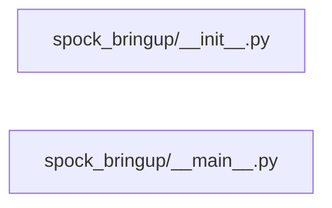

# Structure: spock_bringup

**Files:** 2 · **Lines:** 642 · **Classes:** 0 · **Functions:** 12 · **Methods:** 0

Solid edges = module-level import/call relationships (determined statically from source; only relationships *within this package* are drawn).

title: "spock_bringup module relationships"

## Modules

### `spock_bringup/__init__.py`

*Headless acquire / up / down / status orchestration.*

**Imports:** `from __future__ import annotations`, `import json`, `from pathlib import Path`, `from typing import Any`, `from typing import Callable`, `from typing import Dict`, `from typing import List`, `from typing import Optional`, `from typing import Tuple`, `from spock_onboarding import llmfit_bridge`, `from spock_onboarding.health import format_llama_line`, `from spock_onboarding.health import probe_embed_chat`, `from spock_onboarding.health import probe_llama_server`, `from spock_onboarding.llama_process import DEFAULT_CHAT_PORT`, `from spock_onboarding.llama_process import DEFAULT_EMBED_PORT`, `from spock_onboarding.llama_process import LlamaProcessManager`, `from spock_onboarding.llama_process import wait_until_healthy`, `from spock_onboarding.pick import download_pair`, `from spock_onboarding.pick import pick_from_recipe`, `from spock_onboarding.pick import pick_from_selection`, `from spock_onboarding.pick import pick_model_pair`, `from spock_onboarding.pick import resolve_hf_token`, `from spock_onboarding.readiness import check_ui_ready`, `from spock_onboarding.readiness import collect_next_ui_prompts`, `from spock_onboarding.readiness import format_status_text`, `from spock_onboarding.readiness import full_deps_marker`, `from spock_onboarding.readiness import write_readiness`, `from spock_onboarding.runtime import ensure_llama_server`, `from spock_onboarding.state import FirstModelsState`, `from spock_rag_adapter.reembed import clear_embeddings`, `from spock_rag_adapter.reembed import embedding_status`, `from spock_rag_adapter.reembed import format_clear_result`, `from spock_rag_adapter.reembed import format_status`, `from spock_shell.paths import SHIP_COMPUTER_DB`, `from WarpCore.host_recipe import pinned_launch_settings`, `from spock_shell.paths import SHIP_COMPUTER_DB`, `from WarpCore.host_recipe import effective_recipe`, `from WarpCore.host_recipe import launch_plan_for_role`

**Functions**

- **`load_summary(root)`** — lines 75-76
- **`cmd_acquire(root, hf_token, download_llama, download_models, embed_repo, chat_repo, embed_quant, chat_quant, embed_n_ctx, chat_n_ctx, cb)`** — lines 79-187
  - *Ensure llama-server + GGUFs; write first_models_last.json.*
- **`cmd_up(root, embed_port, chat_port, wait_s, cb)`** — lines 208-357
- **`cmd_reembed(root, clear_only, assume_yes, embeddings_url, cb)`** — lines 360-416
  - *Clear document embeddings (keep docs) and print next steps / live status.*
- **`cmd_down(root, owned_only, cb)`** — lines 419-437
- **`cmd_status(root, embed_port, chat_port, cb)`** — lines 440-489

### `spock_bringup/__main__.py`

*CLI: python -m spock_bringup acquire\|up\|down\|status\|reembed*

> Contains a `__main__` guard (run directly).

**Imports:** `from __future__ import annotations`, `import argparse`, `import json`, `import sys`, `from pathlib import Path`, `from spock_bringup import cmd_acquire`, `from spock_bringup import cmd_down`, `from spock_bringup import cmd_reembed`, `from spock_bringup import cmd_status`, `from spock_bringup import cmd_up`, `from spock_onboarding.llama_process import DEFAULT_CHAT_PORT`, `from spock_onboarding.llama_process import DEFAULT_EMBED_PORT`

**Functions**

- **`main(argv)`** — lines 14-149
