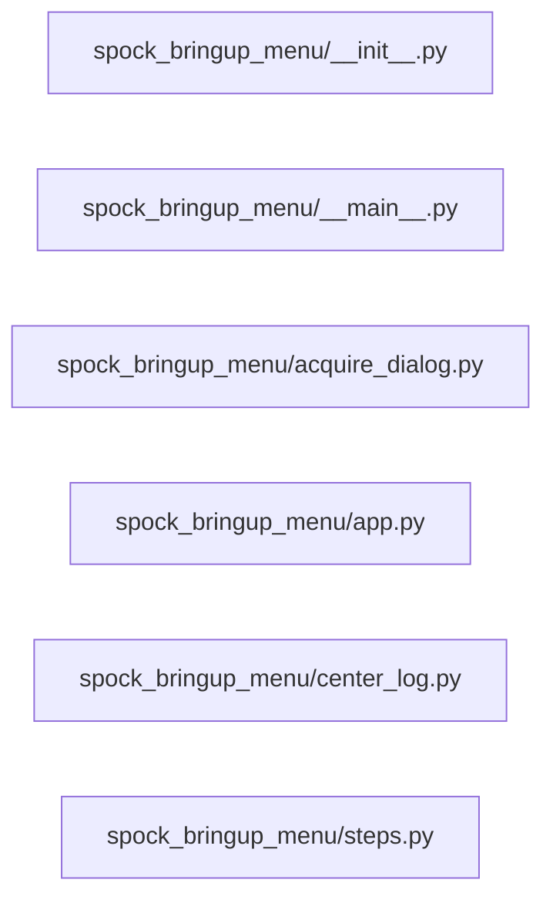

# Structure: spock_bringup_menu

**Files:** 6 · **Lines:** 1,189 · **Classes:** 5 · **Functions:** 8 · **Methods:** 44

Solid edges = module-level import/call relationships (determined statically from source; only relationships *within this package* are drawn).

title: "spock_bringup_menu module relationships"

## Modules

### `spock_bringup_menu/__init__.py`

*Spock Bringup Menu — PyQt6 lite onboarding console.*

**Imports:** `from spock_bringup_menu.app import BringupMenuWindow`

### `spock_bringup_menu/__main__.py`

*Entry: Spock Bringup Menu (lite onboarding GUI).*

> Contains a `__main__` guard (run directly).

**Imports:** `from __future__ import annotations`, `import os`, `import sys`, `import _warpcore_path`, `from spock_bringup_menu.app import BringupMenuWindow`, `from spock_shell.qt_app import create_app`

**Functions**

- **`main()`** — lines 17-25

### `spock_bringup_menu/acquire_dialog.py`

*Step 3 Acquire — pick the embed and chat GGUFs that fit this host.

The shortlists come from the host recipe (the same artefact Launch reads), so
what is offered here is what the machine can actually run: three best-fitting
models per role, labelled with llmfit's vocabulary — perfect, good, tight.*

**Imports:** `from __future__ import annotations`, `from typing import Any`, `from typing import Dict`, `from typing import List`, `from typing import Optional`, `from PyQt6.QtCore import QThread`, `from PyQt6.QtCore import pyqtSignal`, `from PyQt6.QtGui import QFont`, `from PyQt6.QtWidgets import QCheckBox`, `from PyQt6.QtWidgets import QDialog`, `from PyQt6.QtWidgets import QDialogButtonBox`, `from PyQt6.QtWidgets import QGroupBox`, `from PyQt6.QtWidgets import QLabel`, `from PyQt6.QtWidgets import QRadioButton`, `from PyQt6.QtWidgets import QVBoxLayout`, `from spock_onboarding.fit_select import shortlists`, `from WarpCore as hr`, `from WarpCore as hr`

**Classes**

- **`_ShortlistWorker(QThread)`** — lines 31-61
  - *Hub queries take ~20 s; keep the dialog responsive.*
  - `run(self)`
- **`AcquireSelectDialog(QDialog)`** — lines 64-298
  - *Two radio groups — one model per role — over the recipe's fit budget.*
  - `accept(self)`
  - `cli_args(self)` *Selections as ``spock_bringup acquire`` flags.*

### `spock_bringup_menu/app.py`

*Spock Bringup Menu — novice-friendly SuiteShell for onboarding steps 1–16.*

**Imports:** `from __future__ import annotations`, `import json`, `import os`, `import subprocess`, `from datetime import datetime`, `from pathlib import Path`, `from typing import Any`, `from typing import Dict`, `from typing import List`, `from typing import Optional`, `from typing import Sequence`, `from PyQt6.QtCore import QTimer`, `from PyQt6.QtWidgets import QMessageBox`, `from PyQt6.QtWidgets import QVBoxLayout`, `from PyQt6.QtWidgets import QWidget`, `from spock_bringup_menu.center_log import BringupCenterPanel`, `from spock_bringup_menu.steps import STEPS`, `from spock_bringup_menu.steps import build_cli_command`, `from spock_bringup_menu.steps import build_spawn_command`, `from spock_bringup_menu.steps import step_by_id`, `from spock_shell.config import save_config`, `from spock_shell.paths import ROOT`, `from spock_shell.paths import ensure_root_on_path`, `from spock_shell.profiles import apply_profile_payload`, `from spock_shell.profiles import build_profile_payload`, `from spock_shell.profiles import harvest_live_config`, `from spock_shell.profiles import maybe_load_profile`, `from spock_shell.profiles import open_manage_profiles_dialog`, `from spock_shell.profiles import pick_profile_payload`, `from spock_shell.profiles import prompt_save_profile`, `from spock_shell.profiles import save_profile_interactive`, `from spock_shell.theme import THEMES`, `from spock_shell.widgets import SidePanel`, `from spock_shell.window import NavItem`, `from spock_shell.window import SuiteShellWindow`, `import psutil`, `from spock_shell.busy_ui import busy_scope`, `from spock_shell.busy_ui import clear_override_cursors`, `from WarpCore as hr`, `from spock_shell.paths import SHIP_COMPUTER_DB`, `from spock_shell.profiles import prompts_enabled`, `from spock_bringup_menu.acquire_dialog import AcquireSelectDialog`, `from spock_shell.paths import SHIP_COMPUTER_DB`, `from EngineeringDeck.ask_panel import AskAiPanel`, `from WarpCore.search import hybrid_search`, `from model_selector_core import merge_embedding_profile`, `from spock_shell.bridge_host import make_llm_client`, `from llama_server_manager import LlamaServerManager`

**Classes**

- **`BringupMenuWindow(SuiteShellWindow)`** — lines 92-595
  - `on_ready(self)`
  - `build_home_widget(self)`
  - `build_right_dock(self, layout)`
  - `show_home(self)`
  - `nav_steps(self)`
  - `open_ai_helper(self)`
  - `closeEvent(self, event)`

**Functions**

### `spock_bringup_menu/center_log.py`

*Center workspace: step checklist + embedded progress log.*

**Imports:** `from __future__ import annotations`, `from pathlib import Path`, `from typing import Dict`, `from PyQt6.QtGui import QFont`, `from PyQt6.QtWidgets import QLabel`, `from PyQt6.QtWidgets import QTextEdit`, `from PyQt6.QtWidgets import QVBoxLayout`, `from PyQt6.QtWidgets import QWidget`, `from spock_bringup_menu.steps import STEPS`, `from spock_progress_log.panel import ProgressLogPanel`

**Classes**

- **`BringupCenterPanel(QWidget)`** — lines 15-85
  - `set_step_state(self, step_id, state)`
  - `mark_running(self, step_id)`
  - `mark_result(self, step_id, ok)`
  - `append_launch(self, line)`
  - `start_cli(self, title, command, cwd)`

### `spock_bringup_menu/steps.py`

*Bringup menu step definitions (aligned with Spock-Menu 1–16).*

**Imports:** `from __future__ import annotations`, `from dataclasses import dataclass`, `from pathlib import Path`, `import os`, `from typing import List`, `from typing import Literal`, `from typing import Optional`, `from typing import Sequence`, `import sys`

**Classes**

- **`BringupStep`** — lines 15-20

**Functions**

- **`venv_python(root)`** — lines 63-72
- **`powershell_exe()`** — lines 75-80
- **`build_cli_command(step_id, root, extra_args)`** — lines 83-151
  - *Return argv for a cli step, or None if not applicable.*
- **`build_spawn_command(step_id, root)`** — lines 154-170
- **`step_by_id(step_id)`** — lines 173-177
