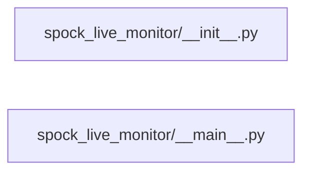

# Structure: spock_live_monitor

**Files:** 2 · **Lines:** 302 · **Classes:** 1 · **Functions:** 2 · **Methods:** 8

Solid edges = module-level import/call relationships (determined statically from source; only relationships *within this package* are drawn).

title: "spock_live_monitor module relationships"

## Modules

### `spock_live_monitor/__init__.py`

*Stand-alone Live Monitor package.*

### `spock_live_monitor/__main__.py`

*Stand-alone Ship Status / Live Monitor (PyQt6).*

> Contains a `__main__` guard (run directly).

**Imports:** `from __future__ import annotations`, `import sys`, `from pathlib import Path`, `from typing import Dict`, `from typing import Optional`, `from PyQt6.QtCore import Qt`, `from PyQt6.QtCore import QTimer`, `from PyQt6.QtGui import QFont`, `from PyQt6.QtWidgets import QApplication`, `from PyQt6.QtWidgets import QDialog`, `from PyQt6.QtWidgets import QFrame`, `from PyQt6.QtWidgets import QGridLayout`, `from PyQt6.QtWidgets import QHBoxLayout`, `from PyQt6.QtWidgets import QLabel`, `from PyQt6.QtWidgets import QMainWindow`, `from PyQt6.QtWidgets import QMessageBox`, `from PyQt6.QtWidgets import QPushButton`, `from PyQt6.QtWidgets import QSpinBox`, `from PyQt6.QtWidgets import QTableWidget`, `from PyQt6.QtWidgets import QTableWidgetItem`, `from PyQt6.QtWidgets import QTextEdit`, `from PyQt6.QtWidgets import QVBoxLayout`, `from PyQt6.QtWidgets import QWidget`, `from spock_onboarding.health import probe_embed_chat`, `from spock_onboarding.live_snapshot import get_live_monitor_snapshot`, `from spock_onboarding.llama_process import discover_llama_servers`, `from spock_onboarding.spock_status import run_spock_status_text`, `from spock_shell.busy_ui import clear_override_cursors`

**Classes**

- **`LiveMonitorWindow(QMainWindow)`** — lines 44-284
  - `closeEvent(self, event)`

**Functions**

- **`main(argv)`** — lines 287-297
