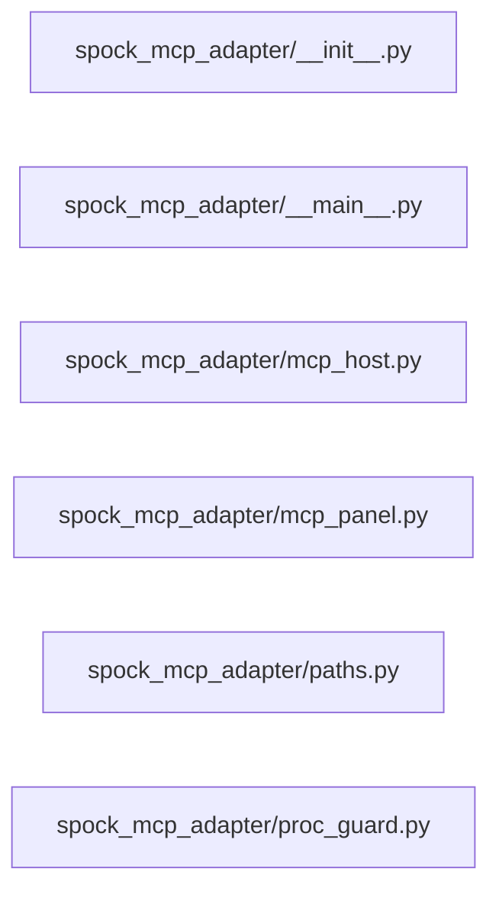

# Structure: spock_mcp_adapter

**Files:** 6 · **Lines:** 1,638 · **Classes:** 3 · **Functions:** 13 · **Methods:** 51

Solid edges = module-level import/call relationships (determined statically from source; only relationships *within this package* are drawn).

title: "spock_mcp_adapter module relationships"

## Modules

### `spock_mcp_adapter/__init__.py`

*Standalone MCP adapter window for Spock-Onboarding.*

### `spock_mcp_adapter/__main__.py`

*Stand-alone MCP Adapter window (PyQt6).*

> Contains a `__main__` guard (run directly).

**Imports:** `from __future__ import annotations`, `import sys`, `from pathlib import Path`, `from typing import Optional`, `from PyQt6.QtCore import QTimer`, `from PyQt6.QtWidgets import QApplication`, `from PyQt6.QtWidgets import QMainWindow`, `from PyQt6.QtWidgets import QScrollArea`, `from PyQt6.QtWidgets import QVBoxLayout`, `from PyQt6.QtWidgets import QWidget`, `from WarpCore import settings_store`, `from WarpCore.config_defaults import merge_mcp_settings`, `from WarpCore.theme import apply_theme_to`, `from WarpCore.theme import theme_by_name`, `from spock_mcp_adapter.mcp_host import McpAdapterHost`, `from spock_mcp_adapter.mcp_panel import McpControlPanel`, `from spock_mcp_adapter.paths as DEFAULT_ROOT`

**Classes**

- **`McpAdapterWindow(QMainWindow)`** — lines 20-81
  - `closeEvent(self, event)`

**Functions**

- **`main(argv)`** — lines 84-94

### `spock_mcp_adapter/mcp_host.py`

*Host-side MCP adapter control shared by suite mini-apps.

Ports the adapter lifecycle from Spock-to-bridge.py so any SuiteShellWindow can
drive mcp_panel.McpControlPanel without copying process-management code.*

**Imports:** `from __future__ import annotations`, `import os`, `import subprocess`, `import sys`, `import threading`, `import time`, `from pathlib import Path`, `from typing import Any`, `from typing import Callable`, `from typing import Dict`, `from typing import List`, `from typing import Optional`, `from PyQt6.QtCore import QTimer`, `from PyQt6.QtGui import QFont`, `from PyQt6.QtWidgets import QApplication`, `from PyQt6.QtWidgets import QDialog`, `from PyQt6.QtWidgets import QHBoxLayout`, `from PyQt6.QtWidgets import QMessageBox`, `from PyQt6.QtWidgets import QPushButton`, `from PyQt6.QtWidgets import QTextEdit`, `from PyQt6.QtWidgets import QVBoxLayout`, `from PyQt6.QtWidgets import QWidget`, `from WarpCore.config_defaults import DEFAULT_MCP_SETTINGS`, `from WarpCore.config_defaults import merge_mcp_settings`, `from spock_mcp_adapter.paths import ROOT`, `from spock_mcp_adapter.paths import SHIP_COMPUTER_DB`, `from WarpCore.service_endpoints import DEFAULT_MCP_PORT`, `from WarpCore.service_endpoints import DEFAULT_MCP_WEBUI_PORT`, `from WarpCore.service_endpoints import DEFAULT_RAG_PORT`, `import psutil`, `from spock_mcp_adapter.proc_guard import tcp_open`, `from spock_mcp_adapter.proc_guard import tcp_open`, `from contextlib import nullcontext`, `from spock_mcp_adapter.proc_guard import exclusive_start`, `from spock_mcp_adapter.proc_guard import tcp_open`, `from spock_mcp_adapter.proc_guard import tcp_open`, `from spock_mcp_adapter.proc_guard import tcp_open`, `from spock_health_report import discover_mcp_adapter_pids`, `import psutil`, `import psutil`, `from spock_health_report import probe_mcp_adapter`, `import psutil`, `from spock_mcp_adapter.proc_guard as _tcp`

**Classes**

- **`McpAdapterHost`** — lines 136-1022
  - *Start/stop/find the MCP adapter and feed McpControlPanel callbacks.*
  - `script_path(self)`
  - `python_exe(self)`
  - `find_text(self, needle)`
  - `running_pids(self)` *PIDs for THIS repo's scripts/mcp_spock_server.py only.*
  - `adapter_status_text(self)`
  - `health_context(self)`
  - `on_settings_changed(self, settings)` *Merge a panel's partial update so sibling panels never clobber it.*
  - `refresh_panel(self)`
  - `ensure_http_adapter(self, quiet)` *Start streamable-http when autostart expects it and :port is down.*
  - `ensure_http_adapter_async(self, quiet)` *Start HTTP adapter on a worker thread so the Qt UI stays responsive.*
  - `start_adapter(self, quiet, transport, http_host, http_port)` *Start MCP adapter using saved MCP settings unless overrides are passed.*
  - `kill_processes(self)` *Stop every this-install mcp_spock_server.py (HTTP and stdio).*
  - `stop_adapter(self)`
  - `find_adapter(self)`

**Functions**

- **`show_output_dialog(parent, title, text)`** — lines 101-133
  - *Scrollable output viewer with Select All / Copy (MCP / diagnostics).*

### `spock_mcp_adapter/mcp_panel.py`

*MCP adapter control panel (stdio + HTTP) with logging.*

**Imports:** `from __future__ import annotations`, `import time`, `from pathlib import Path`, `from typing import Any`, `from typing import Callable`, `from typing import Dict`, `from typing import Optional`, `import requests`, `from PyQt6.QtCore import QTimer`, `from PyQt6.QtCore import Qt`, `from PyQt6.QtCore import pyqtSignal`, `from PyQt6.QtGui import QFont`, `from PyQt6.QtWidgets import QComboBox`, `from PyQt6.QtWidgets import QFormLayout`, `from PyQt6.QtWidgets import QGroupBox`, `from PyQt6.QtWidgets import QHBoxLayout`, `from PyQt6.QtWidgets import QLabel`, `from PyQt6.QtWidgets import QLineEdit`, `from PyQt6.QtWidgets import QMessageBox`, `from PyQt6.QtWidgets import QPushButton`, `from PyQt6.QtWidgets import QSpinBox`, `from PyQt6.QtWidgets import QTextEdit`, `from PyQt6.QtWidgets import QVBoxLayout`, `from PyQt6.QtWidgets import QWidget`, `from WarpCore.config_defaults import DEFAULT_LLAMA_SERVER`, `from WarpCore.config_defaults import merge_mcp_settings`

**Classes**

- **`McpControlPanel(QWidget)`** — lines 79-372
  - *MCP adapter controls: transport, HTTP host/port, start/stop, health, log.*
  - `collect_settings(self)`
  - `apply_settings(self, settings)`
  - `refresh_status(self)`
  - `apply_theme(self)`

**Functions**

### `spock_mcp_adapter/paths.py`

*Install root paths for MCP adapter (Spock-Onboarding).*

**Imports:** `from __future__ import annotations`, `from pathlib import Path`

### `spock_mcp_adapter/proc_guard.py`

*Avoid duplicate sidecar processes (MCP HTTP) across windows.*

**Imports:** `from __future__ import annotations`, `import os`, `import socket`, `import subprocess`, `import time`, `from contextlib import contextmanager`, `from pathlib import Path`, `from typing import Iterator`, `from typing import List`, `from typing import Union`, `from spock_mcp_adapter.paths import ROOT`, `import psutil`, `import msvcrt`, `import fcntl`, `import msvcrt`, `import fcntl`

**Functions**

- **`fold_path(text)`** — lines 18-19
- **`pids_running_script(script)`** — lines 22-45
  - *PIDs whose command line contains this install's script path.*
- **`tcp_open(host, port, timeout)`** — lines 48-54
- **`kill_script_pids(script)`** — lines 57-76
  - *Terminate every PID running this install's script (Windows /taskkill).*
- **`exclusive_start(name, timeout)`** — lines 80-137
  - *Named inter-process lock. Yields True if this caller holds it.*
