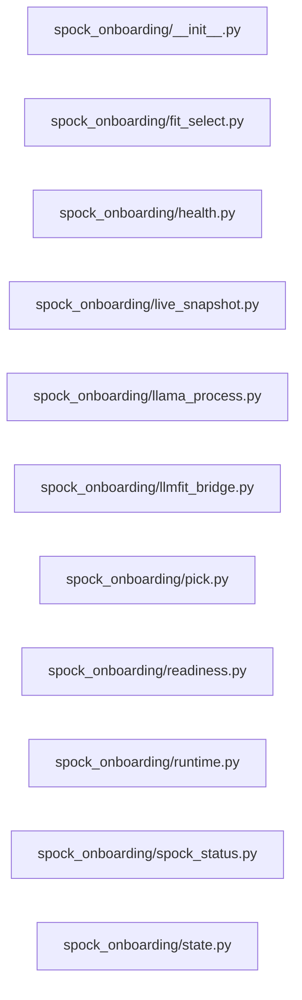

# Structure: spock_onboarding

**Files:** 11 · **Lines:** 1,975 · **Classes:** 4 · **Functions:** 61 · **Methods:** 13

Solid edges = module-level import/call relationships (determined statically from source; only relationships *within this package* are drawn).

 title: "spock_onboarding module relationships"

## Modules

### `spock_onboarding/__init__.py`

*Spock-Onboarding headless bringup package.*

### `spock_onboarding/fit_select.py`

*Recipe-driven GGUF shortlists for Bringup step 3 Acquire.

Acquire used to auto-pick from a three-tier catalog keyed on one VRAM number.
This module instead reads the host recipe — the same artefact Launch uses — and
ranks candidates per role the way llmfit does, so the user chooses from models
that actually fit the machine they are on.

The Hub is preferred for candidates and the built-in catalog*

**Imports:** `from __future__ import annotations`, `from typing import Any`, `from typing import Dict`, `from typing import List`, `from typing import Optional`, `import _warpcore_path`, `from model_pick_policy import catalog_rows`, `from model_pick_policy import detect_existing_embedding_dim`, `from model_pick_policy import infer_embed_dim`, `from model_pick_policy import recipe_role_budget`, `from model_pick_policy import top_role_fits`, `from model_pick_policy import usable_vram_gb`, `from WarpCore as hr`, `from model_selector_core import query_hf_embedding_models`, `from model_selector_core import query_hf_models`, `from spock_shell.paths import SHIP_COMPUTER_DB`

**Functions**

- **`existing_embedding_dim()`** — lines 33-38
  - *Dim already in ship_computer.db — switching it invalidates those vectors.*
- **`host_planning_inputs(db_path)`** — lines 41-57
  - *Recipe + live hardware to size models against.*
- **`specs_from_recipe(recipe, hardware)`** — lines 60-83
  - *Minimal specs dict for the Hub queries, from a live hardware probe.*
- **`role_shortlist(role, recipe, hardware, limit, use_hub, specs)`** — lines 97-147
  - *Top ``limit`` fitting models for ``role`` ("embed" or "chat").*
- **`shortlists(recipe, hardware, limit, use_hub)`** — lines 150-169
  - *Shortlists for both roles from one recipe read.*
- **`describe_pick(row)`** — lines 172-185
  - *One-line summary for menus and logs.*

### `spock_onboarding/health.py`

*HTTP health probes for llama-server (no Qt).*

**Imports:** `from __future__ import annotations`, `import os`, `from typing import Any`, `from typing import Dict`, `from typing import List`, `from typing import Optional`, `from typing import Tuple`, `from urllib.parse import urlparse`, `import requests`, `from spock_onboarding.llama_process import is_embedding_gguf_path`

**Functions**

- **`parse_host_port(url_or_host, default_port)`** — lines 14-26
- **`probe_llama_server(host, port, role_hint, timeout)`** — lines 29-100
- **`format_llama_line(info, label)`** — lines 103-109
- **`probe_embed_chat(embed_port, chat_port, host, timeout)`** — lines 112-125

### `spock_onboarding/live_snapshot.py`

*CPU / memory / GPU snapshot for Live Monitor (no Qt).*

**Imports:** `from __future__ import annotations`, `import shutil`, `import subprocess`, `from typing import Dict`, `import psutil`

**Functions**

- **`get_live_monitor_snapshot()`** — lines 54-109
  - *Return sections matching Ship Status Live Monitor boxes.*

### `spock_onboarding/llama_process.py`

*Qt-free llama-server process management (embed + chat).*

**Imports:** `from __future__ import annotations`, `import os`, `import subprocess`, `import time`, `from dataclasses import dataclass`, `from dataclasses import field`, `from datetime import datetime`, `from pathlib import Path`, `from typing import Any`, `from typing import Dict`, `from typing import List`, `from typing import Optional`, `from typing import Set`, `from typing import TextIO`, `import psutil`, `from WarpCore.service_endpoints import DEFAULT_CHAT_PORT`, `from WarpCore.service_endpoints import DEFAULT_EMBED_PORT`

**Classes**

- **`ServerInstance`** — lines 138-159
  - `alive(self)`
- **`LlamaProcessManager`** — lines 201-378
  - *Track owned llama-server processes; attach to discovered peers.*
  - `list_instances(self, refresh)`
  - `alive_for_role(self, role)`
  - `port_in_use(self, port)`
  - `stop_role(self, role)`
  - `stop_pid(self, pid)`
  - `stop_owned(self)`
  - `launch(self, model_path, port, ngl, role, n_ctx, batch, ubatch, split_mode, tensor_split, n_parallel, pin_cuda, cuda_device)`

**Functions**

- **`is_embedding_gguf_path(path)`** — lines 30-42
- **`parse_cmdline(cmdline)`** — lines 45-78
- **`role_from_parsed(parsed)`** — lines 81-85
- **`build_server_argv(llama_server, model_path, port, n_ctx, ngl, role, batch, ubatch, split_mode, tensor_split, n_parallel)`** — lines 88-134
- **`discover_llama_servers()`** — lines 162-198
- **`wait_until_healthy(probe_fn, host, port, role_hint, timeout_s, interval_s)`** — lines 381-400
  - *Poll probe_fn(host, port, role_hint=...) until reachable or timeout.*

### `spock_onboarding/llmfit_bridge.py`

*Thin subprocess bridge to llmfit JSON CLI (local exe or uvx).*

**Imports:** `from __future__ import annotations`, `import json`, `import os`, `import re`, `import shutil`, `import subprocess`, `from pathlib import Path`, `from typing import Any`, `from typing import Dict`, `from typing import List`, `from typing import Optional`, `from typing import Tuple`

**Functions**

- **`find_llmfit_exe()`** — lines 24-39
- **`find_uvx()`** — lines 42-43
- **`available()`** — lines 46-50
- **`system_info(timeout_s)`** — lines 98-100
- **`recommend(limit, force_runtime, timeout_s)`** — lines 103-118
- **`fit(limit, timeout_s)`** — lines 121-123
- **`plan(model, context, quant, timeout_s)`** — lines 126-140
- **`suggest_ngl_from_plan(plan_data)`** — lines 143-159
- **`suggest_ngl_from_payloads(plan_data, model_row)`** — lines 162-176
  - *Derive llama-server ``-ngl`` from llmfit plan/fit JSON (MCP + GUI).*
- **`resolve_ngl(model_path, n_ctx, current_ngl, use_llmfit)`** — lines 179-199

### `spock_onboarding/pick.py`

*Lean embed+chat GGUF pick + download for greenfield bringup.*

**Imports:** `from __future__ import annotations`, `import os`, `from dataclasses import dataclass`, `from pathlib import Path`, `from typing import Callable`, `from typing import List`, `from typing import Optional`, `from typing import Tuple`, `from spock_onboarding import llmfit_bridge`, `from spock_onboarding.fit_select import shortlists`, `from spock_shell.paths import SHIP_COMPUTER_DB`, `from WarpCore as hr`, `from huggingface_hub import hf_hub_download`, `from huggingface_hub import list_repo_files`

**Classes**

- **`ModelPick`** — lines 14-21

**Functions**

- **`estimate_vram_gb()`** — lines 65-87
- **`pick_model_pair(vram_gb)`** — lines 90-114
  - *Pick the highest catalog tier whose min VRAM the machine meets.*
- **`pick_from_recipe(root)`** — lines 117-159
  - *Best-fitting pair for the host recipe, or None when it cannot be read.*
- **`pick_from_selection(embed_repo, chat_repo, embed_quant, chat_quant, embed_n_ctx, chat_n_ctx, note)`** — lines 162-181
  - *Pair the user chose from the step 3 fit shortlist.*
- **`download_repo_gguf(repo_id, dest_dir, quant, token, cb)`** — lines 201-255
- **`download_pair(root, pick, token, cb)`** — lines 258-274
- **`resolve_hf_token(explicit)`** — lines 277-300

### `spock_onboarding/readiness.py`

*Readiness artifact for menu + future PyQt UI contract.*

**Imports:** `from __future__ import annotations`, `import json`, `import os`, `import sys`, `from datetime import datetime`, `from datetime import timezone`, `from pathlib import Path`, `from typing import Any`, `from typing import Dict`, `from typing import List`, `from typing import Optional`, `import subprocess`

**Functions**

- **`ready_path(root)`** — lines 16-17
- **`check_ui_ready(root)`** — lines 20-49
- **`collect_next_ui_prompts(root, hf_token_present)`** — lines 52-70
- **`write_readiness(root, ui_ready, servers_ready, full_deps_ok, venv_python, embed, chat, reasons, next_ui_prompts, extra)`** — lines 73-103
- **`load_readiness(root)`** — lines 106-114
- **`full_deps_marker(root)`** — lines 117-118
- **`format_status_text(data)`** — lines 121-144

### `spock_onboarding/runtime.py`

*Detect / download llama-server (Windows) — headless.*

**Imports:** `from __future__ import annotations`, `import json`, `import os`, `import shutil`, `import zipfile`, `from pathlib import Path`, `from typing import Callable`, `from typing import List`, `from typing import Optional`, `from typing import Tuple`, `from urllib.request import Request`, `from urllib.request import urlopen`

**Functions**

- **`normalize_fs_path(path)`** — lines 22-33
- **`default_llama_install_dir(root)`** — lines 36-44
- **`detect_llama_server(root, config_hint, install_dir)`** — lines 47-99
- **`download_llama_server_windows(root, install_dir, cb)`** — lines 174-226
- **`ensure_llama_server(root, hint, install_dir, download_if_missing, cb)`** — lines 229-243

### `spock_onboarding/spock_status.py`

*Spock Status report (same intent as Ship Status -> Run Spock Status).*

**Imports:** `from __future__ import annotations`, `import json`, `from pathlib import Path`, `from typing import Any`, `from typing import Dict`, `from typing import List`, `from typing import Optional`, `import requests`, `from spock_onboarding.health import probe_embed_chat`, `from spock_onboarding.llama_process import discover_llama_servers`

**Functions**

- **`probe_spock_status(root, embed_port, chat_port, rag_url, mcp_host, mcp_port)`** — lines 66-96
- **`format_spock_status_report(data)`** — lines 99-171
- **`run_spock_status_text(**kwargs)`** — lines 174-175

### `spock_onboarding/state.py`

*Persist first-models summary for bringup / future UI.*

**Imports:** `from __future__ import annotations`, `import json`, `from dataclasses import dataclass`, `from dataclasses import field`, `from pathlib import Path`, `from typing import Any`, `from typing import Dict`, `from typing import Optional`

**Classes**

- **`FirstModelsState`** — lines 12-92
  - `summary_path(self)`
  - `summary_dict(self)`
  - `write_summary_json(self)`
  - `load(cls, root)`
