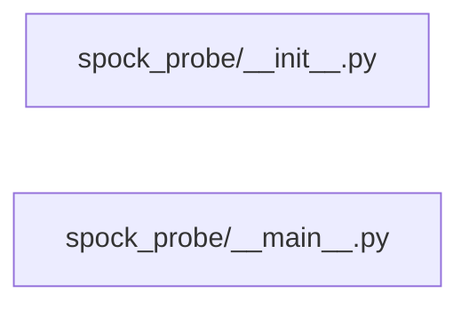

# Structure: spock_probe

**Files:** 2 · **Lines:** 40 · **Classes:** 0 · **Functions:** 1 · **Methods:** 0

Solid edges = module-level import/call relationships (determined statically from source; only relationships *within this package* are drawn).

title: "spock_probe module relationships"

## Modules

### `spock_probe/__init__.py`

*Spock readiness / health probe package.*

### `spock_probe/__main__.py`

*python -m spock_probe — readiness / health report.*

> Contains a `__main__` guard (run directly).

**Imports:** `from __future__ import annotations`, `import argparse`, `import json`, `import sys`, `from pathlib import Path`, `from spock_bringup import cmd_status`, `from spock_onboarding.llama_process import DEFAULT_CHAT_PORT`, `from spock_onboarding.llama_process import DEFAULT_EMBED_PORT`

**Functions**

- **`main(argv)`** — lines 14-35
