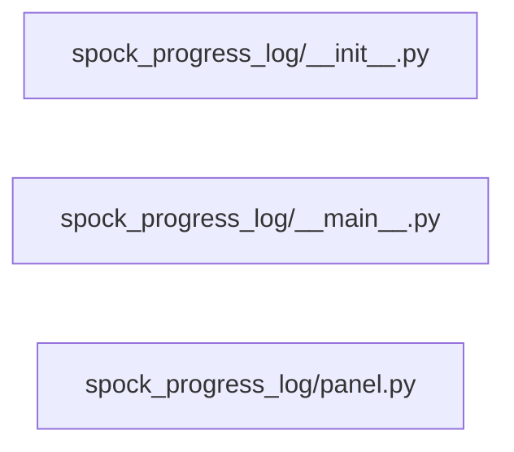

# Structure: spock_progress_log

**Files:** 3 · **Lines:** 355 · **Classes:** 2 · **Functions:** 4 · **Methods:** 16

Solid edges = module-level import/call relationships (determined statically from source; only relationships *within this package* are drawn).

title: "spock_progress_log module relationships"

## Modules

### `spock_progress_log/__init__.py`

*Scrollable PyQt6 progress / status log modal and embeddable panel.*

**Imports:** `from spock_progress_log.panel import ProgressLogPanel`, `from spock_progress_log.__main__ import run_progress_log`

**Functions**

### `spock_progress_log/__main__.py`

*Run a command and stream its output into a scrollable PyQt6 modal.

Usage:
  python -m spock_progress_log --title "Bring up" -- python -u -m spock_bringup up*

> Contains a `__main__` guard (run directly).

**Imports:** `from __future__ import annotations`, `import argparse`, `import sys`, `from pathlib import Path`, `from PyQt6.QtCore import Qt`, `from PyQt6.QtWidgets import QApplication`, `from PyQt6.QtWidgets import QDialog`, `from PyQt6.QtWidgets import QHBoxLayout`, `from PyQt6.QtWidgets import QPushButton`, `from PyQt6.QtWidgets import QVBoxLayout`, `from spock_progress_log.panel import ProgressLogPanel`

**Classes**

- **`ProgressLogDialog(QDialog)`** — lines 25-66
  - `closeEvent(self, event)`
  - `exit_code(self)`

**Functions**

- **`run_progress_log(title, command, cwd)`** — lines 69-73
- **`main(argv)`** — lines 76-100

### `spock_progress_log/panel.py`

*Reusable PyQt6 progress log panel (QProcess streaming).*

**Imports:** `from __future__ import annotations`, `import os`, `import sys`, `from pathlib import Path`, `from typing import List`, `from PyQt6.QtCore import QProcess`, `from PyQt6.QtCore import QProcessEnvironment`, `from PyQt6.QtCore import pyqtSignal`, `from PyQt6.QtGui import QFont`, `from PyQt6.QtGui import QTextCursor`, `from PyQt6.QtWidgets import QHBoxLayout`, `from PyQt6.QtWidgets import QLabel`, `from PyQt6.QtWidgets import QPlainTextEdit`, `from PyQt6.QtWidgets import QPushButton`, `from PyQt6.QtWidgets import QVBoxLayout`, `from PyQt6.QtWidgets import QWidget`, `import winreg`

**Classes**

- **`ProgressLogPanel(QWidget)`** — lines 81-238
  - *Embeddable log + status that runs a command via QProcess.*
  - `exit_code(self)`
  - `is_running(self)`
  - `clear_log(self)`
  - `append_line(self, text)`
  - `start(self, title, command, cwd)` *Start a command. Returns False if already running or command empty.*
  - `stop(self)`

**Functions**
