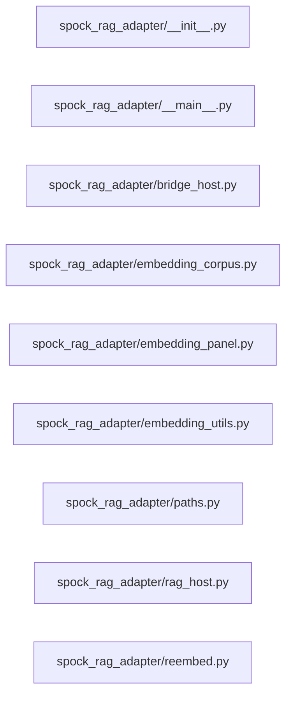

# Structure: spock_rag_adapter

**Files:** 9 · **Lines:** 1,166 · **Classes:** 2 · **Functions:** 33 · **Methods:** 11

Solid edges = module-level import/call relationships (determined statically from source; only relationships *within this package* are drawn).

title: "spock_rag_adapter module relationships"

## Modules

### `spock_rag_adapter/__init__.py`

*Standalone Embedding Profile / RAG API window.*

### `spock_rag_adapter/__main__.py`

*Stand-alone Embedding Profile / RAG API window (PyQt6).*

> Contains a `__main__` guard (run directly).

**Imports:** `from __future__ import annotations`, `import sys`, `from pathlib import Path`, `from typing import Optional`, `from PyQt6.QtCore import QTimer`, `from PyQt6.QtWidgets import QApplication`, `from PyQt6.QtWidgets import QMainWindow`, `from PyQt6.QtWidgets import QScrollArea`, `from PyQt6.QtWidgets import QVBoxLayout`, `from PyQt6.QtWidgets import QWidget`, `from WarpCore import settings_store`, `from WarpCore.config_defaults import merge_embedding_profile`, `from WarpCore.theme import apply_theme_to`, `from WarpCore.theme import theme_by_name`, `from spock_rag_adapter.embedding_panel import EmbeddingProfilePanel`, `from spock_rag_adapter.paths as DEFAULT_ROOT`, `from spock_rag_adapter.paths import SHIP_COMPUTER_DB`, `from spock_rag_adapter.rag_host import RagAdapterHost`, `from spock_rag_adapter.rag_host import is_rag_up`, `from spock_rag_adapter.rag_host import rag_bind`

**Classes**

- **`EmbeddingRagWindow(QMainWindow)`** — lines 20-88
  - `closeEvent(self, event)`

**Functions**

- **`main(argv)`** — lines 91-101

### `spock_rag_adapter/bridge_host.py`

*Shared LLM provider wiring for the Spock suite.

`make_llm_client(cfg)` is the one entry point every mini-app uses to get a chat
client configured from the app config. Provider settings are class-level on
`LLMClient`, so `apply_provider_config()` must run before constructing one.*

**Imports:** `from __future__ import annotations`, `from typing import Any`, `from spock_rag_adapter.paths import ensure_root_on_path`, `from llm_client import LLMClient`, `from llm_client import normalize_openai_compat_base`, `from llm_client import repair_openai_compat_settings`

**Functions**

- **`apply_provider_config(cfg)`** — lines 26-53
  - *Push config into the LLMClient class-level provider settings.*
- **`make_llm_client(cfg)`** — lines 56-71
  - *Build a chat client for the provider named in cfg['ask_ai_provider'].*

### `spock_rag_adapter/embedding_corpus.py`

*Which embedding GGUF produced documents.embedding in ship_computer.db.

Wiki scan records a singleton row (kb_embedding_corpus) and stamps each
document. Ask AI, RAG, Maintenance tests, and profile load compare the live
llama-server on :8080 to that row.*

**Imports:** `from __future__ import annotations`, `import os`, `import sqlite3`, `from datetime import datetime`, `from datetime import timezone`, `from typing import Any`, `from typing import Dict`, `from typing import Optional`, `from typing import Tuple`, `from spock_rag_adapter.paths import SHIP_COMPUTER_DB`, `from WarpCore.ship_schema import ensure_ship_computer_schema`, `from spock_health_report import embeddings_host_port`, `from spock_health_report import probe_llama_server`

**Functions**

- **`fold_path(text)`** — lines 31-32
- **`model_basename(path)`** — lines 35-36
- **`is_gguf_path(path)`** — lines 39-41
- **`resolve_gguf_identity(path, model_id)`** — lines 44-64
  - *Best GGUF identity from a path and/or model id.*
- **`models_match(a, b)`** — lines 67-74
  - *True if two GGUF identities are the same path or the same basename.*
- **`ensure_schema(db_path)`** — lines 77-97
- **`read_corpus(db_path)`** — lines 100-128
- **`write_corpus(model_path, embeddings_url, embeddings_dim, model_id, source, db_path)`** — lines 131-174
- **`probe_live_model(embeddings_url, timeout)`** — lines 177-196
  - *Ask the llama-server behind embeddings_url which GGUF is loaded.*
- **`record_from_live_server(embeddings_url, embeddings_dim, model_id, db_path)`** — lines 199-226
  - *Probe :8080 and persist kb_embedding_corpus. False if server/model unknown.*
- **`live_vs_corpus(embeddings_url, profile_model_path, profile_model_id, db_path)`** — lines 229-292
  - *Compare live :8080, optional profile GGUF, and kb_embedding_corpus.*
- **`format_mismatch(corpus_path, live_path, profile_path, live_reachable)`** — lines 295-325
- **`assert_live_matches_corpus(embeddings_url, db_path)`** — lines 328-336
  - *Raise RuntimeError when a corpus exists and live :8080 is a different GGUF.*
- **`guarded_hybrid_search(hybrid_search_fn)`** — lines 339-347
  - *Wrap WarpCore.hybrid_search so a wrong :8080 GGUF fails instead of mixing spaces.*
- **`model_counts(db_path)`** — lines 350-370
- **`profile_embedding_path(payload)`** — lines 373-384

### `spock_rag_adapter/embedding_panel.py`

*Compatibility shim — canonical panel is ``model_selector.embedding_panel``.

Stand-alone RAG adapter and older imports keep working via this re-export.*

**Imports:** `from __future__ import annotations`, `from model_selector.embedding_panel import EmbeddingProfilePanel`, `from model_selector.widgets import _action_btn`, `from model_selector.widgets import _panel_stylesheet`

### `spock_rag_adapter/embedding_utils.py`

*Embedding profile helpers (probe dim, .env, DB sample).*

**Imports:** `from __future__ import annotations`, `import json`, `import os`, `import sqlite3`, `from typing import Any`, `from typing import Dict`, `from typing import List`, `from typing import Optional`, `import requests`, `from spock_rag_adapter.paths import ROOT`

**Functions**

- **`probe_embeddings_dim(url, timeout)`** — lines 15-45
  - *POST a short string to /embeddings and return vector length.*
- **`sample_db_embedding_dim(db_path)`** — lines 48-60
- **`write_embedding_env(profile, env_path)`** — lines 63-94
  - *Upsert embedding-related keys in .env (create if missing).*

### `spock_rag_adapter/paths.py`

*Install root paths for Embedding / RAG adapter.*

**Imports:** `from __future__ import annotations`, `import sys`, `from pathlib import Path`

**Functions**

- **`ensure_root_on_path()`** — lines 13-17

### `spock_rag_adapter/rag_host.py`

*Start / stop the Spock RAG API subprocess for the standalone window.*

**Imports:** `from __future__ import annotations`, `import os`, `import subprocess`, `import sys`, `import time`, `import urllib.request`, `from pathlib import Path`, `from typing import Any`, `from typing import Callable`, `from typing import Dict`, `from typing import Optional`, `from typing import Tuple`, `from PyQt6.QtWidgets import QMessageBox`, `from PyQt6.QtWidgets import QWidget`, `from spock_mcp_adapter.proc_guard import exclusive_start`, `from spock_mcp_adapter.proc_guard import kill_script_pids`, `from spock_mcp_adapter.proc_guard import pids_running_script`, `from spock_mcp_adapter.proc_guard import tcp_open`, `from spock_rag_adapter.paths import RAG_SCRIPT`, `from spock_rag_adapter.paths import ROOT`, `from WarpCore.config_defaults import merge_embedding_profile`, `from spock_rag_adapter.embedding_utils import write_embedding_env`

**Classes**

- **`RagAdapterHost`** — lines 55-223
  - *Own RAG API lifecycle for EmbeddingProfilePanel callbacks.*
  - `refresh_panel(self)`
  - `on_profile_applied(self, profile)`
  - `start_rag(self)`
  - `stop_rag(self)`

**Functions**

- **`rag_bind(config)`** — lines 26-34
- **`rag_url(host, port)`** — lines 37-38
- **`is_rag_up(host, port, timeout)`** — lines 41-52

### `spock_rag_adapter/reembed.py`

*Clear document embeddings and kb_embedding_corpus for a clean re-embed.

Does NOT delete documents, settings, or profiles — unlike reset.py --mode content.*

> Contains a `__main__` guard (run directly).

**Imports:** `from __future__ import annotations`, `import argparse`, `import os`, `import sqlite3`, `import sys`, `from pathlib import Path`, `from typing import Any`, `from typing import Dict`, `from typing import Optional`, `from spock_rag_adapter.paths import ROOT`, `from spock_rag_adapter.paths import SHIP_COMPUTER_DB`, `from spock_rag_adapter.paths import ensure_root_on_path`, `from WarpCore.ship_schema import ensure_ship_computer_schema`, `from spock_rag_adapter.embedding_corpus import ensure_schema`, `from WarpCore.ship_schema import ensure_ship_computer_schema`, `from spock_rag_adapter.embedding_corpus import ensure_schema`, `from spock_rag_adapter.embedding_corpus import probe_live_model`, `from spock_rag_adapter.embedding_corpus import read_corpus`

**Functions**

- **`clear_embeddings(db_path)`** — lines 24-90
  - *Null document vectors and clear kb_embedding_corpus. Keep document rows.*
- **`embedding_status(db_path, embeddings_url)`** — lines 93-139
  - *Counts + corpus row + live :8080 probe.*
- **`format_status(report)`** — lines 142-167
- **`format_clear_result(result)`** — lines 170-189
- **`main(argv)`** — lines 202-256
