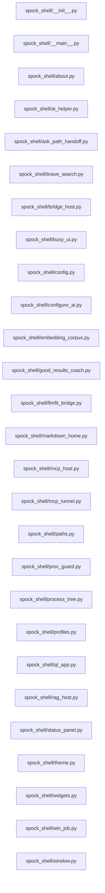

# Structure: spock_shell

**Files:** 27 · **Lines:** 6,239 · **Classes:** 17 · **Functions:** 117 · **Methods:** 119

Solid edges = module-level import/call relationships (determined statically from source; only relationships *within this package* are drawn).

 title: "spock_shell module relationships"

## Modules

### `spock_shell/__init__.py`

*Shared PyQt6 shell for Spock suite mini-apps (skeleton-v2 layout).*

**Imports:** `from __future__ import annotations`, `from spock_shell.window import SuiteShellWindow`

### `spock_shell/__main__.py`

*Demo entry: empty suite shell (Module 0 smoke).*

> Contains a `__main__` guard (run directly).

**Imports:** `from __future__ import annotations`, `import sys`, `from spock_shell.paths import ensure_root_on_path`, `from spock_shell.qt_app import create_app`, `from spock_shell.window import SuiteShellWindow`

**Functions**

- **`main()`** — lines 10-19

### `spock_shell/about.py`

*About dialog for suite mini-apps.

Also carries the MCP tool / port reference that used to sit behind a Help
sub-tab inside the MCP panel, so it is reachable from every window.*

**Imports:** `from __future__ import annotations`, `from typing import Dict`, `from PyQt6.QtCore import Qt`, `from PyQt6.QtGui import QFont`, `from PyQt6.QtWidgets import QDialog`, `from PyQt6.QtWidgets import QLabel`, `from PyQt6.QtWidgets import QPushButton`, `from PyQt6.QtWidgets import QTabWidget`, `from PyQt6.QtWidgets import QTextEdit`, `from PyQt6.QtWidgets import QVBoxLayout`, `from PyQt6.QtWidgets import QWidget`, `from spock_shell.paths import ROOT`, `from spock_shell.paths import SHIP_COMPUTER_DB`

**Classes**

- **`AboutDialog(QDialog)`** — lines 65-134

### `spock_shell/ai_helper.py`

*Open Chat AI Helper with a minimal host adapter.*

**Imports:** `from __future__ import annotations`, `from typing import Any`, `from typing import Dict`, `from typing import Optional`, `from PyQt6.QtWidgets import QMessageBox`, `from PyQt6.QtWidgets import QWidget`, `from spock_shell.bridge_host import make_llm_client`, `from spock_shell.paths import SHIP_COMPUTER_DB`, `from spock_shell.paths import ensure_root_on_path`, `from spock_shell.bridge_host import apply_provider_config`, `from chat_ai_helper import ChatAIHelperWindow`, `from WarpCore.search as _emb_ok`, `from WarpCore.search import hybrid_search`

**Classes**

- **`_HelperHost`** — lines 13-23
  - *Duck-typed stand-in for MainWindow bits ChatAIHelperWindow expects.*

**Functions**

- **`open_ai_helper(parent, theme, config)`** — lines 26-62

### `spock_shell/ask_path_handoff.py`

*Offer to copy Ship's Logs Path filter into Ask AI Path.*

**Imports:** `from __future__ import annotations`, `import sqlite3`, `from pathlib import Path`, `from typing import Any`, `from typing import MutableSet`, `from typing import Optional`, `from PyQt6.QtWidgets import QMessageBox`, `from PyQt6.QtWidgets import QWidget`, `from deep_dive import build_documents_filter_clause`

**Functions**

- **`ships_logs_path_filter(logs)`** — lines 12-25
  - *Current Documents-tab Path: text from Ship's Logs, or empty.*
- **`path_filter_match_count(db_path, path_filter)`** — lines 28-54
  - *How many documents match this path filter (extension unrestricted).*
- **`offer_copy_ships_path_to_ask(parent, logs, ask, db_path, offered)`** — lines 57-105
  - *Ask once per filter value whether to copy Ship's Logs Path → Ask AI Path.*

### `spock_shell/brave_search.py`

*Brave Search center panel (Search + Ask Leo) — same UX as monolith Home.*

**Imports:** `from __future__ import annotations`, `from typing import Dict`, `from typing import Optional`, `from PyQt6.QtWidgets import QLabel`, `from PyQt6.QtWidgets import QVBoxLayout`, `from PyQt6.QtWidgets import QWidget`, `from PyQt6.QtWebEngineWidgets import QWebEngineView`

**Functions**

- **`build_brave_search_panel(theme)`** — lines 100-120
  - *Center panel with Brave Search + Ask Leo (QWebEngineView when available).*

### `spock_shell/bridge_host.py`

*Shared LLM provider wiring for the Spock suite.

`make_llm_client(cfg)` is the one entry point every mini-app uses to get a chat
client configured from the app config. Provider settings are class-level on
`LLMClient`, so `apply_provider_config()` must run before constructing one.*

**Imports:** `from __future__ import annotations`, `from typing import Any`, `from spock_shell.paths import ensure_root_on_path`, `from llm_client import LLMClient`, `from llm_client import normalize_openai_compat_base`, `from llm_client import repair_openai_compat_settings`, `from WarpCore.service_endpoints import DEFAULT_CHAT_PORT`, `from WarpCore.service_endpoints import resolve_ctx`, `from WarpCore.service_endpoints import resolve_ports`

**Functions**

- **`apply_provider_config(cfg)`** — lines 42-72
  - *Push config into the LLMClient class-level provider settings.*
- **`make_llm_client(cfg)`** — lines 75-90
  - *Build a chat client for the provider named in cfg['ask_ai_provider'].*

### `spock_shell/busy_ui.py`

*Immediate wait-cursor + progress feedback for long Qt actions.

Qt timers do not fire while the GUI thread is blocked. Call ``heartbeat()``
from long synchronous work so the elapsed label updates and the event loop
can paint. Always clear the full override-cursor stack on exit — a single
``restoreOverrideCursor()`` leaves the spinner stuck on Windows when dialogs
stacked extra overrides.*

**Imports:** `from __future__ import annotations`, `import time`, `from contextlib import contextmanager`, `from typing import Iterator`, `from typing import List`, `from typing import Optional`, `from PyQt6.QtCore import QEventLoop`, `from PyQt6.QtCore import Qt`, `from PyQt6.QtWidgets import QApplication`, `from PyQt6.QtWidgets import QLabel`, `from PyQt6.QtWidgets import QProgressBar`, `from PyQt6.QtWidgets import QVBoxLayout`, `from PyQt6.QtWidgets import QWidget`

**Classes**

- **`BusySession`** — lines 31-101
  - *One in-progress busy scope (progress UI + wait cursor).*
  - `start(self)`
  - `pulse(self, status)` *Update elapsed text and let Qt paint (call during long work).*
  - `stop(self)`

**Functions**

- **`clear_override_cursors()`** — lines 22-28
  - *Pop every application override cursor (safe if already clear).*
- **`heartbeat(status)`** — lines 104-107
  - *Keep busy UI alive while the GUI thread runs synchronous work.*
- **`pause_busy_for_dialog()`** — lines 111-120
  - *Drop wait cursor while a QMessageBox is shown; restore afterward.*
- **`busy_scope(parent, message, show_dialog)`** — lines 124-145
  - *Wait cursor + optional progress window with elapsed seconds.*

### `spock_shell/config.py`

*Load / save app config via WarpCore settings_store.*

**Imports:** `from __future__ import annotations`, `from typing import Any`, `from typing import Dict`, `from spock_shell.paths import SHIP_COMPUTER_DB`, `from spock_shell.paths import ensure_root_on_path`, `import _warpcore_path`, `from WarpCore import settings_store`, `import _warpcore_path`, `from WarpCore import settings_store`

**Functions**

- **`load_config()`** — lines 10-17
- **`save_config(config, by)`** — lines 20-27

### `spock_shell/configure_ai.py`

*Configure Spock AI — one tabbed form for every chat / RAG / MCP backend.

Replaces the scattered connection modals and one-off "test" buttons that used to
live in the monolith and in Chat AI Helper. Each connector tab owns its
settings, a Test connection probe, and a single Save action that also pins
``ask_ai_provider`` so there is exactly one answer to "what will Ask AI use?".*

**Imports:** `from __future__ import annotations`, `from typing import Any`, `from typing import Callable`, `from typing import Dict`, `from typing import Optional`, `import requests`, `from PyQt6.QtCore import QTimer`, `from PyQt6.QtCore import pyqtSignal`, `from PyQt6.QtWidgets import QFormLayout`, `from PyQt6.QtWidgets import QGroupBox`, `from PyQt6.QtWidgets import QHBoxLayout`, `from PyQt6.QtWidgets import QLabel`, `from PyQt6.QtWidgets import QLineEdit`, `from PyQt6.QtWidgets import QMessageBox`, `from PyQt6.QtWidgets import QPushButton`, `from PyQt6.QtWidgets import QSpinBox`, `from PyQt6.QtWidgets import QTabWidget`, `from PyQt6.QtWidgets import QVBoxLayout`, `from PyQt6.QtWidgets import QWidget`, `from spock_shell.paths import ensure_root_on_path`, `from llm_client import embeddings_chat_collision`, `from llm_client import google_adc_bearer_token`, `from llm_client import normalize_openai_compat_base`, `from llm_client import vertex_global_base`, `from llm_client as is_adc_api_key`, `from llm_client as looks_like_google_openai_url`, `from spock_shell.bridge_host import apply_provider_config`, `from spock_shell.bridge_host import make_llm_client`, `from WarpCore.service_endpoints import DEFAULT_CHAT_PORT`, `from WarpCore.service_endpoints import DEFAULT_DOCS_PORT`, `from WarpCore.service_endpoints import DEFAULT_EMBED_PORT`, `from WarpCore.service_endpoints import DEFAULT_CTX`, `from WarpCore.service_endpoints import resolve_ctx`, `from WarpCore.service_endpoints import resolve_ports`, `from WarpCore.service_endpoints import sync_embedding_url_port`, `from spock_shell.profiles import open_manage_profiles_dialog`, `from mcp_panel import merge_mcp_settings`, `from model_selector_core import merge_embedding_profile`, `from model_selector_panels import EmbeddingProfilePanel`, `from mcp_panel import merge_mcp_settings`, `from mcp_panel import McpControlPanel`, `from mcp_panel import LlamaWebUiPanel`

**Classes**

- **`_ConnectorTab(QWidget)`** — lines 69-139
  - *Shared skeleton: hint, form rows, Test connection, Save & Use.*
  - `build_fields(self)`
  - `collect(self)`
  - `test_connection(self)`
  - `set_status(self, text, color)`
  - `ok(self, text)`
  - `bad(self, text)`
- **`LmStudioTab(_ConnectorTab)`** — lines 142-191
  - `build_fields(self)`
  - `collect(self)`
  - `test_connection(self)`
- **`OllamaTab(_ConnectorTab)`** — lines 194-233
  - `build_fields(self)`
  - `collect(self)`
  - `test_connection(self)`
- **`LlamaCppTab(_ConnectorTab)`** — lines 236-363
  - `build_fields(self)`
  - `collect(self)`
  - `test_connection(self)`
- **`OpenAiCompatTab(_ConnectorTab)`** — lines 366-494
  - `build_fields(self)`
  - `collect(self)`
  - `test_connection(self)`
- **`ConfigureAiPanel(QWidget)`** — lines 497-782
  - *Tabbed configuration for every AI backend the suite can talk to.*
  - `refresh_active_provider(self)`
  - `collect_all(self)` *Snapshot every tab — used when saving or naming a Spock profile.*
  - `probe_active_provider(self)`

**Functions**

### `spock_shell/embedding_corpus.py`

*Which embedding GGUF produced documents.embedding in ship_computer.db.

Wiki scan records a singleton row (kb_embedding_corpus) and stamps each
document. Ask AI, RAG, Maintenance tests, and profile load compare the live
llama-server on :8080 to that row.*

**Imports:** `from __future__ import annotations`, `import os`, `import sqlite3`, `from datetime import datetime`, `from datetime import timezone`, `from typing import Any`, `from typing import Dict`, `from typing import Optional`, `from typing import Tuple`, `from spock_shell.paths import SHIP_COMPUTER_DB`, `from WarpCore.ship_schema import ensure_ship_computer_schema`, `from spock_health_report import embeddings_host_port`, `from spock_health_report import probe_llama_server`

**Functions**

- **`fold_path(text)`** — lines 31-32
- **`model_basename(path)`** — lines 35-36
- **`is_gguf_path(path)`** — lines 39-41
- **`resolve_gguf_identity(path, model_id)`** — lines 44-64
  - *Best GGUF identity from a path and/or model id.*
- **`models_match(a, b)`** — lines 67-74
  - *True if two GGUF identities are the same path or the same basename.*
- **`ensure_schema(db_path)`** — lines 77-97
- **`read_corpus(db_path)`** — lines 100-128
- **`write_corpus(model_path, embeddings_url, embeddings_dim, model_id, source, db_path)`** — lines 131-174
- **`probe_live_model(embeddings_url, timeout)`** — lines 177-196
  - *Ask the llama-server behind embeddings_url which GGUF is loaded.*
- **`record_from_live_server(embeddings_url, embeddings_dim, model_id, db_path)`** — lines 199-226
  - *Probe :8080 and persist kb_embedding_corpus. False if server/model unknown.*
- **`live_vs_corpus(embeddings_url, profile_model_path, profile_model_id, db_path)`** — lines 229-292
  - *Compare live :8080, optional profile GGUF, and kb_embedding_corpus.*
- **`format_mismatch(corpus_path, live_path, profile_path, live_reachable)`** — lines 295-325
- **`assert_live_matches_corpus(embeddings_url, db_path)`** — lines 328-336
  - *Raise RuntimeError when a corpus exists and live :8080 is a different GGUF.*
- **`guarded_hybrid_search(hybrid_search_fn)`** — lines 339-347
  - *Wrap WarpCore.hybrid_search so a wrong :8080 GGUF fails instead of mixing spaces.*
- **`model_counts(db_path)`** — lines 350-370
- **`profile_embedding_path(payload)`** — lines 373-384

### `spock_shell/good_results_coach.py`

*Good Results coach — short tips that cut Ask / Deep Dive trial-and-error.

Signals use live timing, Launch sizing heuristics, and Path filter vs question.
Tips are advisory only; they never change -c or filters automatically.*

**Imports:** `from __future__ import annotations`, `import os`, `import re`, `from pathlib import Path`, `from typing import Any`, `from typing import Dict`, `from typing import List`, `from typing import Optional`, `from spock_scanner_core import recommend_n_ctx`

**Functions**

- **`path_filter_excludes_spock(path_filter)`** — lines 35-50
  - *True when a non-empty Path filter likely hides Spock app sources.*
- **`tip_path_vs_question(question, path_filter)`** — lines 53-63
- **`tip_pack_saturation(timing)`** — lines 66-94
  - *Deep Dive packed to the token window — suggest -c or narrower Path.*
- **`tip_timeout()`** — lines 97-103
- **`tip_launch_fit(model_path, n_ctx, vram_gb, role, sibling_size_gb)`** — lines 106-161
  - *Warn before Launch when weights+KV look too large for the selected GPU.*
- **`collect_ask_tips(question, path_filter, timing, answer, timed_out)`** — lines 164-182
  - *Ordered tips for the Ask AI panel (status + optional transcript line).*

### `spock_shell/llmfit_bridge.py`

*Thin subprocess bridge to local llmfit CLI JSON (fit / plan / system).

Prefers ``D:\llmfit\target\release\llmfit.exe``, then PATH. All helpers
degrade gracefully when the binary is missing or returns non-JSON.*

**Imports:** `from __future__ import annotations`, `import json`, `import os`, `import re`, `import shutil`, `import subprocess`, `from functools import lru_cache`, `from pathlib import Path`, `from typing import Any`, `from typing import Dict`, `from typing import List`, `from typing import Optional`, `from typing import Tuple`

**Functions**

- **`find_llmfit_exe()`** — lines 28-43
- **`available()`** — lines 46-50
- **`system_info(timeout_s)`** — lines 88-92
- **`system_info_cached(refresh)`** — lines 101-117
  - *Session-cached ``llmfit --json system``.*
- **`recommend(limit, force_runtime, timeout_s)`** — lines 120-130
- **`fit(limit, timeout_s)`** — lines 133-137
- **`plan(model, context, quant, timeout_s)`** — lines 140-156
- **`parse_ngl_from_verify_command(cmd)`** — lines 159-163
- **`model_hint_from_path(model_path)`** — lines 166-176
  - *Best-effort selector string for ``llmfit plan`` from a GGUF path.*
- **`suggest_ngl_from_payloads(plan_data, model_row)`** — lines 179-228
  - *Derive a llama-server ``-ngl`` value from llmfit JSON.*
- **`resolve_ngl(model_path, n_ctx, quant, current_ngl, use_llmfit)`** — lines 240-265
  - *Resolve launch ``-ngl``.*
- **`load_fixture(name)`** — lines 268-273
  - *Load checked-in JSON under tests/fixtures/llmfit/ (utf-8-sig safe).*
- **`system_to_gpu_list(system_payload)`** — lines 276-337
  - *Convert ``llmfit --json system`` into scanner-style GPU dicts.*
- **`hardware_fingerprint(system_payload)`** — lines 340-358
  - *Stable key for caching fit estimates against this machine.*
- **`fit_estimate_index(limit, system_payload)`** — lines 419-428
- **`lookup_fit_estimate(model_id, index)`** — lines 431-453
  - *Match an HF / catalog id to a cached llmfit fit row.*
- **`enrich_hub_row_with_fit(row, index)`** — lines 456-475
  - *Attach estimated_tps / fit_level / llmfit_run_mode when a match exists.*

### `spock_shell/markdown_home.py`

*Center Home pane that renders a module HELPER markdown file.*

**Imports:** `from __future__ import annotations`, `from pathlib import Path`, `from typing import Dict`, `from typing import Optional`, `from typing import Union`, `from PyQt6.QtWidgets import QLabel`, `from PyQt6.QtWidgets import QTextBrowser`, `from PyQt6.QtWidgets import QVBoxLayout`, `from PyQt6.QtWidgets import QWidget`, `from spock_shell.paths import ROOT`

**Functions**

- **`helper_md_path(filename)`** — lines 15-22
  - *Resolve a HELPER doc under AIHelperDocuments/ (or absolute / repo-relative path).*
- **`about_me_path(filename)`** — lines 25-27
  - *Backward-compatible alias for ``helper_md_path``.*
- **`build_markdown_home(theme, md_path, fallback_title, fallback_subtitle)`** — lines 30-82
  - *QWidget with a scrollable markdown view of ``md_path`` (HELPER or abs).*
- **`reload_markdown_home(widget, theme)`** — lines 85-106

### `spock_shell/mcp_host.py`

*Host-side MCP adapter control shared by suite mini-apps.

Ports the adapter lifecycle from Spock-to-bridge.py so any SuiteShellWindow can
drive mcp_panel.McpControlPanel without copying process-management code.*

**Imports:** `from __future__ import annotations`, `import os`, `import subprocess`, `import sys`, `import threading`, `import time`, `from pathlib import Path`, `from typing import Any`, `from typing import Callable`, `from typing import Dict`, `from typing import List`, `from typing import Optional`, `from PyQt6.QtCore import QTimer`, `from PyQt6.QtGui import QFont`, `from PyQt6.QtWidgets import QApplication`, `from PyQt6.QtWidgets import QDialog`, `from PyQt6.QtWidgets import QHBoxLayout`, `from PyQt6.QtWidgets import QMessageBox`, `from PyQt6.QtWidgets import QPushButton`, `from PyQt6.QtWidgets import QTextEdit`, `from PyQt6.QtWidgets import QVBoxLayout`, `from PyQt6.QtWidgets import QWidget`, `from mcp_panel import DEFAULT_MCP_SETTINGS`, `from mcp_panel import merge_mcp_settings`, `from spock_shell.paths import ROOT`, `from spock_shell.paths import SHIP_COMPUTER_DB`, `from WarpCore.service_endpoints import DEFAULT_MCP_PORT`, `from WarpCore.service_endpoints import DEFAULT_MCP_WEBUI_PORT`, `from WarpCore.service_endpoints import DEFAULT_RAG_PORT`, `import psutil`, `from spock_shell.proc_guard import tcp_open`, `from spock_shell.proc_guard import tcp_open`, `from contextlib import nullcontext`, `from spock_shell.proc_guard import exclusive_start`, `from spock_shell.proc_guard import tcp_open`, `from spock_shell.proc_guard import tcp_open`, `from spock_shell.proc_guard import tcp_open`, `from spock_health_report import discover_mcp_adapter_pids`, `import psutil`, `import psutil`, `from spock_health_report import probe_mcp_adapter`, `import psutil`, `from spock_shell.proc_guard as _tcp`

**Classes**

- **`McpAdapterHost`** — lines 100-973
  - *Start/stop/find the MCP adapter and feed McpControlPanel callbacks.*
  - `script_path(self)`
  - `python_exe(self)`
  - `find_text(self, needle)`
  - `running_pids(self)` *PIDs for THIS repo's scripts/mcp_spock_server.py only.*
  - `adapter_status_text(self)`
  - `health_context(self)`
  - `on_settings_changed(self, settings)` *Merge a panel's partial update so sibling panels never clobber it.*
  - `refresh_panel(self)`
  - `ensure_http_adapter(self, quiet)` *Start streamable-http when autostart expects it and :port is down.*
  - `ensure_http_adapter_async(self, quiet)` *Start HTTP adapter on a worker thread so the Qt UI stays responsive.*
  - `start_adapter(self, quiet, transport, http_host, http_port)` *Start MCP adapter using saved MCP settings unless overrides are passed.*
  - `kill_processes(self)` *Stop every this-install mcp_spock_server.py (HTTP and stdio).*
  - `stop_adapter(self)`
  - `find_adapter(self)`

**Functions**

- **`show_output_dialog(parent, title, text)`** — lines 65-97
  - *Scrollable output viewer with Select All / Copy (MCP / diagnostics).*

### `spock_shell/mcp_tunnel.py`

*Cloudflare quick tunnel for the Spock MCP HTTP adapter.

Uses ``cloudflared tunnel --url http://127.0.0.1:<port>`` (no account required).
Named/account tunnels can be added later; this module focuses on the quick tunnel
flow that yields a ``*.trycloudflare.com`` URL for llama.cpp / browser MCP clients.*

**Imports:** `from __future__ import annotations`, `import os`, `import re`, `import shutil`, `import subprocess`, `import time`, `from pathlib import Path`, `from typing import Any`, `from typing import Dict`, `from typing import List`, `from typing import Optional`, `from typing import Tuple`, `from spock_shell.paths import ROOT`, `from spock_shell.proc_guard import tcp_open`, `import psutil`

**Functions**

- **`find_cloudflared(explicit)`** — lines 24-35
  - *Resolve cloudflared.exe — explicit path, PATH, then common install dir.*
- **`discover_tunnel_pids()`** — lines 44-63
  - *PIDs running cloudflared that mention our MCP port or log file.*
- **`read_public_url(log_file)`** — lines 66-76
  - *Parse the most recent trycloudflare.com URL from cloudflared log output.*
- **`start_quick_tunnel(local_port, local_host, cloudflared, timeout)`** — lines 79-173
  - *Start cloudflared quick tunnel → local MCP HTTP adapter.*
- **`stop_tunnel(proc)`** — lines 176-209
  - *Stop our cloudflared spawn and any discovered tunnel PIDs.*
- **`tunnel_status(local_port)`** — lines 212-223
  - *Snapshot for health / UI panels.*

### `spock_shell/paths.py`

*Repo paths shared by suite apps.*

**Imports:** `from __future__ import annotations`, `import os`, `from pathlib import Path`, `from WarpCore.service_endpoints import resolve_spock_root`, `import sys`

**Functions**

- **`ensure_root_on_path()`** — lines 24-30

### `spock_shell/proc_guard.py`

*Avoid duplicate sidecar processes (RAG API, MCP HTTP) across suite windows.

Hub, Navigation, and Engineering each restore a profile and may try to start
the same listener. Two windows racing a ``Popen`` before ``/health`` answers
is what produced multiple ``_start_rag_api.py`` / ``mcp_spock_server.py`` PIDs.*

**Imports:** `from __future__ import annotations`, `import os`, `import socket`, `import subprocess`, `import time`, `from contextlib import contextmanager`, `from pathlib import Path`, `from typing import Iterator`, `from typing import List`, `from typing import Union`, `from spock_shell.paths import ROOT`, `import psutil`, `import msvcrt`, `import fcntl`, `import msvcrt`, `import fcntl`

**Functions**

- **`fold_path(text)`** — lines 23-24
- **`pids_running_script(script)`** — lines 27-50
  - *PIDs whose command line contains this install's script path.*
- **`tcp_open(host, port, timeout)`** — lines 53-59
- **`kill_script_pids(script)`** — lines 62-81
  - *Terminate every PID running this install's script (Windows /taskkill).*
- **`exclusive_start(name, timeout)`** — lines 85-146
  - *Named inter-process lock. Yields True if this caller holds it.*

### `spock_shell/process_tree.py`

*Process-tree terminate helpers (Windows-safe Stop Scan / Bringup stop).*

**Imports:** `from __future__ import annotations`, `import os`, `import sqlite3`, `import time`, `from pathlib import Path`, `from typing import Iterable`, `from typing import Optional`, `import psutil`, `import _warpcore_path`, `from WarpCore import settings_store`

**Functions**

- **`terminate_process_tree(pid, timeout)`** — lines 17-57
  - *Terminate ``pid`` and all descendants; escalate to kill if needed.*
- **`iter_wiki_scan_pids(root)`** — lines 64-83
  - *PIDs whose cmdline looks like wiki_agent / universal extractor for ``root``.*
- **`cancel_wiki_queue(db_path, reason)`** — lines 86-110
  - *Mark pending/running agent_queue rows failed so bootstrap can re-queue.*
- **`clear_wiki_agent_lockfiles(root)`** — lines 113-134
- **`stop_wiki_scan(root, proc_pid, db_path)`** — lines 137-167
  - *Kill wiki_agent + extractor tree, cancel queue, clear lock/progress files.*

### `spock_shell/profiles.py`

*Named Spock configuration profiles, shared by every suite mini-app.

Profiles live in the ``spock_profile`` table of ``ship_computer.db``. The
payload shape is deliberately the same one the old monolith wrote, so a profile
saved in one app loads in any other:
    {"config": {...}, "servers": [...], "launch_ui": {...},
     "rag_was_running": bool, "mcp_was_running": bool,
     "webui_was_running"*

**Imports:** `from __future__ import annotations`, `import json`, `import os`, `from pathlib import Path`, `from typing import Any`, `from typing import Callable`, `from typing import Dict`, `from typing import List`, `from typing import Optional`, `from typing import Tuple`, `from PyQt6.QtCore import Qt`, `from PyQt6.QtWidgets import QApplication`, `from PyQt6.QtWidgets import QDialog`, `from PyQt6.QtWidgets import QHBoxLayout`, `from PyQt6.QtWidgets import QLabel`, `from PyQt6.QtWidgets import QLineEdit`, `from PyQt6.QtWidgets import QListWidget`, `from PyQt6.QtWidgets import QListWidgetItem`, `from PyQt6.QtWidgets import QMessageBox`, `from PyQt6.QtWidgets import QProgressBar`, `from PyQt6.QtWidgets import QPushButton`, `from PyQt6.QtWidgets import QTextEdit`, `from PyQt6.QtWidgets import QVBoxLayout`, `from PyQt6.QtWidgets import QWidget`, `from spock_shell.paths import SHIP_COMPUTER_DB`, `from spock_shell.paths import ensure_root_on_path`, `from model_selector_core import merge_embedding_profile`, `from model_selector_core import write_embedding_env`, `from spock_profile_store import count_profiles`, `from spock_profile_store import delete_profiles`, `from spock_profile_store import find_profile_by_name`, `from spock_profile_store import get_profile`, `from spock_profile_store import insert_profile`, `from spock_profile_store import list_profile_summaries`, `from spock_profile_store import list_profiles`, `from spock_profile_store as profile_stardate`, `from spock_profile_store import upsert_profile`, `from WarpCore.config_defaults import merge_mcp_settings`, `from WarpCore.config_defaults import merge_uieg_config`, `from WarpCore.search import set_embeddings_url`, `from spock_shell.busy_ui import heartbeat`, `from spock_shell.busy_ui import pause_busy_for_dialog`, `from spock_shell.busy_ui import busy_scope`, `from WarpCore import settings_store`, `from WarpCore import settings_store`, `from spock_shell.busy_ui import busy_scope`, `from spock_shell.paths as SPOCK_ROOT`, `from spock_shell.config import load_config`, `from spock_shell.bridge_host import apply_provider_config`, `from spock_shell.embedding_corpus import live_vs_corpus`, `from spock_shell.embedding_corpus import profile_embedding_path`, `from spock_shell.busy_ui import busy_scope`, `from spock_shell.embedding_corpus import live_vs_corpus`, `from spock_shell.embedding_corpus import profile_embedding_path`, `from lm_studio_api as lm_snapshot`, `from spock_shell.rag_host import is_rag_up`, `from spock_shell.rag_host import rag_bind`, `from spock_shell.config import save_config`, `from model_selector_core import is_embedding_gguf_path`, `from spock_shell.embedding_corpus import model_basename`, `from spock_shell.embedding_corpus import profile_embedding_path`, `from spock_shell.config import load_config`, `from spock_shell.config import save_config`, `from spock_shell.mcp_host import McpAdapterHost`, `from WarpCore.host_recipe import effective_recipe`, `from WarpCore.host_recipe import launch_plan_for_role`, `from spock_shell.paths import SHIP_COMPUTER_DB`, `from spock_shell.rag_host import spawn_rag_api`, `from mcp_panel import spawn_ui_mcp_proxy`, `from llama_server_manager import LlamaServerManager`

**Classes**

- **`SaveProfileDialog(QDialog)`** — lines 146-235
  - *Exit prompt: save a named profile, skip, or cancel the close.*
  - `choice(self)`
  - `profile_name(self)`
- **`LoadProfileDialog(QDialog)`** — lines 238-336
  - *Picker of saved profiles (newest first).*
  - `selected_id(self)`
- **`ProfileReviewPanel(QWidget)`** — lines 339-553
  - *List, preview, and delete named profiles in ship_computer.db.*
  - `refresh(self)`

**Functions**

- **`prompts_enabled()`** — lines 62-66
  - *False in headless / smoke runs, where a modal prompt would hang.*
- **`profile_load_answered()`** — lines 72-79
  - *True once something upstream has already asked about loading a profile.*
- **`mark_profile_load_answered()`** — lines 82-83
- **`last_saved_profile_name()`** — lines 86-93
- **`remember_profile_name(name)`** — lines 96-107
- **`confirm_replace_profile(parent, name)`** — lines 110-123
- **`open_manage_profiles_dialog(parent)`** — lines 556-569
- **`build_profile_payload(config, llama_manager, launch_panel, rag_running, mcp_running, webui_running)`** — lines 752-784
  - *Snapshot config plus whatever live state the calling app can see.*
- **`harvest_live_config(config, configure_panel, persist)`** — lines 787-819
  - *Refresh `config` from ship_computer.db, then overlay live Configure widgets.*
- **`apply_profile_payload(payload, config, save_config, parent, llama_manager, launch_panel, mcp_panel, webui_panel, gpu_list, start_rag, start_mcp, on_theme)`** — lines 962-1144
  - *Restore settings from a profile, then start what the app can start.*
- **`save_profile_interactive(parent, payload, prompt)`** — lines 1148-1182
  - *Ask for a name and store the payload. Returns the new profile id.*
- **`prompt_save_profile(parent, payload)`** — lines 1185-1219
  - *Exit-time prompt. Returns False when the user cancels the close.*
- **`pick_profile_payload(parent)`** — lines 1222-1247
  - *Manual Load: pick a profile and return its payload (no restore).*
- **`warn_embedding_vs_wiki_scan(parent, payload)`** — lines 1250-1279
  - *Warn if saved/live embed GGUF differs from last wiki_agent scan corpus.*
- **`maybe_load_profile(parent)`** — lines 1282-1313
  - *Ask whether to restore a saved profile. Returns the chosen payload.*

### `spock_shell/qt_app.py`

*Shared QApplication bootstrap for suite mini-apps (WebEngine-safe).*

**Imports:** `from __future__ import annotations`, `import sys`, `from PyQt6.QtCore import Qt`, `from PyQt6.QtWidgets import QApplication`, `from PyQt6.QtWebEngineWidgets import QWebEngineView`, `from spock_shell.win_job import ensure_kill_on_close_job`, `from llama_server_manager import stop_all_owned_in_process`, `from spock_shell.rag_host import stop_spawned_rag`

**Functions**

- **`create_app(argv)`** — lines 11-28

### `spock_shell/rag_host.py`

*Start / detect the Spock RAG API so a profile load can bring :8090 up.

Navigation Station can host RagApiServer in-process. The hub and other windows
do not, so they spawn ``_start_rag_api.py`` in a new console (same pattern as
the llama.cpp WebUI launcher).*

**Imports:** `from __future__ import annotations`, `import os`, `import subprocess`, `import sys`, `import time`, `import urllib.request`, `from typing import Any`, `from typing import Dict`, `from typing import Optional`, `from typing import Tuple`, `from spock_shell.paths import ROOT`, `from spock_shell.proc_guard import exclusive_start`, `from spock_shell.proc_guard import pids_running_script`

**Functions**

- **`rag_bind(config)`** — lines 23-31
- **`rag_url(host, port)`** — lines 34-35
- **`is_rag_up(host, port, timeout)`** — lines 38-49
- **`spawn_rag_api(config, wait_s)`** — lines 52-97
  - *Launch ``_start_rag_api.py`` if this install is not already serving :8090.*
- **`stop_spawned_rag()`** — lines 100-116
  - *Terminate RAG API processes this process started via spawn_rag_api().*

### `spock_shell/status_panel.py`

*Non-modal Status console (spock_health_report).*

**Imports:** `from __future__ import annotations`, `from typing import Any`, `from typing import Dict`, `from typing import Optional`, `from PyQt6.QtGui import QFont`, `from PyQt6.QtWidgets import QHBoxLayout`, `from PyQt6.QtWidgets import QLabel`, `from PyQt6.QtWidgets import QPushButton`, `from PyQt6.QtWidgets import QTextEdit`, `from PyQt6.QtWidgets import QVBoxLayout`, `from PyQt6.QtWidgets import QWidget`, `from spock_shell.paths import SHIP_COMPUTER_DB`, `from spock_shell.paths import ensure_root_on_path`, `from spock_health_report import format_spock_health_report`, `from spock_health_report import probe_spock_health`, `from PyQt6.QtCore import Qt`

**Classes**

- **`StatusConsole(QWidget)`** — lines 20-107
  - *Standalone Status window used by every suite mini-app.*
  - `apply_theme(self)`
  - `refresh(self)`

### `spock_shell/theme.py`

*Re-export WarpCore themes for suite mini-apps.*

**Imports:** `from __future__ import annotations`, `import _warpcore_path`, `from WarpCore.theme import THEMES`, `from WarpCore.theme import main_stylesheet`

### `spock_shell/widgets.py`

*Reusable shell widgets (from pyqt6-skeleton-v2).*

**Imports:** `from __future__ import annotations`, `from typing import Callable`, `from typing import Dict`, `from PyQt6.QtGui import QFont`, `from PyQt6.QtWidgets import QLabel`, `from PyQt6.QtWidgets import QPushButton`, `from PyQt6.QtWidgets import QVBoxLayout`, `from PyQt6.QtWidgets import QWidget`

**Classes**

- **`ModernButton(QPushButton)`** — lines 11-39
  - `apply_theme(self)`
- **`SidePanel(QWidget)`** — lines 42-71
  - `add_button(self, text, callback)`
  - `apply_theme(self)`

### `spock_shell/win_job.py`

*Windows job object: kill this process's children when Spock exits.

CREATE_NEW_CONSOLE RAG / --ui-mcp-proxy / llama-server stay alive after the
Qt window dies unless they are in a job with KILL_ON_JOB_CLOSE. Child suite
windows inherit the hub job, so closing the hub reaps Navigation's servers too.*

**Imports:** `from __future__ import annotations`, `import sys`, `from typing import Optional`, `import ctypes`, `from ctypes import wintypes`

**Functions**

- **`ensure_kill_on_close_job()`** — lines 16-94
  - *Put this process in a kill-on-close job. No-op if already in a job.*

### `spock_shell/window.py`

*Suite shell: left nav + center stack + AI Helper / Status / About (skeleton-v2).*

**Imports:** `from __future__ import annotations`, `from typing import Callable`, `from typing import Dict`, `from typing import List`, `from typing import Optional`, `from typing import Sequence`, `from typing import Tuple`, `from PyQt6.QtCore import Qt`, `from PyQt6.QtWidgets import QComboBox`, `from PyQt6.QtWidgets import QFrame`, `from PyQt6.QtWidgets import QLabel`, `from PyQt6.QtWidgets import QMainWindow`, `from PyQt6.QtWidgets import QMessageBox`, `from PyQt6.QtWidgets import QScrollArea`, `from PyQt6.QtWidgets import QSplitter`, `from PyQt6.QtWidgets import QStatusBar`, `from PyQt6.QtWidgets import QStackedWidget`, `from PyQt6.QtWidgets import QVBoxLayout`, `from PyQt6.QtWidgets import QWidget`, `from spock_shell.about import AboutDialog`, `from spock_shell.ai_helper import open_ai_helper`, `from spock_shell.config import load_config`, `from spock_shell.config import save_config`, `from spock_shell.status_panel import StatusConsole`, `from spock_shell.theme import THEMES`, `from spock_shell.theme import main_stylesheet`, `from spock_shell.widgets import ModernButton`, `from spock_shell.widgets import SidePanel`, `from PyQt6.QtCore import QTimer`, `from llama_server_manager import LlamaServerManager`, `from model_selector_panels import LlmStatusWindow`, `from PyQt6.QtCore import QTimer`

**Classes**

- **`SuiteShellWindow(QMainWindow)`** — lines 32-302
  - *Base window for every Spock suite mini-app.*
  - `nav_steps(self)` *Return (label, callback_or_None). None = separator.*
  - `build_home_widget(self)`
  - `build_right_dock(self, layout)`
  - `on_ready(self)`
  - `show_home(self)`
  - `show_center(self, widget)`
  - `open_ai_helper(self)`
  - `open_status(self)` *Open Ship Status (Live Monitor). Subclasses with a llama manager use it.*
  - `open_about(self)`
  - `closeEvent(self, event)`
  - `change_theme(self, theme_name)`
  - `apply_theme(self)`
