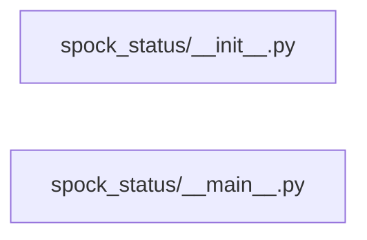

# Structure: spock_status

**Files:** 2 · **Lines:** 38 · **Classes:** 0 · **Functions:** 1 · **Methods:** 0

Solid edges = module-level import/call relationships (determined statically from source; only relationships *within this package* are drawn).

title: "spock_status module relationships"

## Modules

### `spock_status/__init__.py`

*Spock Status CLI package.*

### `spock_status/__main__.py`

*CLI: python -m spock_status*

> Contains a `__main__` guard (run directly).

**Imports:** `from __future__ import annotations`, `import argparse`, `import sys`, `from pathlib import Path`, `from spock_onboarding.spock_status import format_spock_status_report`, `from spock_onboarding.spock_status import probe_spock_status`

**Functions**

- **`main(argv)`** — lines 15-33
