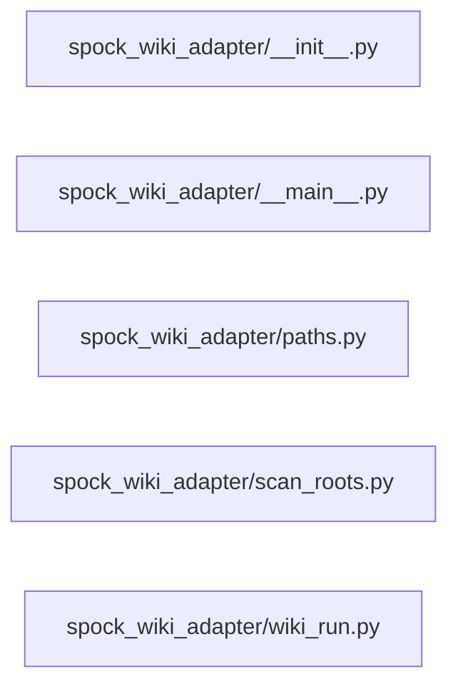

# Structure: spock_wiki_adapter

**Files:** 5 · **Lines:** 854 · **Classes:** 3 · **Functions:** 7 · **Methods:** 12

Solid edges = module-level import/call relationships (determined statically from source; only relationships *within this package* are drawn).

title: "spock_wiki_adapter module relationships"

## Modules

### `spock_wiki_adapter/__init__.py`

*Standalone Run Wiki Scan window.*

### `spock_wiki_adapter/__main__.py`

*Stand-alone Run Wiki Scan window (PyQt6).*

> Contains a `__main__` guard (run directly).

**Imports:** `from __future__ import annotations`, `import sys`, `from pathlib import Path`, `from typing import Optional`, `from PyQt6.QtWidgets import QApplication`, `from PyQt6.QtWidgets import QMainWindow`, `from PyQt6.QtWidgets import QVBoxLayout`, `from PyQt6.QtWidgets import QWidget`, `from WarpCore import settings_store`, `from WarpCore.theme import apply_theme_to`, `from WarpCore.theme import theme_by_name`, `from spock_wiki_adapter.paths as DEFAULT_ROOT`, `from spock_wiki_adapter.wiki_run import build_wiki_agent_run_panel`

**Classes**

- **`WikiScanWindow(QMainWindow)`** — lines 17-52
  - `closeEvent(self, event)`

**Functions**

- **`main(argv)`** — lines 55-65

### `spock_wiki_adapter/paths.py`

*Install root paths for Wiki Scan adapter.*

**Imports:** `from __future__ import annotations`, `from pathlib import Path`

### `spock_wiki_adapter/scan_roots.py`

*Modal dialog to maintain scan_roots (Spock Console / scan_config.json).*

**Imports:** `from __future__ import annotations`, `import json`, `from typing import List`, `from PyQt6.QtGui import QFont`, `from PyQt6.QtWidgets import QDialog`, `from PyQt6.QtWidgets import QFileDialog`, `from PyQt6.QtWidgets import QHBoxLayout`, `from PyQt6.QtWidgets import QLabel`, `from PyQt6.QtWidgets import QListWidget`, `from PyQt6.QtWidgets import QMessageBox`, `from PyQt6.QtWidgets import QPushButton`, `from PyQt6.QtWidgets import QVBoxLayout`, `from spock_wiki_adapter.paths import ROOT`, `from spock_wiki_adapter.paths import SCAN_CONFIG`, `from spock_wiki_adapter.paths import SHIP_COMPUTER_DB`, `import _warpcore_path`, `from WarpCore import settings_store`, `import _warpcore_path`, `from WarpCore import settings_store`

**Classes**

- **`ScanRootsDialog(QDialog)`** — lines 23-148

### `spock_wiki_adapter/wiki_run.py`

*Wiki Agent run panel — stream wiki_agent.py without freezing Qt.*

**Imports:** `from __future__ import annotations`, `import io`, `import os`, `import re`, `import subprocess`, `import sys`, `from typing import Any`, `from typing import Callable`, `from typing import Dict`, `from typing import Optional`, `from PyQt6.QtCore import QThread`, `from PyQt6.QtCore import Qt`, `from PyQt6.QtCore import pyqtSignal`, `from PyQt6.QtGui import QFont`, `from PyQt6.QtWidgets import QApplication`, `from PyQt6.QtWidgets import QCheckBox`, `from PyQt6.QtWidgets import QDialog`, `from PyQt6.QtWidgets import QHBoxLayout`, `from PyQt6.QtWidgets import QLabel`, `from PyQt6.QtWidgets import QMessageBox`, `from PyQt6.QtWidgets import QPushButton`, `from PyQt6.QtWidgets import QTextEdit`, `from PyQt6.QtWidgets import QVBoxLayout`, `from PyQt6.QtWidgets import QWidget`, `from WarpCore.config_defaults import merge_embedding_profile`, `from WarpCore.deps import missing_deps_message`, `from WarpCore.deps import missing_ingest_deps`, `from spock_rag_adapter.embedding_utils import write_embedding_env`, `from spock_wiki_adapter.paths import EMBED_HEALTH_SCRIPT`, `from spock_wiki_adapter.paths import ROOT`, `from spock_wiki_adapter.paths import SHIP_COMPUTER_DB`, `from spock_wiki_adapter.paths import WIKI_SCRIPT`, `from spock_wiki_adapter.paths import WIKI_STATUS_SCRIPT`, `from spock_health_report import format_spock_health_report`, `from spock_health_report import probe_spock_health`, `from spock_shell.process_tree import stop_wiki_scan`, `from spock_shell.busy_ui import clear_override_cursors`, `from spock_shell.busy_ui import clear_override_cursors`, `from spock_wiki_adapter.scan_roots import ScanRootsDialog`, `from spock_shell.busy_ui import clear_override_cursors`, `from db_maintenance import format_configured_scan_roots`, `from spock_shell.process_tree import terminate_process_tree`, `from spock_rag_adapter.embedding_corpus import live_vs_corpus`, `from spock_rag_adapter.embedding_corpus import read_corpus`, `from spock_rag_adapter.embedding_corpus import record_from_live_server`

**Classes**

- **`ProcessOutputReader(QThread)`** — lines 57-89
  - `run(self)`
  - `stop(self)`

**Functions**

- **`strip_ansi(text)`** — lines 43-44
- **`build_wiki_agent_run_panel(theme, config, title, source_label)`** — lines 197-624
