# Spock Screenshots

ShareX captures from `assets/`, pre-scanned with LM Studio vision, resized to JPEG for GitHub-friendly docs.

Ordered by original capture time (`LastWriteTime` on the source PNG).

**63** image(s).

## 1. spock-primary-ai-gpu-selection-dialog

*Captured: 10/31/2026 3:27:11 PM*

![Spock's Primary AI GPU dialog asks which GPU should run embedding and chat LLM servers on a multi-GPU machine. The Quadro RTX 6000 (22 GB) is selected as CUDA[0], while the Quadro P2200 is listed as display/video only.](images/spock-primary-ai-gpu-selection-dialog.jpg)

Spock's Primary AI GPU dialog asks which GPU should run embedding and chat LLM servers on a multi-GPU machine. The Quadro RTX 6000 (22 GB) is selected as CUDA[0], while the Quadro P2200 is listed as display/video only.

## 2. spock-model-acquisition-panel

*Captured: 11/01/2026 1:26:39 PM*

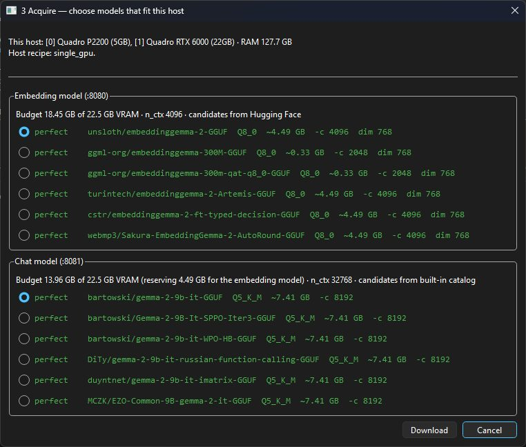

A Spock UI panel for selecting embedding and chat models based on host hardware capabilities. It displays a list of compatible GGUF models with their sizes and context lengths.

## 3. spock-bringup-progress-panel

*Captured: 11/01/2026 1:28:47 PM*

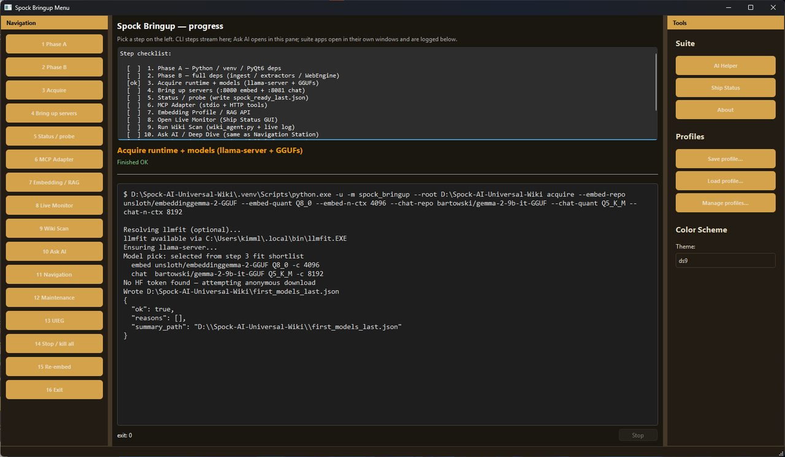

The Spock Bringup progress window shows a left Navigation sidebar of numbered phase buttons, a central step checklist with CLI output for the 'Acquire runtime + models' step, and a right Tools panel containing Suite, Profiles, and Color Scheme controls.

## 4. spock-bringup-progress-panel-2

*Captured: 11/01/2026 1:29:17 PM*

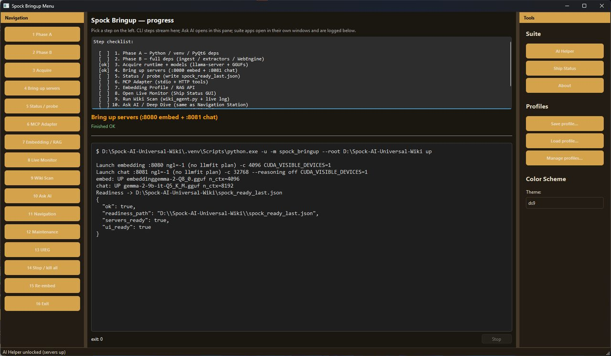

The Spock Bringup Menu window shows a progress pane with a step checklist and terminal output for bringing up servers, flanked by a Navigation step list on the left and a Tools panel with Suite, Profiles, and Color Scheme controls on the right.

## 5. spock-bringup-progress-status-probe

*Captured: 11/01/2026 1:29:24 PM*

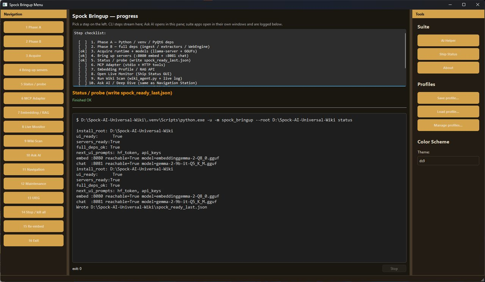

The Spock Bringup progress panel shows a step checklist and a finished Status / probe terminal output, with a numbered Navigation menu on the left and a Tools sidebar (Suite, Profiles, Color Scheme) on the right.

## 6. spock-mcp-adapter-settings-panel

*Captured: 11/01/2026 1:29:53 PM*

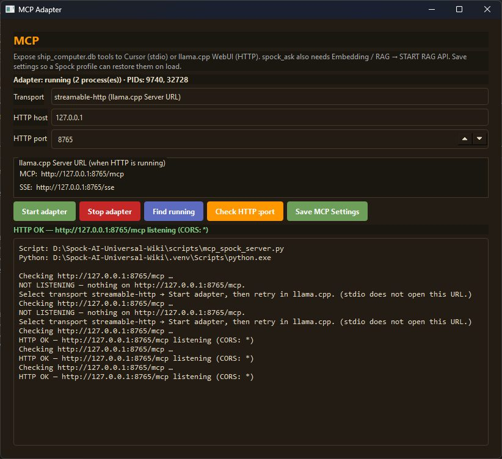

The Spock MCP Adapter panel shows transport, HTTP host, and port fields with Start, Stop, and Save MCP Settings buttons. A log area reports the mcp_spock_server.py script path and HTTP listening status.

## 7. spock-embedding-profile-rag-api-panel

*Captured: 11/01/2026 1:30:18 PM*

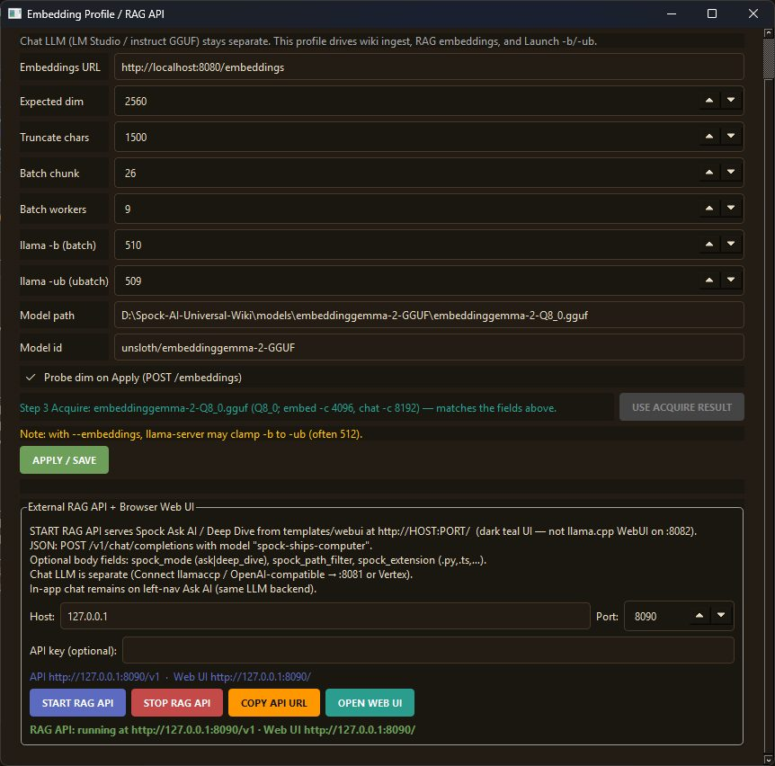

The Spock Embedding Profile / RAG API panel displays configuration fields for the embedding model (URL, dimensions, batch settings, model path) alongside an External RAG API section with host, port, and start/stop controls.

## 8. ship-status-live-monitor

*Captured: 11/01/2026 1:30:31 PM*

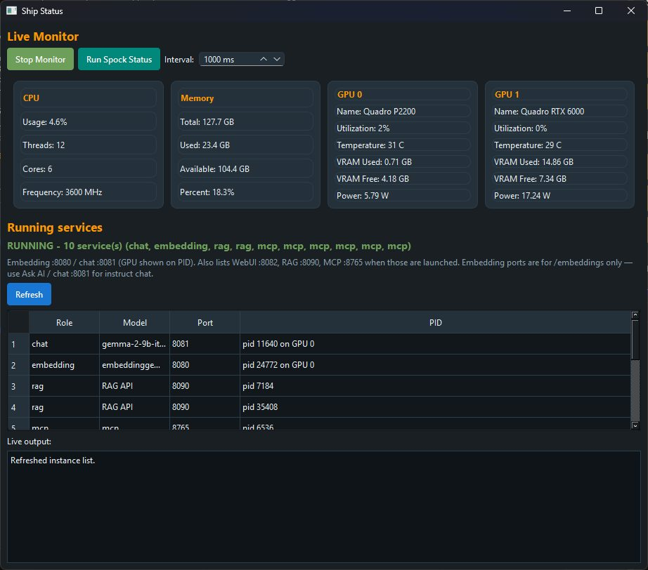

The Ship Status panel displays live system metrics for CPU, memory, and GPUs. It also lists running AI services with their assigned roles, models, and ports.

## 9. spock-run-wiki-scan-panel

*Captured: 11/01/2026 1:32:48 PM*

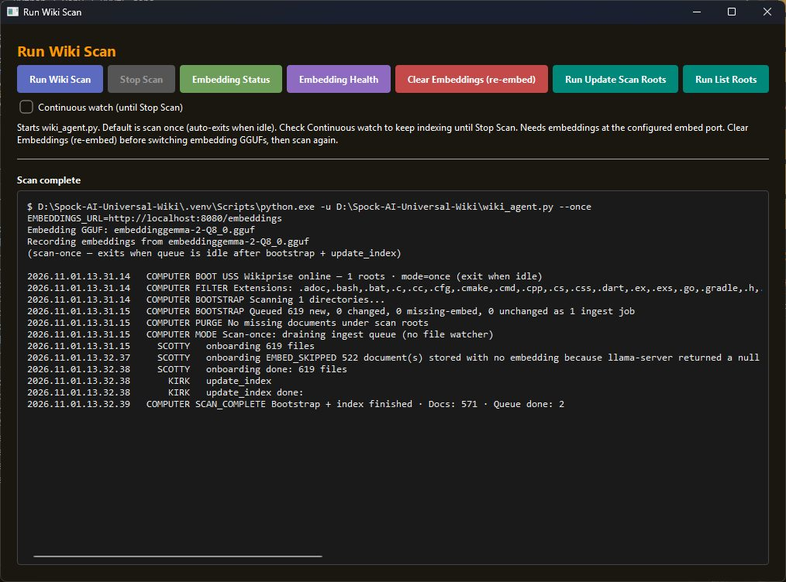

The Spock Run Wiki Scan panel shows action buttons for embeddings and scan roots above a terminal log. The log reports a completed scan that onboarded 619 files and finished the index update.

## 10. spock-embedding-status-panel

*Captured: 11/01/2026 1:33:01 PM*

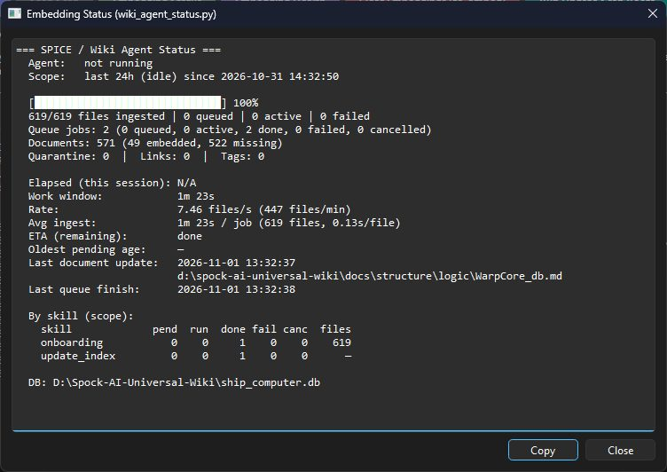

The Spock Embedding Status panel displays wiki agent ingestion metrics, including a 100% progress bar, queue job counts, and document statistics. The window also shows per-skill breakdowns and a Copy/Close action bar at the bottom.

## 11. spock-wiki-scan-embedding-health

*Captured: 11/01/2026 1:33:25 PM*

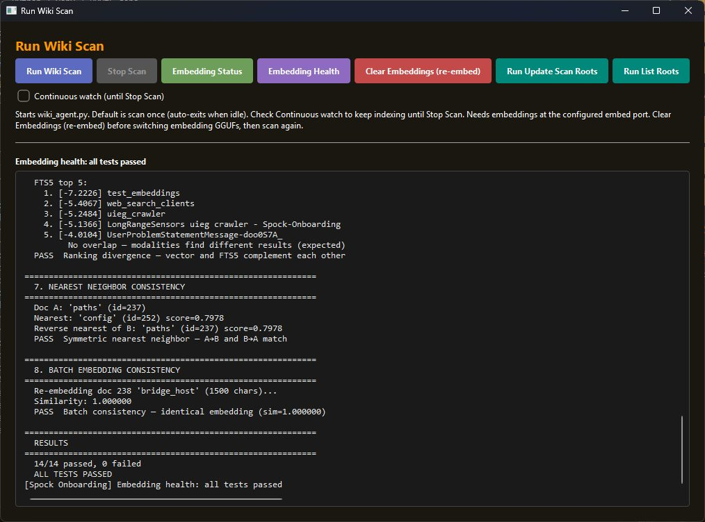

The Run Wiki Scan panel shows scan and embedding control buttons above a terminal log. The log reports embedding health diagnostics, ending with 14/14 tests passed and an all-tests-passed status.

## 12. spock-status-console-health-check

*Captured: 11/01/2026 1:39:01 PM*

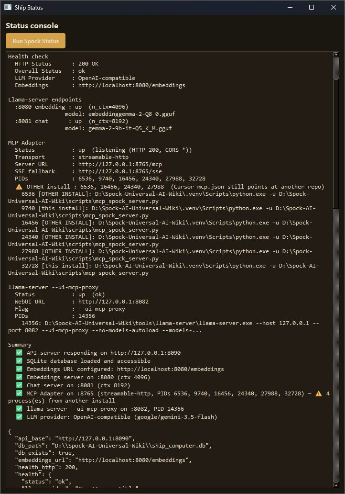

The Spock Ship Status window shows a Status console panel with a Run Spock Status button. The console lists health check results, llama-server endpoints, MCP adapter status, and a summary of running services.

## 13. spock-ship-status-live-monitor

*Captured: 11/01/2026 1:40:06 PM*

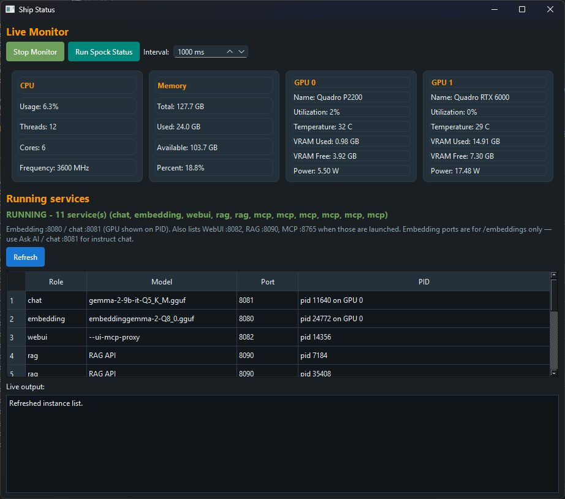

The Spock Ship Status window shows a Live Monitor panel with CPU, memory, and dual GPU statistics alongside a Running services table listing chat, embedding, webui, and rag roles with their models, ports, and PIDs.

## 14. spock-ask-ai-deep-dive-panel

*Captured: 11/01/2026 1:44:45 PM*

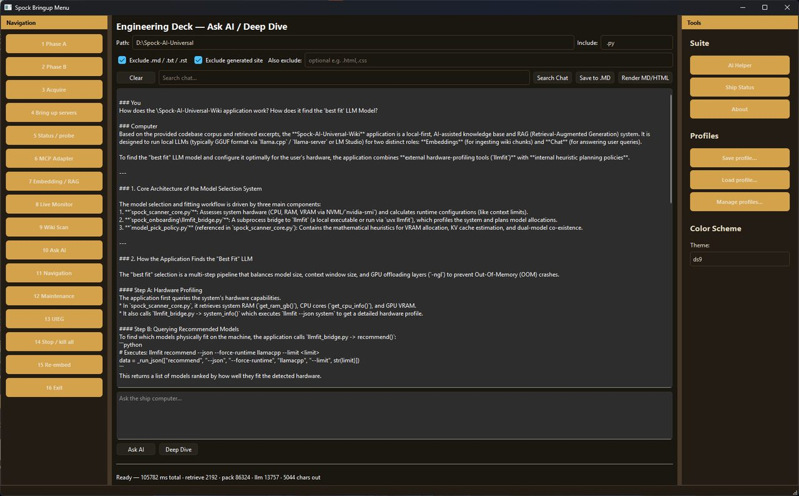

The Spock Bringup Menu shows the Engineering Deck panel for Ask AI / Deep Dive with a chat transcript on LLM model selection. A left sidebar lists numbered navigation phases, and a right sidebar provides Tools, Profiles, and Color Scheme controls.

## 15. spock-ask-ai-deep-dive-panel-2

*Captured: 11/01/2026 1:45:20 PM*

The Spock Bringup Menu displays the Engineering Deck 'Ask AI / Deep Dive' panel, showing a markdown output area and an 'Ask the ship computer' input with Ask AI and Deep Dive buttons. Flanking sidebars list numbered navigation steps on the left and Suite, Profiles, and Color Scheme tools on the right.

## 16. spock-navigation-station-overview

*Captured: 11/01/2026 1:45:44 PM*

The Spock-Navigation-Station window shows a left Navigation pane listing onboarding steps from Home through Exit and a right Tools pane with Suite, Search, and Color Scheme controls. The central pane presents a step-purpose table and documentation on launch flags, hardware probing, and path filters.

## 17. spock-ship-status-hardware-scan

*Captured: 11/01/2026 1:45:51 PM*

The Spock Navigation Station window shows the Ship status tab displaying hardware scan results, including OS, CPU, GPU, and LM Studio compatibility details. A left navigation sidebar and a right Tools panel with suite buttons and a theme selector frame the terminal-style output.

## 18. spock-navigation-model-guide

*Captured: 11/01/2026 1:45:57 PM*

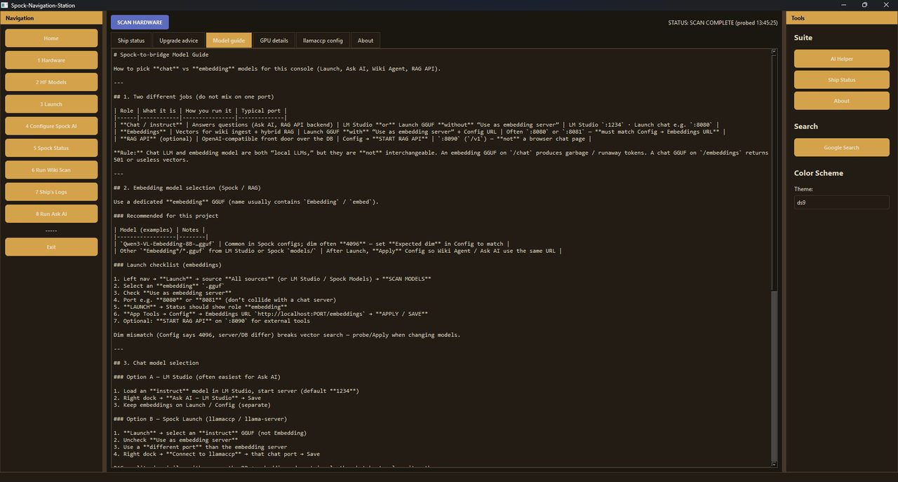

The Spock Navigation Station window shows the Model guide tab open with a markdown guide on choosing embedding versus chat models. Left and right sidebars list Navigation steps and Tools such as Suite, Search, and Color Scheme.

## 19. spock-gpu-details-hardware-scan

*Captured: 11/01/2026 1:46:31 PM*

The Spock Navigation Station window displays the GPU details tab following a completed hardware scan, listing memory, clocks, and thermal specs for a Quadro P2200 and a Quadro RTX 6000. A left navigation menu and a right-hand tools panel with suite, search, and theme controls flank the terminal-style output.

## 20. spock-llamacpp-config-panel

*Captured: 11/01/2026 1:46:37 PM*

The Spock Navigation Station window shows the active llamacpp config tab with a Generate Config output detailing chat, embedding, and RAG setup. The left navigation lists configuration steps and the right Tools panel offers Suite, Search, and Color Scheme options.

## 21. spock-navigation-station-about-tab

*Captured: 11/01/2026 1:46:40 PM*

The Spock Navigation Station window shows the About tab of the SPOCK-TO-BRIDGE hardware scan, detailing purpose, architecture ports, and requirements. A left navigation menu and a right Tools panel with Suite, Search, and Color Scheme controls flank the main text area.

## 22. spock-huggingface-embedding-models-list

*Captured: 11/01/2026 1:47:11 PM*

The Spock UI displays the HuggingFace panel with a table of embedding models, listing model IDs, parameters, size, context length, and download counts. Filter buttons for embeddings and chat models appear above the list, with the left navigation showing Spock setup steps.

## 23. spock-hf-chat-models-list

*Captured: 11/01/2026 1:47:24 PM*

The Spock Navigation Station shows the HuggingFace models panel with the Filter Chat control active, listing fifteen Google-provided chat models in a sortable table. A left Navigation menu and a right Tools panel containing Suite, Search, and Color Scheme options frame the model list.

## 24. spock-navigation-station-gemma-quantizations

*Captured: 11/01/2026 1:47:50 PM*

The Spock Navigation Station window shows a gemma-2-9b-it GGUF model page with a Llamacpp imatrix quantization download table. A left Navigation sidebar and a right Tools panel containing Suite, Search, and Color Scheme options frame the rendered markdown content.

## 25. spock-model-selection-panel

*Captured: 11/01/2026 1:55:20 PM*

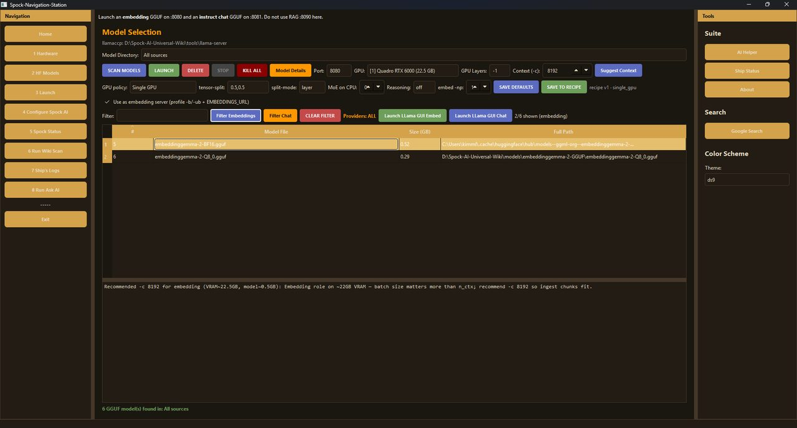

The Spock Navigation Station window shows the Model Selection panel with buttons for scanning, launching, and deleting GGUF models. A table lists two embeddinggemma GGUF files alongside their sizes and full file paths.

## 26. spock-model-selection-panel-2

*Captured: 11/01/2026 1:55:39 PM*

The Spock Navigation Station window shows the Model Selection panel with a table of GGUF model files, launch controls, and GPU/context settings. A left sidebar lists numbered setup steps while a right Tools panel provides suite actions, search, and a theme selector.

## 27. spock-configure-ai-lm-studio

*Captured: 11/01/2026 1:57:46 PM*

The Spock Navigation Station window displays the Configure Spock AI panel with the Active provider section on the Connect to LM Studio tab. Input fields for host, port, model id, and load context are shown between the left navigation menu and the right Tools sidebar.

## 28. spock-active-provider-ollama-settings

*Captured: 11/01/2026 1:57:52 PM*

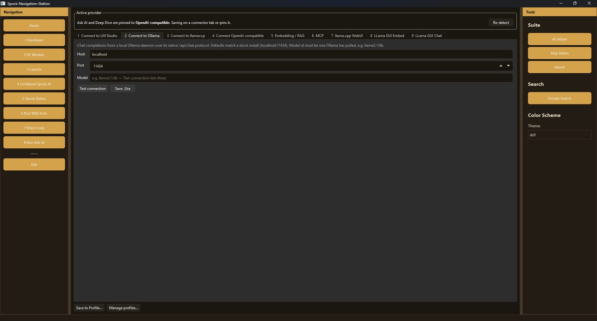

The Spock Navigation Station window displays the Configure Spock AI panel with the Active provider tab set to Connect to Ollama, showing Host (localhost) and Port (11434) fields. A right-hand Tools sidebar provides Suite, Search, and Color Scheme controls.

## 29. spock-configure-ai-llamaccp-settings

*Captured: 11/01/2026 1:58:00 PM*

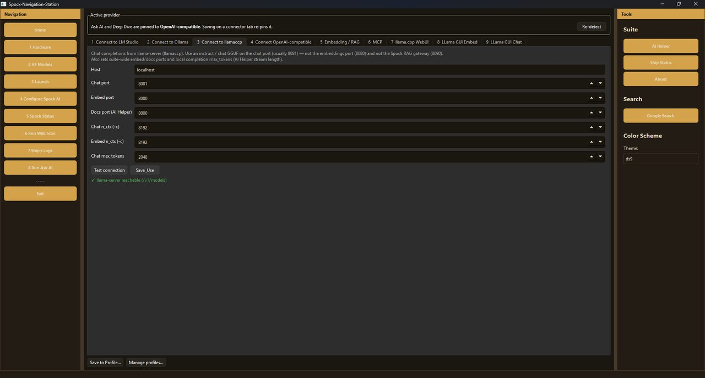

The Spock Navigation Station window displays the Configure Spock AI panel with the Connect to llamaccp tab active, showing host and port fields for chat, embed, and docs connections. A green status line confirms the llama-server is reachable at /v1/models.

## 30. spock-configure-ai-openai-provider

*Captured: 11/01/2026 1:58:18 PM*

The Spock Navigation Station window displays the Configure Spock AI panel with the Active provider section open on the OpenAI-compatible connector tab. The form shows Base URL, API key, model, context window, and max output tokens fields, with a green health status line confirming the connection.

## 31. spock-embedding-profile-rag-api

*Captured: 11/01/2026 1:58:26 PM*

The Spock Navigation Station window shows the Embedding Profile panel with model parameters such as Embeddings URL, Expected dim, and Model path. Below it, an External RAG API section provides Host/Port fields and Start/Stop RAG API buttons, flanked by a Navigation sidebar on the left and a Tools panel on the right.

## 32. spock-mcp-adapter-configuration

*Captured: 11/01/2026 1:58:31 PM*

The Spock Navigation Station window shows the Configure Spock AI section with the MCP tab active, displaying adapter transport, HTTP host and port fields, and control buttons. A log pane reports the MCP endpoint listening on 127.0.0.1:8765, while the right-hand Tools panel lists Suite, Search, and Color Scheme options.

## 33. spock-llama-cpp-webui-config

*Captured: 11/01/2026 1:58:36 PM*

The Spock Navigation Station window displays the Configure Spock AI section with the Llama.cpp WebUI tab active, showing the llama-server path, WebUI host and port fields, and start/stop controls. A right-hand Tools panel lists Suite actions, a Google Search button, and a Color Scheme theme setting.

## 34. spock-ships-logs-documents-table

*Captured: 11/01/2026 1:59:20 PM*

The Spock Navigation Station window shows the Ship's Logs panel with the Documents tab active, presenting a searchable table of 571 rows with id, path, filename, and title columns plus path and extension filters. Side panels list Navigation steps on the left and Tools such as AI Helper, Ship Status, and theme selection on the right.

## 35. spock-app-config-json-preview

*Captured: 11/01/2026 1:59:50 PM*

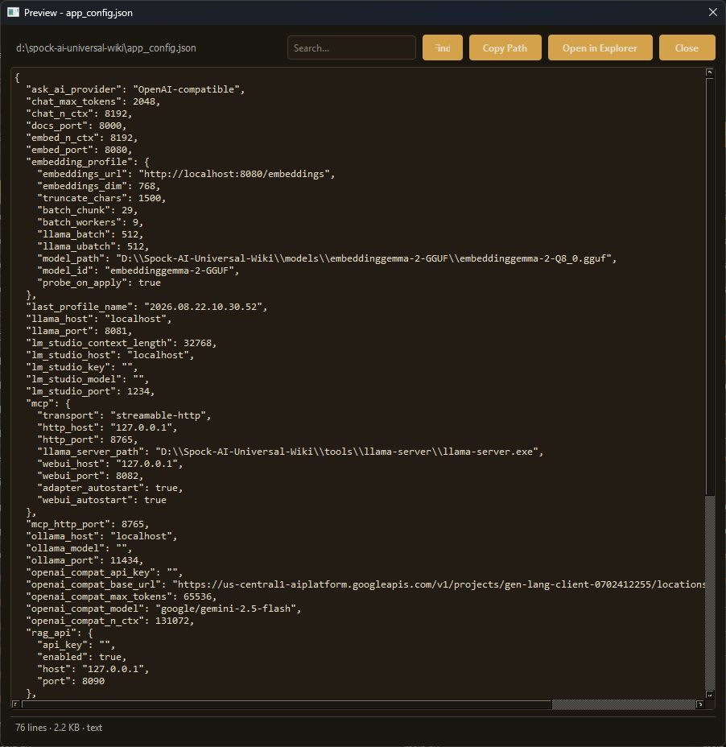

The Spock Preview panel displays the contents of app_config.json as formatted JSON text. The toolbar offers Find, Copy Path, Open in Explorer, and Close actions above the configuration body.

## 36. spock-ask-ai-deep-dive-panel-3

*Captured: 11/01/2026 2:00:06 PM*

The Spock UI displays the Engineering Deck Ask AI / Deep Dive panel, featuring a path field, file include/exclude options, and a chat area labeled 'Ask the ship computer.' Left and right sidebars offer navigation steps (Hardware through Run Ask AI) and tools including AI Helper, Ship Status, and Google Search.

## 37. spock-chat-ai-helper-panel

*Captured: 11/01/2026 2:01:12 PM*

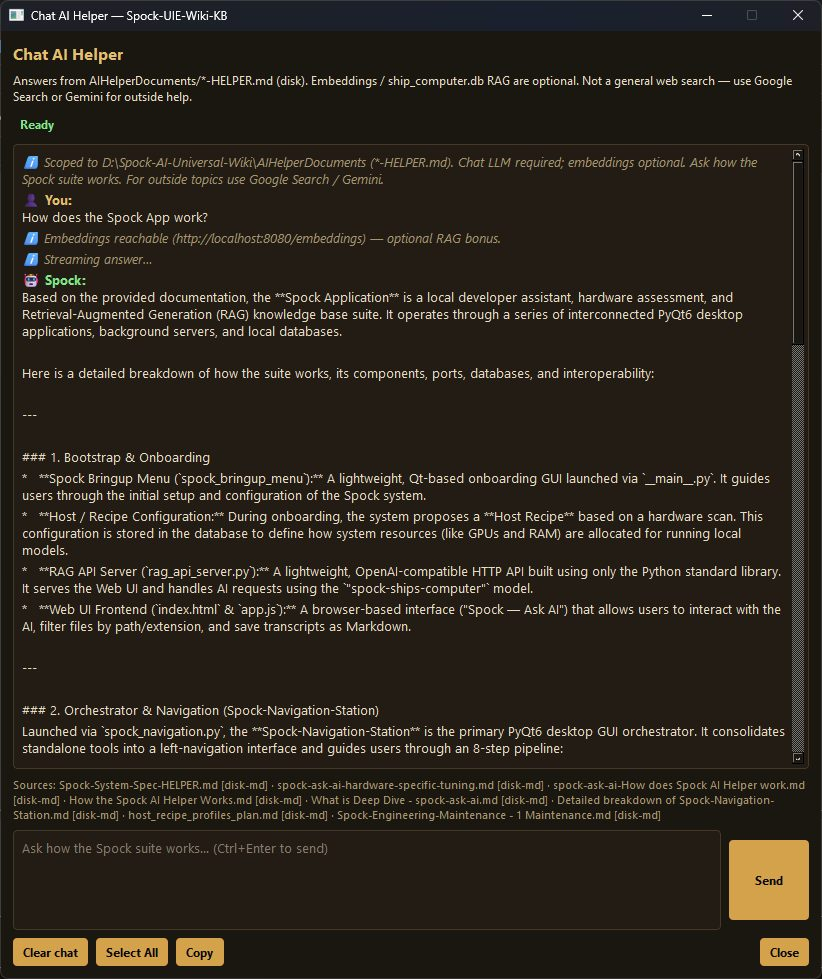

The Spock Chat AI Helper window shows a Ready status, a logged exchange where Spock explains the Spock Application, and a message input with a Send button alongside Clear chat, Select All, Copy, and Close controls.

## 38. spock-navigation-station-about-dialog

*Captured: 11/01/2026 2:01:19 PM*

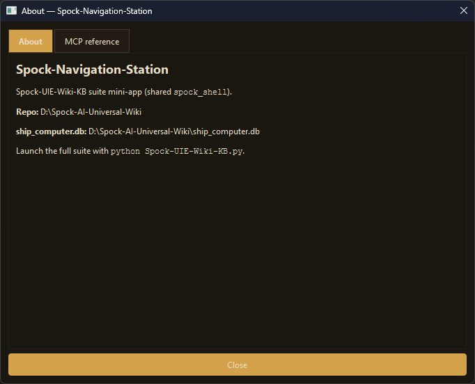

The Spock-Navigation-Station About dialog displays repository paths and launch commands for the Spock-UI-Wiki-KB suite.

## 39. spock-mcp-reference-panel

*Captured: 11/01/2026 2:01:24 PM*

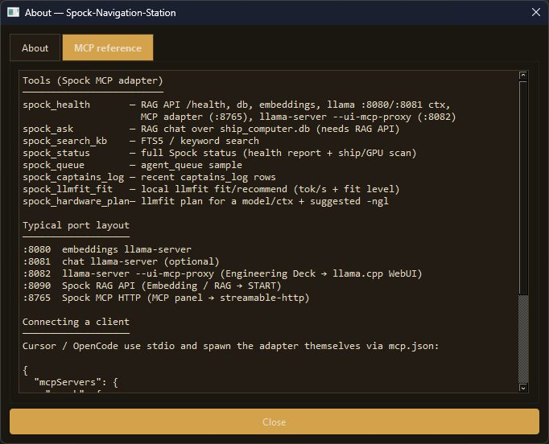

The Spock-Navigation-Station About window shows the active MCP reference tab, listing Spock MCP adapter tools, a typical port layout, and client connection details.

## 40. spock-google-search-view

*Captured: 11/01/2026 2:02:04 PM*

The Spock UI shows a Navigation panel on the left listing workflow steps and a Tools panel on the right with Suite, Search, and Color Scheme sections. The central area displays a Google Search form with the query 'What is LLMfit opensource app?' and Search and Gemini buttons.

## 41. spock-navigation-station-google-search

*Captured: 11/01/2026 2:02:18 PM*

The Spock Navigation Station window shows a left Navigation sidebar with numbered workflow buttons and a right Tools sidebar with Suite, Search, and Color Scheme controls. These Spock panels frame a central Google search results page for the query about LLMfit.

## 42. spock-navigation-station-ai-chat

*Captured: 11/01/2026 2:03:01 PM*

The Spock Navigation Station window shows a left Navigation menu and a right Tools panel with Suite, Search, and Color Scheme controls. The central area displays a Gemini AI chat response describing the Llmfit open-source terminal tool, including a GitHub repository card.

## 43. spock-engineering-maintenance-overview

*Captured: 11/01/2026 2:03:38 PM*

The Spock Engineering Maintenance window shows a shared overview with left navigation tabs and documentation tables for the Engineering Deck and Maintenance sections. A right-hand Tools panel provides Suite buttons (AI Helper, Ship Status, About), a Google Search action, and a Color Scheme theme selector set to ds9.

## 44. spock-scan-roots-panel

*Captured: 11/01/2026 2:03:42 PM*

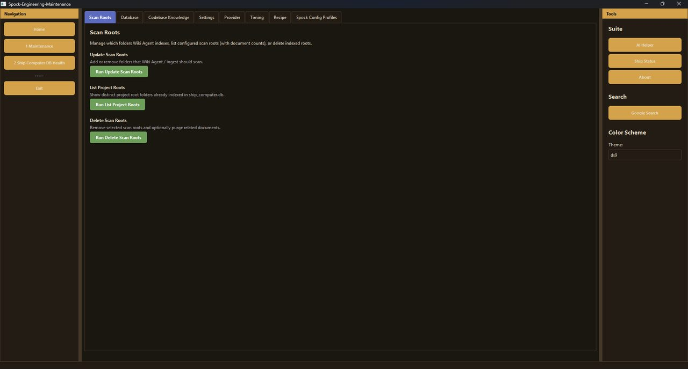

The Spock-Engineering-Maintenance window shows the Scan Roots tab with green buttons to run Update, List, and Delete Scan Roots actions. A left navigation menu and a right Tools panel with Suite, Search, and Color Scheme controls frame the main area.

## 45. spock-database-maintenance-panel

*Captured: 11/01/2026 2:03:45 PM*

The Spock Engineering Maintenance window shows the active Database tab with green action buttons for backup, restore, reindex, purge missing, clear embeddings, and reset operations. The left navigation sidebar highlights the Ship Computer DB Health item, while a right-hand Tools panel offers Suite, Search, and Color Scheme controls.

## 46. spock-settings-variables-table

*Captured: 11/01/2026 2:04:01 PM*

The Spock Engineering Maintenance window shows the Settings tab with green category buttons and a filterable table of console configuration variables. Left and right sidebars provide navigation links and tools such as AI Helper, Ship Status, and a theme selector.

## 47. spock-timing-panel-stage-timings

*Captured: 11/01/2026 2:04:04 PM*

The Spock Engineering Maintenance window shows the Timing tab active, presenting a table of stage timings for Ask AI and Deep Dive queries with columns for response length, latency, and budget usage. The right-side Tools panel provides Suite, Search, and Color Scheme controls.

## 48. spock-recipe-profile-panel

*Captured: 11/01/2026 2:04:08 PM*

The Spock Engineering-Maintenance window shows the Recipe tab with a current recipe profile listing GPU hardware, embedding context, and notes. Below the profile are buttons to create, update, recompute, and refresh recipe profiles, followed by a version history table.

## 49. spock-config-profiles-panel

*Captured: 11/01/2026 2:04:14 PM*

The Spock Engineering Maintenance window displays the active Spock Config Profiles tab, listing saved configuration profiles with timestamps and model names. A detail pane below shows the selected profile's settings, with Load Selected Profile, Delete selected, and Refresh buttons.

## 50. spock-ship-computer-database-overview

*Captured: 11/01/2026 2:04:18 PM*

The Spock Engineering Maintenance UI shows the Ship Computer database overview panel listing stats for ship_computer.db, including size, document count, captains log, agent queue, and quarantine. Side panels provide navigation links and tool shortcuts such as AI Helper, Ship Status, and a theme selector set to ds9.

## 51. spock-ui-knowledge-base-console

*Captured: 11/01/2026 2:04:36 PM*

The Spock-UIEG-KnowledgeBase console shows a left Navigation pane listing capture and status steps next to a right Tools pane with AI Helper, Ship Status, and theme controls. The central area documents the left navigation, disk layout, and right tools for the Spock onboarding workflow.

## 52. spock-github-repo-fetch-panel

*Captured: 11/01/2026 2:05:35 PM*

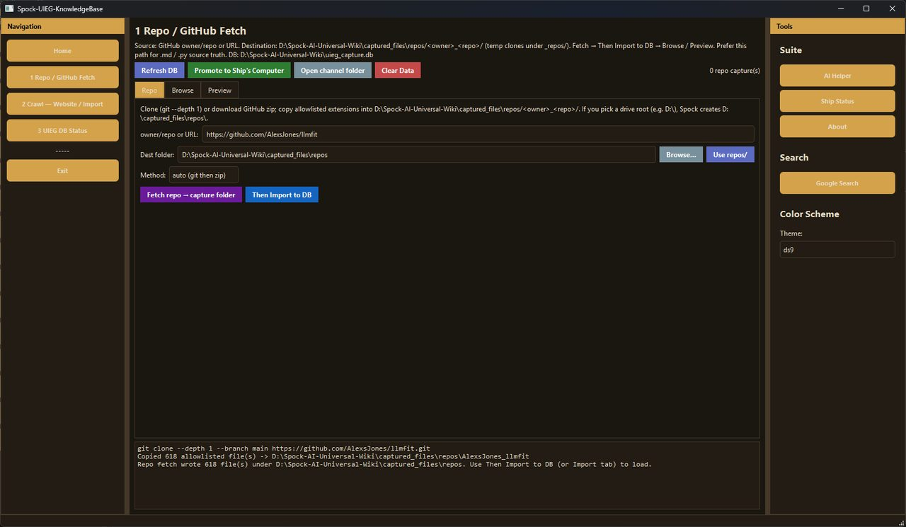

The Spock UIEG KnowledgeBase window shows the 1 Repo / GitHub Fetch panel with a repository URL field, destination folder, and fetch/import buttons. A log at the bottom reports a git clone of the AlexsJones/llmfit repository that copied 618 files.

## 53. spock-repo-github-fetch-panel

*Captured: 11/01/2026 2:05:53 PM*

The Spock UI shows the 1 Repo / GitHub Fetch panel with an owner/repo URL field, a destination folder path, and Fetch/Import action buttons. A left navigation sidebar and a right-hand tools panel containing Suite, Search, and Color Scheme options flank the main form.

## 54. spock-repo-github-fetch-browse

*Captured: 11/01/2026 2:06:00 PM*

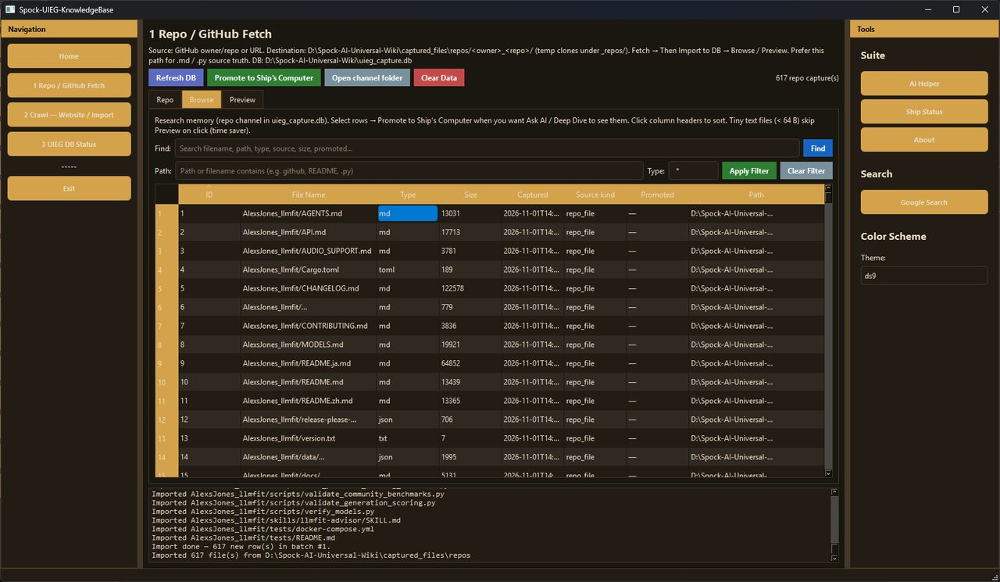

The Spock UI shows the 1 Repo / GitHub Fetch panel with the Browse tab active, presenting a sortable table of captured repository files. Control buttons for refreshing the database, promoting data, and clearing data appear above the file listing.

## 55. spock-repo-github-fetch-preview

*Captured: 11/01/2026 2:06:09 PM*

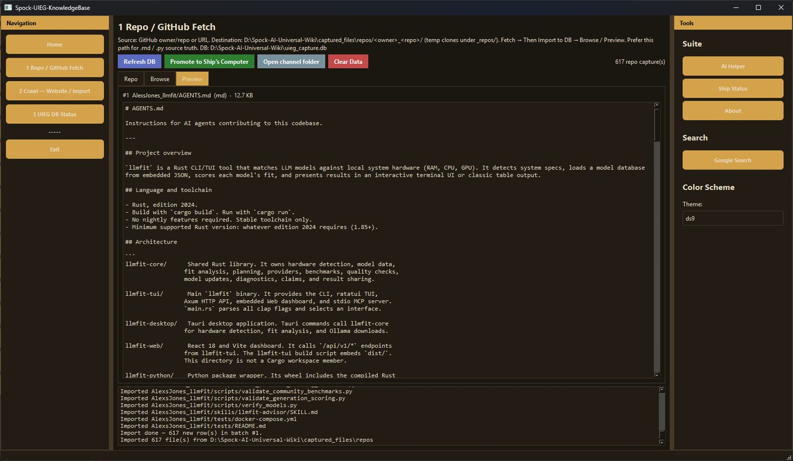

The Spock UI shows the '1 Repo / GitHub Fetch' panel with action buttons, a Preview tab rendering an AGENTS.md file, and an import log listing 617 captured files.

## 56. spock-crawl-website-import-panel

*Captured: 11/01/2026 2:07:02 PM*

The Spock UIEG-KnowledgeBase window shows the '2 Crawl — Website / Import' panel with a URL field, page limit and level controls, and a Crawl button. A log at the bottom reports a completed crawl of a Kaggle page, while the right Tools sidebar lists Suite, Search, and Color Scheme options.

## 57. spock-uiig-db-status-overview

*Captured: 11/01/2026 2:08:45 PM*

The Spock UIIG KnowledgeBase window displays the 3 UIEG DB Status panel, showing capture counts, recent import batches, and repository details for the uiieg_capture.db database. A left Navigation sidebar and a right Tools panel with Suite, Search, and Color Scheme options frame the status report.

## 58. spock-uiig-db-status-database-panel

*Captured: 11/01/2026 2:08:50 PM*

The Spock UIEG-KnowledgeBase window shows the 3 UIEG DB Status panel with the Database tab active, listing blue action buttons to backup, restore, reindex, and reset the UIEG database. Sidebars provide navigation links on the left and Suite, Search, and Color Scheme tools on the right.

## 59. spock-ask-ai-chat-panel

*Captured: 11/01/2026 2:11:58 PM*

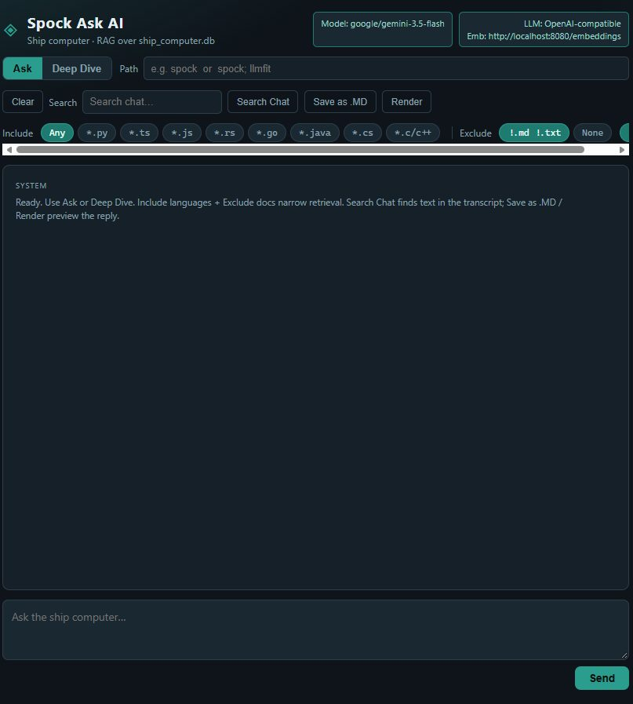

The Spock Ask AI panel shows Ask and Deep Dive tabs, include/exclude language filters, and a chat input for querying the ship computer. The header indicates the active model is google/gemini-3.5-flash with an OpenAI-compatible LLM endpoint.

## 60. spock-ask-ai-deep-dive-chat

*Captured: 11/01/2026 2:15:42 PM*

The Spock Ask AI panel shows the Deep Dive tab active over the Spock-AI-Universal-Wiki path, with language and exclude filter chips above a chat transcript. The user asks how the Spock app uses LLMfit to pick the best embedding and chat LLM, and the computer replies with a dual-model architecture explanation.

## 61. spock-ai-universal-wiki-architecture

*Captured: 11/01/2026 2:17:27 PM*

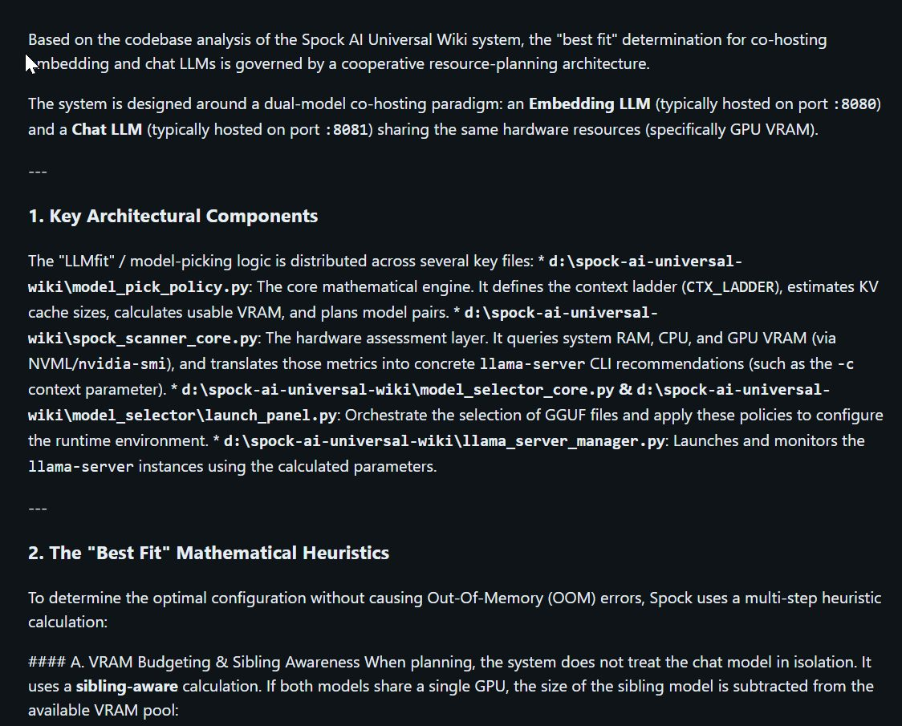

A documentation view describing the Spock AI Universal Wiki system's dual-model co-hosting paradigm and key architectural components. The text outlines the 'best fit' mathematical heuristics and VRAM budgeting logic for embedding and chat LLMs.

## 62. spock-best-fit-heuristics-docs

*Captured: 11/01/2026 2:17:57 PM*

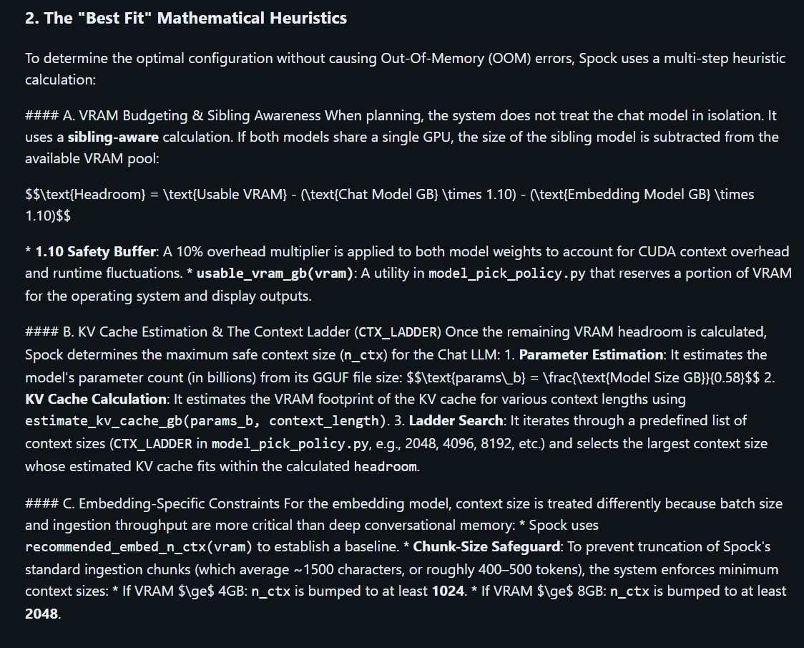

Spock documentation page describing the 'Best Fit' mathematical heuristics for model selection. It covers VRAM budgeting with a safety buffer, KV cache estimation via the context ladder, and embedding-specific context size constraints.

## 63. spock-call-flow-execution

*Captured: 11/01/2026 2:18:12 PM*

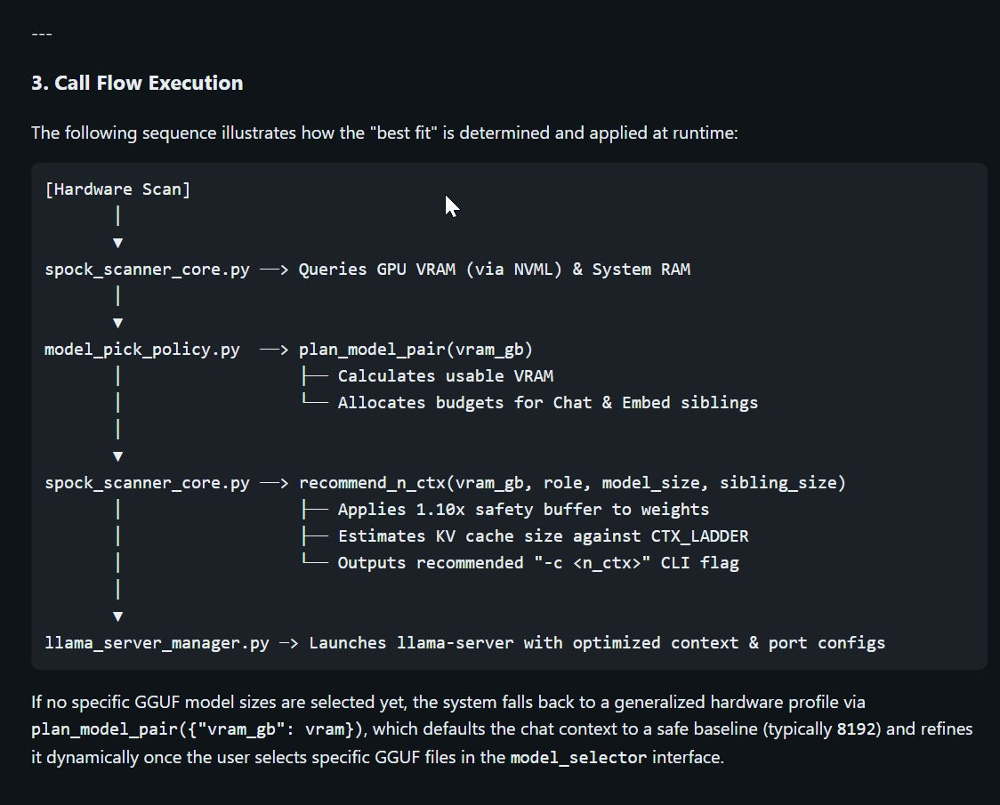

Documentation page showing the Spock 'Call Flow Execution' section with an ASCII sequence diagram. The flow traces hardware scanning and model pairing across spock_scanner_core.py, model_pick_policy.py, and llama_server_manager.py.

